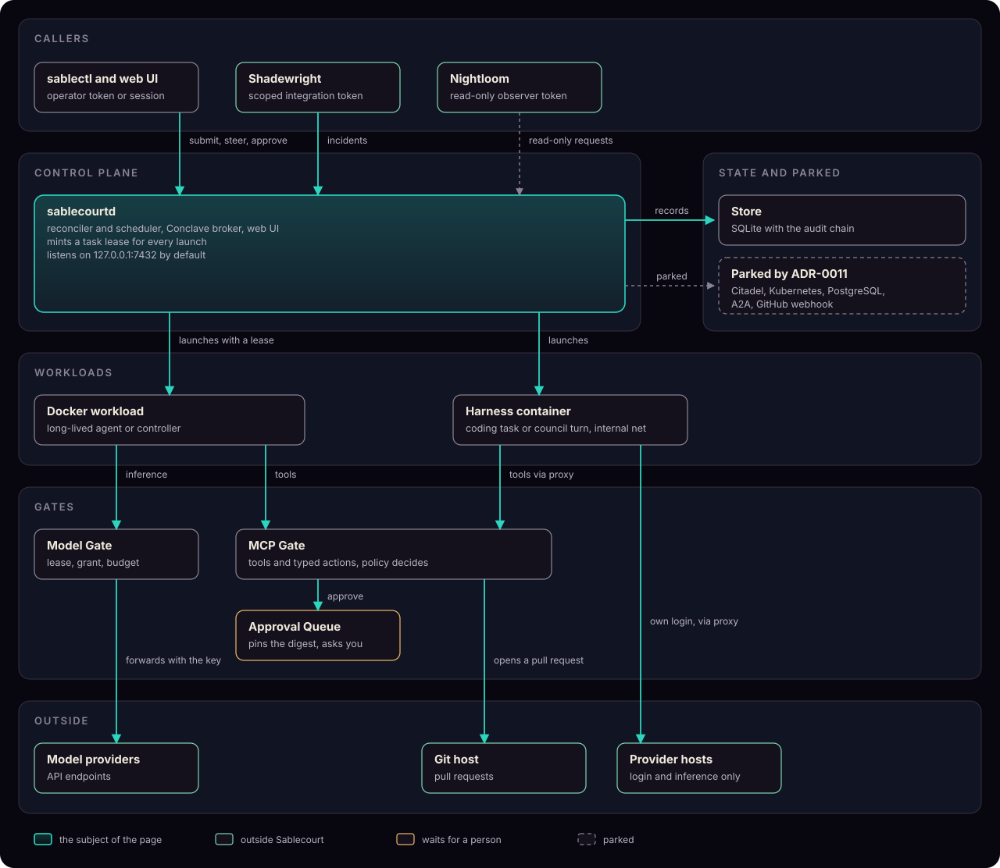

<h1 align="center">
  <picture>
    <source media="(prefers-color-scheme: dark)" srcset="docs/assets/brand/sablecourt-horizontal-nolabs-dark.png">
    
  </picture>
</h1>

<p align="center">
  <em>The Court is three hooded councilors under a sable banner, and every agent or program that comes before them. Each keeps to its own seat and may only ask. The councilors answer from one written law: what it allows goes ahead, what it does not name is refused, and the gravest matters wait for a person's seal.</em>
</p>

<p align="center">
  A control plane that runs coding agents and deterministic programs on one machine under limits you set. Workloads get a task lease instead of provider keys: the Model Gate checks a workload's grant and budget, the MCP Gate its grant and policy, and an action that needs approval gets an approval request that a person approves or denies, or that expires. Council harnesses in containers are the exception for inference: they use their own subscription logins, outside the Model Gate.
</p>

<p align="center">
  <a href="https://github.com/shadewright-labs/sablecourt/actions/workflows/ci.yml?query=branch%3Amain"></a>
  <a href="https://codecov.io/gh/shadewright-labs/sablecourt"></a>
  <a href="go.mod"></a>
  <a href="LICENSE"></a>
</p>

> [!WARNING]
> Nothing is released yet: the repository has no tags and no GitHub releases, so you build it from source. The release workflow in the tree could publish binaries and images, but it has never run. By default (Sanctum mode) the daemon runs under your account on one machine and listens on `127.0.0.1:7432`. Host coding runs and the approval dialog need macOS. Citadel mode, the Kubernetes runtime, voice and live Takeover are in the tree but parked, and the audit chain is not anchored outside its database, so deleting the last rows goes unnoticed. [SECURITY.md](SECURITY.md) states what the security model holds today.

## What it does

1. **Launches** the workloads your manifests declare: a coding CLI on a Git worktree under the macOS Seatbelt sandbox, and long-lived agents and deterministic controllers in Docker containers. Each launched task gets its own lease, revoked when the task ends.
2. **Gates** model calls: for a call through the Model Gate it checks the lease, the provider grant and the budget, then forwards the request to the configured upstream (OpenAI, Anthropic, Gemini, a local OpenAI-compatible server, or one gateway set with `--model-gateway-url`), adding the provider key when one is configured. Deterministic controllers are refused there.
3. **Checks** tools and actions: the MCP Gate serves the tools a workload is granted and a closed set of typed actions. Deterministic policy decides each call: `allow`, `approve` or `deny`, and no matching rule means deny.
4. **Queues** an action whose effect is `approve`, pinned by the SHA-256 digest of its payload. In Sanctum mode you confirm it in a native macOS dialog. The API also accepts a signature from a device enrolled earlier, but enrolling a device answers `503` today, so on a fresh install outside macOS you can only deny.
5. **Convenes** councils: one question about your checkout goes to `claude`, `codex` and `agy` in rounds. With a Docker engine configured, each turn runs in its own container and the seat uses its saved login; without one, turns start on the host under macOS Seatbelt with an empty home directory. The room posts a valid final message after a verified successful exit.
6. **Records** task submission and cancellation, approval requests and approve or deny decisions, the common Model Gate denials and settled successful calls in an audit chain that `sablectl audit verify` checks. Not everything is recorded: a forwarded upstream error status and an expired approval leave no row, and council inference does not pass the Model Gate at all.

A model's answer is never authorization: only deterministic policy, or a person confirming a pinned digest, lets an action run.

[](docs/diagrams/system-context.svg)

## State of the areas

The [docs home page](docs/index.md#status) has a longer status table with issue references.

| Area | State | Limits |
| --- | --- | --- |
| Tasks, reconciler, scheduler | Built | Suspend stops the workload, so resume does not work yet |
| Host coding runs | Partly built | macOS Seatbelt launches the CLIs; a host run gets a fresh home directory, so a saved harness login does not reach it |
| Docker workloads and deterministic controllers | Built | |
| Model Gate, MCP Gate, typed actions, policy | Built | The upstream MCP bridge is parked |
| Approvals | Partly built | Pairing a device answers `503`, so a fresh install approves only through the macOS dialog; a device enrolled earlier can still sign |
| Conclaves | Built | Voice and live Takeover are parked |
| Council | Built | The room posts a turn's final message after a verified successful exit, and checks any writer diff against the copy stored for that attempt; an empty or missing final message gives no answer. Container seats use their own logins and are not counted by the Model Gate |
| Learning | Partly built | Matching legacy `learning:` entries still reach context packets. SQLite stores reviewed learning records, but acceptance has no operator interface and packets do not use those records |
| Audit chain | Built | Misses deletion of the last rows; not anchored outside the database |
| Shadewright incident intake | Partly built | Both POST routes return a result; there is no GET for an incident's later status |
| Court Memory search | Built | SQLite uses `LIKE`, the parked PostgreSQL store `ILIKE`; no full-text search |
| Citadel mode, Kubernetes, PostgreSQL, A2A, GitHub webhook, chat alerts | Parked | |

## Install

Nothing is released, so build from source with `make install`. You need Go 1.27.4 or newer (the version in [go.mod](go.mod)) on macOS or Linux.

```bash
git clone https://github.com/shadewright-labs/sablecourt.git
cd sablecourt
make install                                       # sablecourtd and sablectl into ~/.local/bin
sablecourtd --manifests=examples/local-demo.yaml   # listens on 127.0.0.1:7432 by default
```

The daemon writes `operator.token` to `$SABLECOURT_STATE_DIR`, by default `~/.local/share/sablecourt`. Its SQLite database defaults to `sablecourt.db` in the directory you start it from; `--db` chooses another path. Open the web UI at `http://127.0.0.1:7432` and sign in with the token, or use `sablectl`, which reads the token from the same directory:

```bash
sablectl workload list
sablectl conclave open feature-conclave --title="Fix retry timeout"
sablectl conclave list
```

Councils (`sablectl council "<question>"`) need more setup, and the CLI wants `claude`, `codex` and `agy` on its own `PATH` in both modes. In container mode, the daemon needs Docker Engine 28.0 or newer with isolated gateway networking, and each seat needs its harness image (built for `linux/arm64`) from `sablectl harness build <role>` and a login, prepared with `sablectl harness build <role>` and `sablectl harness login <role>` (the daemon checks the resulting image, volumes and credential file, not which command made them). The `claude` and `agy` images carry no vendor software, so for those two roles the login command first installs the pinned tool into its own volume when the login volume does not exist yet or the tool is missing, of another version or does not match its digest ([harness images](docs/how-to/harness-images.md)). Without Docker, the daemon admits a council only on a host where the macOS Seatbelt sandbox works and the three CLIs are on its `PATH`.

## Guides

- [Overview](docs/overview.md): what Sablecourt is and is not, why it starts on one machine, and the parked parts.
- [Concepts](docs/concepts.md) and the [glossary](docs/glossary.md): workloads, leases, gates, Conclaves and the court vocabulary.
- [How it works](docs/how-it-works/index.md): the path of a request and where each invariant is enforced.
- [Run a council](docs/how-to/run-a-council.md), [log in to harnesses](docs/how-to/log-in-harnesses.md) and [harness images and tool install](docs/how-to/harness-images.md): what each harness image contains and how the proprietary tools are installed at login.
- [Review an approval](docs/how-to/review-an-approval.md): read the pinned payload, then approve or deny.
- [Watch and steer](docs/how-to/watch-and-steer.md) and [retry with a handoff](docs/how-to/retry-with-handoff.md).
- [Reference](docs/reference/index.md): manifests, HTTP API, CLI, configuration, limits and metrics, with the tested parts checked against the code.
- [Decision records](docs/adr/README.md) and the [diagram standard](docs/diagrams/README.md).

## Repositories

| Repository | Contents |
| --- | --- |
| [sablecourt](https://github.com/shadewright-labs/sablecourt) | The daemon `sablecourtd`, the CLI `sablectl` and these docs |
| [shadewright](https://github.com/shadewright-labs/shadewright) | The Kubernetes remediation operator. Its ADR-0049 decides a one-way handoff of incidents to Sablecourt; its code has no sender yet |
| [shadewright-labs.github.io](https://github.com/shadewright-labs/shadewright-labs.github.io) | Website repository. Website: [shadewrightlabs.com](https://shadewrightlabs.com) |

## Development

```bash
make test         # go test -race ./...
make vet          # go vet ./...
make build        # bin/sablecourtd and bin/sablectl
make docs         # regenerate the generated blocks of docs/reference/cli.md
make docs-check   # check the generated CLI blocks and the tested parts of the reference pages
make agent-image  # the built-in agent container image
make demo         # run the daemon with examples/local-demo.yaml
```

On macOS, `make service-install` runs the daemon as a launchd job and `make service-uninstall` removes it. On pull requests, CI picks the checks from the changed files and ends in one job, `ci-ok`; the [CI guide](docs/ci.md) lists them.

Contributor and coding-agent guide: [AGENTS.md](AGENTS.md).

## The name

*Sable* is heraldic black. A *court* is both a council of separate houses and a tribunal: here, agents and programs of different kinds working side by side under one set of rules, enforced by the policy, the budgets and the gates.

## License

Apache License 2.0, see [LICENSE](LICENSE).
