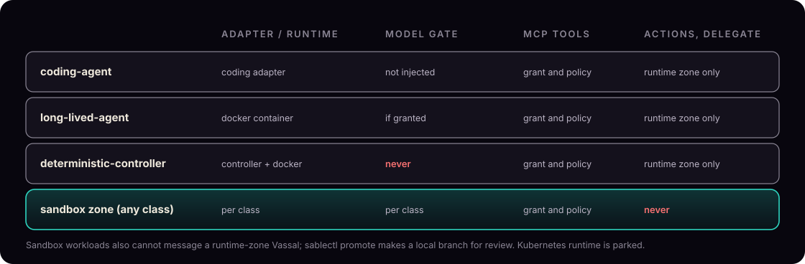

# ADR-0002: Three heterogeneous workload adapters in MVP

- Date: 2026-11-22
- Status: Accepted

## Context

Many orchestrators optimize for a single class of worker (usually coding CLI sessions) and then struggle to accommodate non-LLM operators or stateful background agents later. Sablecourt exists specifically to coordinate distinct workload classes under one policy and audit plane.

## Decision

Implement three minimal workload adapters in the first vertical slice of MVP:

1. Coding agent adapter: runs a coding CLI (Claude Code or Codex) inside an isolated Git worktree with detached process hosting and attached audit/permission hooks.
2. Long-lived AI agent adapter: runs a stateful agent loop with explicit checkpoint persistence, suspend/resume hooks, and strict per-task and daily token budgets through the Model Gate.
3. Deterministic controller adapter: runs a non-LLM binary, script, or rule loop that receives zero Model Gate credentials and communicates only through the task envelope and allowed Data/Action gates.

Every adapter implements the same workload lifecycle contract (`start`, `observe`, `suspend`, `resume`, `stop`, `collect artifacts`) driven by the control plane's `OBSERVE -> UPDATE -> DERIVE/ACT` loop.

## Diagram

Figure: the three workload classes, the adapter each runs under and whether it may reach the Model Gate, as built.

## Alternatives considered

- Coding-agents-only MVP (similar to OpenAI Symphony or `agent-orchestrator`). Rejected because it risks baking Git-branch and terminal assumptions into the core scheduler.
- Long-lived LLM actors only. Rejected because it would leave deterministic non-LLM enforcement and coding worktrees untested until after the core API stabilizes.

## Consequences

- Proves real heterogeneity and zero-LLM enforcement for deterministic controllers from the first milestone.
- Increases initial adapter surface area to three small implementations; each adapter stays deliberately thin in v0.1 (one concrete provider or runner per class).

## Evolution options

- Additional coding harnesses: add Antigravity CLI (`agy`), Aider, or custom headless IDE runners behind the coding adapter interface.
- High-density actor suspend/resume: integrate checkpoint/restore snapshots to object storage (S3 / MinIO / RustFS) or `agent-substrate` when running dozens of mostly idle long-lived agents.
- External operator integration: register existing Kubernetes operators such as Shadewright as supervised deterministic/hybrid workloads reporting incidents and accepting bounded hints without weakening their own invariants.
- Classic application workloads: wrap scheduled jobs, webhooks, or legacy services as declared workloads whose data and action calls traverse the same audit and policy gates.
