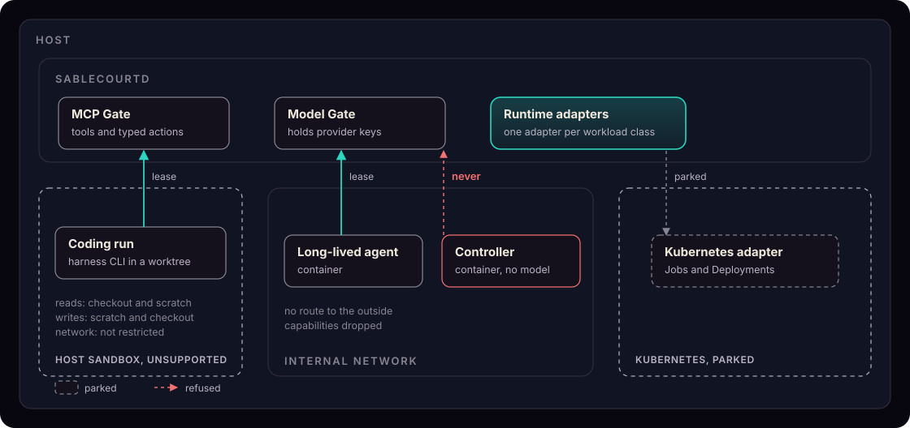

# ADR-0003: Hybrid workload isolation in MVP

- Date: 2026-11-22
- Status: Accepted

## Context

Workloads execute untrusted code, process untrusted repository contents, and invoke external tools. Running everything as unconstrained local host processes breaks invariant 2 (no raw secrets in workloads) and widens blast radius to the owner's full home directory, while mandating microVMs on day one adds heavy setup friction on macOS.

## Decision

Adopt a hybrid isolation model for v0.1 matched to each workload class:

- Long-lived AI agents, untrusted sandbox workloads, and deterministic controllers run inside containers (Docker, Podman, or Apple Containers) attached to an internal gate-only network with no direct internet egress, read-only root filesystems where practical, dropped Linux capabilities, and bind-mounted workspaces restricted to the task directory.
- Local coding CLI agents (Claude Code, Codex) run inside dedicated Git worktrees combined with OS-level sandboxing (macOS Seatbelt or Linux Bubblewrap) or optional container execution, stripped environment variables, and detached session hosts so a control plane restart drops no active run.
- Sandbox-zone workloads receive zero production capability grants; graduating a workload definition or generated workflow from Sandbox to Runtime requires Git review, passing tests, and merge.

## Diagram

Figure: isolation by workload class as amended by ADR-0011 on 2026-11-27, which makes the host sandbox for coding runs unsupported for 0.1.0, so it is drawn dashed.

## Alternatives considered

- Plain host processes with Git worktrees only. Rejected because any runaway shell command inside an AI agent or sandbox can read host files, SSH keys, or local caches.
- gVisor or Kata microVMs from day one. Rejected for local v0.1 because macOS development requires a Linux VM layer anyway and kernel-level sandboxing belongs behind the Kubernetes runtime adapter.

## Consequences

- Containers require a local container engine on the host running long-lived or sandbox workloads.
- Local OS-sandboxed coding CLI sessions remain slightly weaker than full VM isolation when using vendor desktop auth; this accepted trade-off is documented per workload profile and disallowed for untrusted sandbox code.

## Evolution options

- Containerized coding agents by default: run coding CLIs inside ephemeral containers that call Sablecourt's Model Gate instead of relying on host-installed vendor auth files.
- Kernel-level sandboxing on Linux and Kubernetes: plug in `kubernetes-sigs/agent-sandbox` with gVisor or Kata Containers (microVMs) for untrusted code execution and multi-tenant workloads.
- Ephemeral cloud sandboxes: add a remote runtime adapter (Firecracker microVMs or cloud sandbox providers) for heavy or untrusted tasks without touching control plane policy code.
