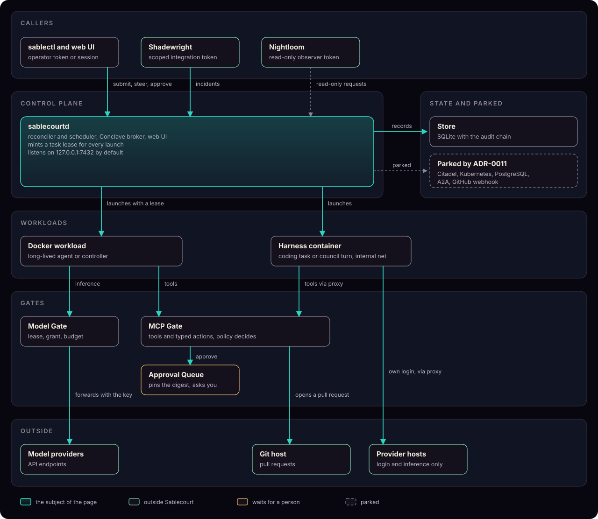

# ADR-0004: In-house Go capability gates for Three Doors in v0.1

- Date: 2026-11-22
- Status: Accepted

## Context

Agenteo's Three Doors architecture separates model inference, data reads, and infrastructure mutations behind mandatory proxies so no workload holds static vendor keys, database passwords, or direct cloud credentials. Deploying `agentgateway`, `Trino`, and `kcp` together on day one would introduce three heavy external systems before Sablecourt's own policy engine exists.

## Decision

Build two thin, deterministic Go proxies inside Sablecourt for v0.1, behind clean provider interfaces:

1. Model Gate: single HTTP endpoint for all workload inference requests. Authenticates workloads via short-lived per-task tokens, enforces hard token and cost budgets (per task and per day), refuses workloads without a model grant, routes requests to configured local or cloud model providers, and records usage metrics in the audit store.
2. Data and Action Gate (MCP + typed actions): exposes allowlisted MCP tools (Streamable HTTP) and a closed catalog of typed mutating actions plus the GitOps write path (branch, commit, pull request). Redacts responses deterministically at the gate boundary before returning text to any workload, and blocks writes when policy fails or a circuit breaker is open.

Raw upstream credentials stay inside the gate process (loaded from OS keychain, mounted secret files, or external secret stores) and never cross into workload environments.

## Diagram

Figure: Docker workloads reach providers and the Git host through the Model Gate and the MCP Gate, which sit inside the daemon. Council harness containers reach their listed provider hosts through the council proxy instead, and host coding runs are drawn as unsupported for 0.1.0.

## Alternatives considered

- Adopting `agentgateway` immediately for Model and MCP routing. Rejected for v0.1 because integrating an external gateway binary, its config schema, and its policy hooks adds moving parts while Sablecourt's own budget and identity schemas are still settling.
- Letting workloads call provider APIs directly and observing usage post-hoc. Rejected because it violates invariants 1 and 2 (no raw secrets in workloads and hard fail-closed budget enforcement).

## Consequences

- Zero external infrastructure dependencies for the gates in v0.1, with deterministic end-to-end tests under `go test -race ./...`.
- Sablecourt owns the initial proxy plumbing (streaming SSE passthrough, token accounting, upstream retry limits, and linear-time redaction).

## Evolution options

- ModelLake backend swap: add an `agentgateway` adapter behind the Model Gate interface for Kubernetes deployments that want CNCF/AAIF-standard LLM and MCP gateway routing.
- DataLake federated SQL door: place `Trino` behind the Data Gate as a read-only federated SQL proxy with query timeouts and row limits once workloads need cross-database analytics.
- InfraLake typed multi-cluster door: integrate `kcp` behind the Action Gate for multi-workspace, multi-cloud infrastructure mutations reconciled by external operators.
- Shared redaction engine: extract or port the linear-time, corpus-tested redaction design from Shadewright (`internal/redact`) as a reusable Go package across Shadewright Labs.
