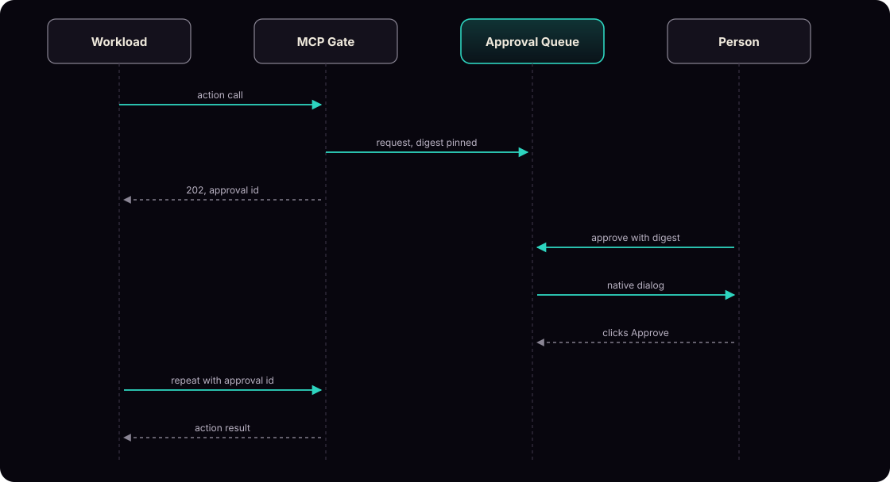

# ADR-0005: Dual-path human-in-the-loop approvals

- Date: 2026-11-22
- Status: Accepted

## Context

Pure GitOps approval (reviewing and merging pull requests) works well for code changes and promoting sandboxed agents to runtime, yet it is too slow and awkward for a long-lived agent asking permission to run a single bounded runtime action. Conversely, a plain localhost web button offers weak security because any compromised local process running as the owner can forge an HTTP POST to `127.0.0.1`.

## Decision

Support two explicit human approval paths based on what is being authorized:

1. GitOps PR gate: all code changes, policy updates, and promotions from Sandbox to Runtime go exclusively through Git branches, pull requests, required checks, and human merge. No agent may push to protected branches or modify its own policies.
2. Runtime approval queue with out-of-band confirmation: actions classified as `approve` in policy pause the task (`input-required`), pin an immutable SHA-256 digest of the exact action payload, and wait for human approval or denial. Approval requires an out-of-band confirmation that an arbitrary local script cannot click or forge (such as a native OS confirmation dialog bridged over parent-child pipes on macOS, or a cryptographically signed approval from a paired device). Denial requires only a valid session token because it cannot widen permissions.

Timeouts, disconnects, and unrecognized fields fail closed (deny or leave undecided; never auto-allow).

## Diagram

Figure: the runtime approval path, the second of the two paths; the GitOps pull request path is not drawn.

## Alternatives considered

- GitOps-only approvals for every action. Rejected because interactive runtime tool approvals would require synthetic PRs for transient operations.
- Local web UI button with bearer token only. Rejected based on Nightloom's red-team finding that any same-user local process can read local tokens and self-approve requests.

## Consequences

- Strong guarantee that neither prompt injection nor a rogue local process can silently escalate from `approve` to `allow`.
- Requires designing a small native or cryptographic confirmation bridge early in the interactive approval milestone.

## Evolution options

- Hardware-backed mobile approvals: pair a phone using Secure Enclave P-256 keys and pinned TLS (following Nightloom's pairing model) so approvals can happen away from the desk.
- ChatOps with signed confirmation: emit approval cards to Slack, Teams, or Matrix that trigger a signed webauthn/passkey or mobile verification step rather than trusting raw webhook replies.
- Multi-approver quorum and policy-as-code: require two distinct reviewers or OPA/Cedar policy checks for high-impact production capabilities in team deployments.
- Time-boxed capability leases: allow a human to grant a scoped, expiring lease (for example 15 minutes on one test namespace) instead of approving identical repetitive actions one by one, while keeping `always allow` forbidden.
