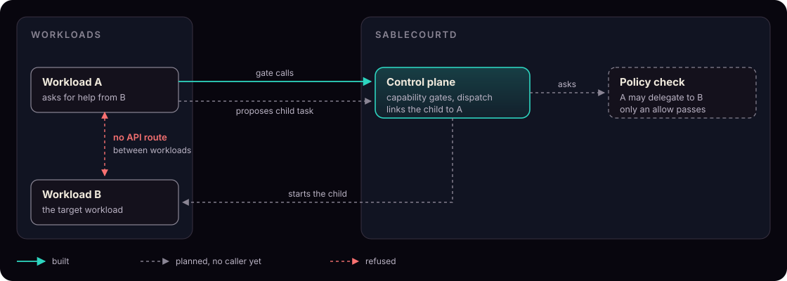
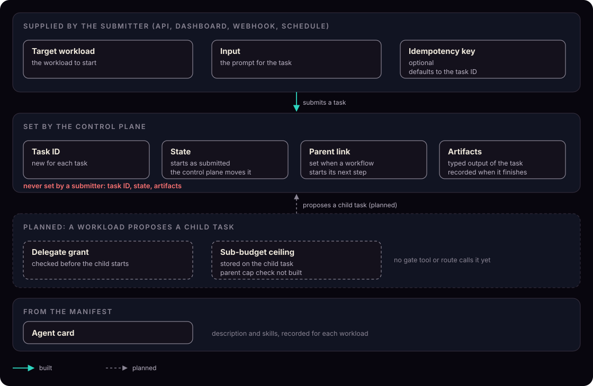
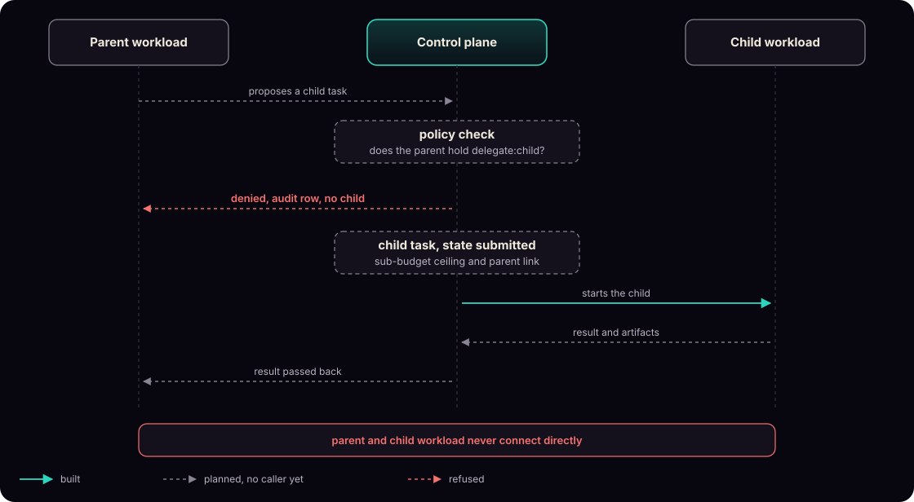

# ADR-0006: Hub-and-spoke dispatch over A2A-compatible task envelopes

- Date: 2026-11-22
- Status: Accepted

## Context

Allowing arbitrary peer-to-peer calls between agents in v0.1 complicates budget accounting, creates hidden retry loops, and opens lateral prompt-injection paths. At the same time, inventing a proprietary internal RPC schema makes later interoperability with external A2A agents harder.

## Decision

Enforce a strict hub-and-spoke topology in v0.1: workloads communicate only with the Sablecourt Control Plane and its capability gates, with zero direct workload-to-workload network connectivity.

Figure: the API has no workload-to-workload route and a child task goes through the control plane; the child task proposal, its policy check and the child start are dashed because no gate tool or route calls the proposal yet. Network-level isolation between containers is not drawn.

Represent every unit of work using an A2A-compatible task envelope:

- Capability metadata aligned with Agent Cards (workload ID, class, declared skills, input/output schemas, allowed gates).
- Explicit task states (`submitted`, `working`, `input-required`, `suspended`, `completed`, `failed`, `cancelled`).
- Typed artifacts, parent task reference, deterministic idempotency key, and explicit budget ceiling.

Figure: the task envelope as `domain.Task` holds it and who fills each field. A workload supplies the target, the input, an optional idempotency key and a sub-budget ceiling; the control plane sets the task ID, the state, the parent link and the artifacts; the agent card comes from the manifest. The sub-budget is stored as given and is not yet checked against the parent cap, so it is drawn dashed.

When one agent needs work from another in v0.1, it proposes a child task to the Control Plane; deterministic policy checks whether the caller is allowed to spawn that target workload and allocates a sub-budget from the parent cap before dispatching.

Figure: one delegation as a sequence. Only the start of the child is built; the proposal, the policy check, the child task with its sub-budget and the return of the result are dashed because no gate tool or route calls the proposal yet.

## Alternatives considered

- Direct peer-to-peer A2A mesh between agents from day one. Rejected because unconstrained agent graphs hide cost amplification, weaken audit attribution, and make circuit breaking much harder.
- Custom ad-hoc JSON messages per workload type. Rejected because it forces separate tracking and UI code for coding agents, AI actors, and deterministic controllers.

## Consequences

- Every delegation step is visible in one audit trail, bounded by parent budgets, and subject to policy and circuit breakers.
- Slightly higher latency for sub-task handoffs (one hop through the control plane), which is negligible compared to model inference or build times.

## Evolution options

- Brokered A2A gateway: expose registered Sablecourt workloads via standard `/.well-known/agent-card.json` and A2A HTTP/gRPC endpoints so external A2A clients or peer agents can negotiate tasks through Sablecourt's policy broker.
- Explicit workflow graphs (DAGs): layer declarative multi-step pipelines and fan-out/fan-in coordinators on top of the same task envelope without changing workload adapters.
- Cross-instance federation: let two Sablecourt deployments (for example local workstation and cloud cluster) exchange signed A2A tasks over mTLS with per-peer capability policies.
