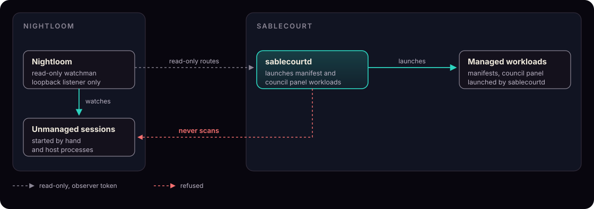

# ADR-0007: Strict separation from Nightloom

- Date: 2026-11-22
- Status: Accepted

## Context

Nightloom already runs as a local, read-only watchman for ad-hoc Claude Code and Codex terminal sessions and LAN SSH hosts under Shadewright Labs. Both tools touch coding agents, creating a temptation to merge them into one binary or have Sablecourt absorb Nightloom's process collectors.

## Decision

Keep Nightloom and Sablecourt as strictly separate products with disjoint responsibilities and trust boundaries:

- Nightloom remains the local, read-only watchman for manually launched interactive sessions and unmanaged host processes (preserving its Rules 1 and 4: no launching agents, `127.0.0.1`-only listener, no stored provider credentials).
- Sablecourt manages and observes only workloads explicitly declared and launched under its own control plane. It does not scan the host process table for unrelated terminal sessions or read ad-hoc provider transcripts outside its managed workspaces.

## Diagram

Figure: the boundary between the two products, with the read-only observer routes as the link drawn.

## Alternatives considered

- Extending Nightloom into an active multi-agent orchestrator. Rejected because active dispatch, capability proxies, and stored upstream credentials violate Nightloom's core rules and expand its audit surface.
- Replacing Nightloom by making Sablecourt watch every local process. Rejected because mixing unmanaged interactive shells (running with raw user credentials) with policy-governed Sablecourt workloads blurs security invariants and adds macOS process-discovery complexity to Sablecourt.

## Consequences

- Both repositories keep small, crisp threat models and independent release lifecycles.
- Running both tools on one Mac requires clear visual and metadata distinction so a coding session started by Sablecourt is easy to tell apart from a manual terminal session.

## Evolution options

- Starter metadata contract: tag Sablecourt-launched local coding sessions with a read-only marker so Nightloom's process inventory displays `Started by: sablecourt` without coupling the two codebases.
- Read-only telemetry bridge: expose a narrow read-only status endpoint on Sablecourt (or consume Nightloom's `nightloomd snapshot` JSON) if a unified read-only overview panel is ever wanted.
- Shared Shadewright Labs Go libraries: extract pure, dependency-light packages (such as redaction, brand palette tokens, or Git worktree helpers) only when two repos genuinely need identical behaviour.
