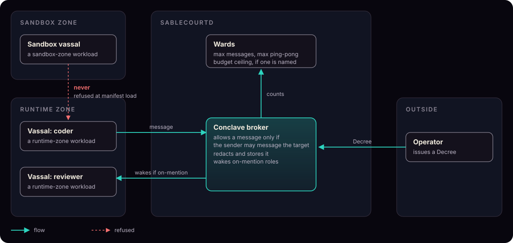
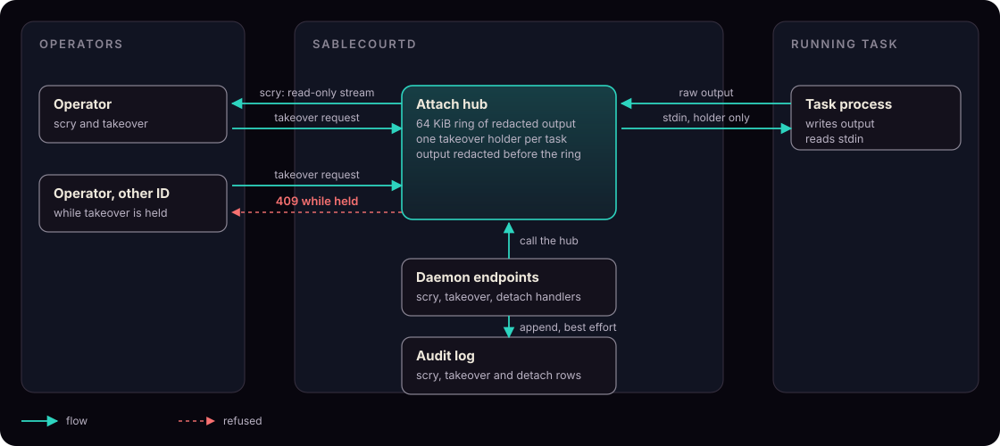

# ADR-0008: Multi-agent Conclaves, Wards, Decrees, Relics, and live Scry/Takeover

Status: Accepted (2026-11-23)

## Context

Single-agent tasks cannot coordinate specialist roles (for example, a `@coder` implementing a patch while a `@reviewer` audits security invariants) without ad-hoc prompt gluing or unmonitored agent-to-agent loops that burn through provider budgets. Operators also need live read-only visibility into running sandboxes and a safe way to step in on `stdin` when an agent stalls.

## Decision

| Component | Rule |
| :--- | :--- |
| Manifest-declared `Conclave` rooms (`internal/conclave`) | Each `Conclave` declares its participating `Vassals` (`role`, `workload`, `activation: always-on \| on-mention`, and an explicit `canMessage` adjacency list). `sandbox`-zone workloads are rejected at manifest load time and runtime if they attempt to message `runtime`-zone Vassals. |
| Deterministic `Wards` | Every Conclave enforces `maxMessages`, `maxPingPong` (consecutive turns without operator input), and an aggregate session `budgetRef` ceiling. Tripping any Ward transitions the Conclave to `input-required`, rejects further Vassal messages with `ErrConclavePaused`, and emits an outbound alert (`internal/notify`) to `@operator`. |
| Operator `Decree` and shared `Relics` | Operators steer running or paused Conclaves by issuing a `Decree` (text or local Whisper voice-to-text), which resets ping-pong counters and resumes execution. Vassals and operators exchange named, linear-time redacted artifacts (`Relics`) persisted in SQLite/PostgreSQL. |
| Live process attach (`internal/attach`) | `Scry` provides read-only SSE streaming over a 64 KiB redacted ring buffer across `coding-agent`, Docker/Podman, and Kubernetes Pods. `Takeover` grants exclusive `stdin` control to one operator at a time (`409 Conflict` if already held) and logs attach/detach events to `audit_log`. |

## Diagram

Figure: the states of a Conclave on main, where a tripped Ward pauses the room and a Decree resumes it.

Figure: who may message whom in a Conclave, and what the broker checks, on main. Only the manifest-load refusal of a sandbox vassal's route to a runtime vassal, directly or through `all`, is drawn; the council's own routing is not.

Figure: live attach on main. The hub keeps a 64 KiB ring of redacted output and the holder of Takeover is an operator ID string; the daemon endpoints call the hub and then append the attach, takeover and detach rows to the audit log, best effort.

## Consequences

- Multi-agent coordination stays bounded by deterministic message, ping-pong, and cost limits.
- Every Conclave message, Relic, and Scry output chunk passes through `internal/redact` before persistence or broadcast.
