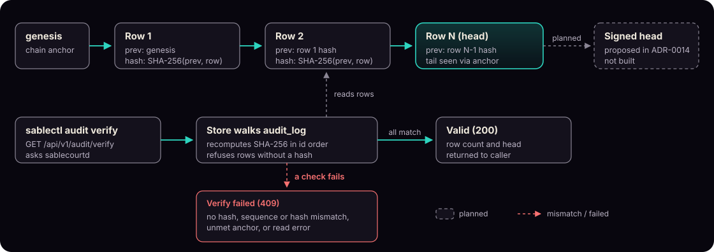

# ADR-0009: Sanctum and Citadel modes, audit hash chain, and cryptographic approvals

Status: Accepted (2026-11-23)

## Context

Sablecourt runs both on a single developer's laptop (macOS/Ubuntu with SQLite and local containers) and in enterprise Kubernetes clusters (PostgreSQL, `agentgateway`, gVisor, `NetworkPolicy`). In addition, operator approval logs and out-of-band mobile confirmations need cryptographic integrity that survives database tampering or replay attempts.

## Decision

| Component | Rule |
| :--- | :--- |
| Operating modes (`--mode=sanctum` and `--mode=citadel`) | `sanctum` (default) binds to `127.0.0.1:7432`, uses SQLite WAL, auto-discovers Podman/Docker/OrbStack/Colima/Rancher Desktop, and supports `sablectl service install` (`launchd`/`systemd`) and `sablectl tailscale expose`. `citadel` enforces `--operator-auth-required` (fail-closed `401` on empty or missing `operator_bearer_token`), targets PostgreSQL, supports `--model-gateway-url` for upstream `agentgateway`, and ships `deploy/k8s/overlays/citadel/`. Legacy `--mode=local` and `--mode=enterprise` flags remain accepted as aliases. |
| Tamper-evident SHA-256 audit chain (`0005_audit_chain.sql`) | Each `audit_log` row stores `prev_hash` and `row_hash = SHA-256(prev_hash \|\| record \|\| created_at)` anchored to `genesis`. `VerifyAuditChain()` (exposed via `/audit`, `GET /api/v1/audit/verify`, and `sablectl audit verify`) detects any modified or deleted historical entry. |
| ECDSA P-256 device pairing (`0006_devices.sql`) | Operators pair CLI or iOS Secure Enclave devices (`sablectl pair`). Approvals bind the signature to `"sablecourt-approve:" + approvalID + ":" + payloadSHA256`, preventing replay across approvals or payload substitution. |
| Scoped integration tokens | Read-only Nightloom observation uses `observer_bearer_token` (restricted to `/api/v1/observer/*` and `/scry`). Shadewright incident escalation uses `shadewright_bearer_token` (restricted to `/api/v1/integrations/shadewright/*`). |

## Diagram

Figure: the audit hash chain and its verification; the dashed box is the signed audit heads proposed in ADR-0014, not built.

## Consequences

- Both workstation and enterprise Kubernetes deployments run the exact same Go binary and policy engine.
- Narrowly scoped bearer tokens isolate external integrations from full operator privileges.
