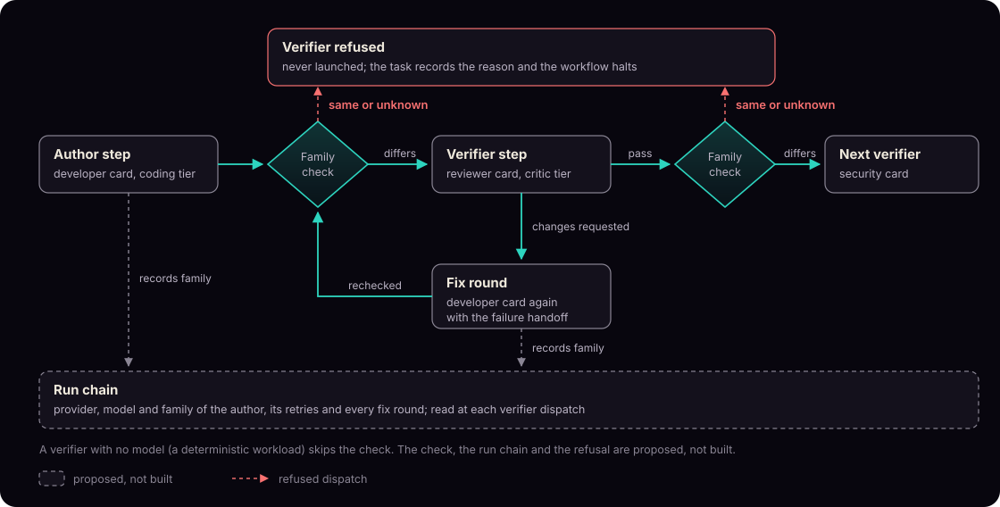

# ADR-0010: Agentic context assembly, scoped learnings, and verification pipeline

- Status: Accepted
- Date: 2026-11-24

## Context

Launching a coding or reasoning agent with only a raw user prompt leaves the agent cold: it misses team conventions, prior operator corrections, repository state, and earlier Conclave artifacts. Having the same agent verify its own output inherits the author's blind spots, and retrying a failed task without structured failure evidence repeats the same mistake.

## Decision

Sablecourt adopts a five-part context and verification pipeline inside the control plane.

### 1. Scoped learnings on Court Memory

Corrections and team rules are stored under reserved namespaces (`learning:global`, `learning:repo:<name>`, `learning:path:<glob>`). Operators can create learnings on `/memory` or save any Conclave message as a learning in one click.

### 2. Deterministic context assembler (`internal/contextpack`)

Before dispatching a non-deterministic workload, `Reconciler.launchTask` builds a bounded, redacted `context-packet.md` combining task intent, matching Scoped Learnings, recent Conclave Relics and Decrees, and an optional read-only repository pre-check (`git status --short`, `git diff --stat`, and `go vet ./...` when applicable, capped at 10 seconds and 16 KiB).

### 3. Independent verifier workflow steps

`WorkflowStep` accepts `role` (`author` | `verifier` | `fast`), `tier` (`fast` | `coding` | `critic`), and `maxRetries`. A `verifier` step receives the author's output and artifacts with an independent verification prompt requiring a `VERDICT: PASS` or `VERDICT: CHANGES_REQUESTED` line backed by evidence.

### 4. Closed-loop failure handoff

On task failure or verifier rejection, Sablecourt builds a standardized `failure-handoff.md` with failure reason, redacted artifacts, and recent events. Automatic remediation is opt-in (`maxRetries` or `auto_remediate`, defaulting to 1 retry when enabled). Operators can also trigger a handoff retry manually via `POST /api/v1/tasks/{id}/retry?handoff=true`, the Web UI ("Fix from failure"), or `sablectl task retry --handoff`.

### 5. Role-based model tiering

`/providers` and `GET/POST /api/v1/providers/tiers` map `fast`, `coding`, and `critic` roles to provider/model pairs persisted in `system:model-tiers`. Workflow steps that declare a `tier` without an explicit `provider` or `model` resolve from this table at dispatch time.

## Consequences

- Agents start with repository state, team rules, and prior artifacts without manual copy-paste from the operator.
- Authoring and verification can run on different models or CLI harnesses with deterministic pass/fail gating.
- All pre-checks remain read-only, time-bounded, and redacted through `internal/redact`, preserving Sablecourt's secret-isolation invariant.
- Automatic remediation stays opt-in and retry-capped, avoiding runaway loops or unexpected model spend.

## Amendment, 2026-11-27 (Accepted 2026-11-27)

Status of this amendment: Accepted (2026-11-27).

Title: coding court roles, operator role cards and author/verifier family separation.

This amendment adds to parts 3 and 5 above. The accepted text stays as written.

What `main` does today:

- A workload's `spec.roleCard` is a plain string, and the context assembler writes it as a "Role Card" section above the packet header, in the part of the packet that is never trimmed ([internal/domain/types.go](https://github.com/shadewright-labs/sablecourt/blob/main/internal/domain/types.go), [internal/contextpack/assembler.go](https://github.com/shadewright-labs/sablecourt/blob/main/internal/contextpack/assembler.go)).
- A `WorkflowStep` has a `role` (`author`, `verifier` or `fast`, or none) and a `tier` (`fast`, `coding` or `critic`). At dispatch, a step with a tier resolves to a provider and model from `system:model-tiers`. The resolved pair goes only into the launch input held in memory; `tasks.input_json` keeps the tier, and nothing durable records which model a run was given ([internal/controlplane/workflow_evidence.go](https://github.com/shadewright-labs/sablecourt/blob/main/internal/controlplane/workflow_evidence.go)).
- At manifest load, a step tier is checked against the compiled default routes, not the stored table, and a `coding-agent` step must resolve to its own workload's harness (`cli:<harness>`) ([internal/config/loader.go](https://github.com/shadewright-labs/sablecourt/blob/main/internal/config/loader.go)). The compiled defaults send both `coding` and `critic` to `cli:claude` ([internal/contextpack/tiers.go](https://github.com/shadewright-labs/sablecourt/blob/main/internal/contextpack/tiers.go)).
- When a step finishes, the next verifier step records the task that just finished as its author, whatever that task's role was ([internal/controlplane/reconciler.go](https://github.com/shadewright-labs/sablecourt/blob/main/internal/controlplane/reconciler.go)).

Nothing on `main` stops a verifier step from running on the same model family as the author it checks, which defeats the reason part 3 exists.

### First role set for the coding court

The coding court starts with four workflow roles, each an operator role card, and one card for councils:

| Card | Used as | Tier the workflow step usually sets | Job |
| --- | --- | --- | --- |
| `developer-go` | `author` step | `coding` | Writes Go changes and their table-driven tests in its assigned worktree. |
| `developer-docs` | `author` step | `coding` | Writes docs and ADR text in its assigned worktree. |
| `reviewer` | `verifier` step | `critic` | Reads the author's diff and evidence without writing, and ends with a verdict line as part 3 requires. |
| `security` | `verifier` step | `critic` | Read-only verifier for changes on invariant paths: gates, leases, redaction, policy, isolation and the audit chain. |
| `architect` | prose for a council question | none | Text an operator can put into a council question ([ADR-0013](0013-bounded-council-rounds.md)) when the question is about design, not a diff. |

The tier column is what the example workflow puts on its steps; the card itself names no tier. On `main`, council seats are the three built-in workloads `claude`, `codex` and `agy`, with no role card and no tier or model. Attaching a card or a tier to a council seat is not part of this amendment and needs an amendment of ADR-0013.

A fix round is not a separate role. It is the developer card again, given the failure handoff from part 4. This keeps one card per kind of work and reuses a mechanism that already exists.

The tier belongs to the workflow step (`WorkflowStep.tier`), and the harness belongs to the workload (`spec.coding.harness`). The tier table picks the model a harness runs, so changing a model within one harness is one table edit and no card changes. Moving a tier to a model on another harness also means changing the workloads whose steps use that tier, because a `coding-agent` workload is pinned to one harness. Until the load-time check reads the stored table, a step whose workload runs a different harness from the compiled default route names its `provider` and `model` explicitly. Because both compiled defaults resolve to Claude today, the family rule below would refuse every verifier step that relies on them, so the work in [issue 206](https://github.com/shadewright-labs/sablecourt/issues/206) also moves the default `critic` route to a family other than the default `coding` route's. Example cards and an example workflow ship in `examples/coding-court/` ([issue 208](https://github.com/shadewright-labs/sablecourt/issues/208)).

### Only the operator authors role cards

A card is the inline `spec.roleCard` string in a Workload manifest of the bundle the daemon loads at start and loads again on reload (`sablectl apply` asks the running daemon to reload its configured manifest source; it does not upload a file). The daemon never reads a card from a file path. The bundle digest covers every manifest file, so editing a card changes the digest of the bundle, and the dispatch record below carries the digest that was in force when each task launched.

The reason is invariant 3. Files in a task checkout come from the repository and from earlier agent runs, so they are untrusted input. Repository content reaches an agent only as untrusted data: files the harness reads in its checkout, the daemon's bounded and redacted pre-check output, the author's diff and artifacts in a verifier prompt, failure handoffs, and learnings (scoped `learning:*` entries in Court Memory today, the reviewed learnings of [ADR-0012](0012-learning-evidence-and-expiry.md) once the assembler reads them). A repository file never becomes a role card, because the card sits above everything else in the packet and an agent reads it as its instructions.

A card is pure prose: what the role does, a checklist, and reminders. The daemon never parses a field out of card text. A card sets no tier, no model and no verdict format of its own; the verdict lines are the ones part 3 requires, and the control plane accepts only `VERDICT: PASS` or `VERDICT: CHANGES_REQUESTED` as the final line, whatever a card says. A card confers nothing. It never grants a permission, a zone, a policy, an action, a budget, a Ward, a mount, a network host, a credential or an approval. Those come from the workload's grants, the workflow and the daemon's own checks, exactly as they do without a card. A card that asks for more access changes nothing the daemon enforces.

A card counts toward the packet like any other required text: a long card leaves less room for learnings, Relics and the pre-check, and a coding harness launch whose input passes its size limit is refused.

### Author and verifier come from different model families

The rule: a verifier step that runs a model must run a model family that no model in its chain ran. The diagram shows the chain and the check; the parts below say what is recorded and where.

**Dispatch record.** Before a task launches, the daemon resolves its provider and model (from the step's tier or from explicit `provider` and `model` fields) and writes a dispatch fact on the task's event history (`task_events`): provider, model, family, where the route came from, and the bundle digest. For a non-verifier workflow step that runs a model, it also adds the entry to the run's chain in the step registration (`system:workflow-steps`). A non-deterministic task that resolves no model records an unknown model. None of this exists on `main` and it is new work under issue 206.

**Family.** One classifier, owned by the daemon, maps a model name to a family: names starting `claude-` and the aliases `opus`, `sonnet` and `haiku` are Anthropic; names starting `gpt-`, `codex-`, `o1`, `o3` or `o4` are OpenAI; names starting `gemini-` are Google. A route in the tier table may carry an explicit family, set by the operator, for models that match no built-in prefix (such as a local model or a gateway's model name). Built-in prefix rules always apply to recognized names, and a tier route whose explicit family disagrees with its prefix rule is refused. Any other name is unknown, and an unknown family refuses. The family comes from the model, not the harness name, because one harness can run models of more than one family (`agy` runs Gemini and Claude models) and two harnesses can run models of the same family.

**What the record proves (invariant 5).** For a coding harness, the recorded model is the one the daemon passed at launch. The daemon cannot see which model the provider ran behind the harness's encrypted connection, so the record states what was asked for, not what was observed. For a Model Gate workload, the gate's spend ledger (`budget_ledger`) also holds the model of every request it admitted for the task, and those models count too.

**The chain.** For each workflow run, the chain holds every step that ran a model and fed the change under review: the author step, any `fast` step or step with no role before the verifier, every retry of those steps (a retry keeps the earlier attempt's commit, so both attempts count), every fix round after a `CHANGES_REQUESTED` verdict, and any models recorded in `budget_ledger` for those tasks. An entry never leaves the chain during the run. A verifier never joins it. A deterministic step (no model) adds nothing.

**The check.** At every dispatch of a verifier step that runs a model, including a manual or automatic retry of that step, the daemon refuses the step when the verifier's family is unknown, when the chain is empty or holds an unknown family, or when the verifier's family appears in the chain. A refused step does not launch, the task records the reason, and the workflow halts (invariant 4). The cases:

- Consecutive verifiers, such as `reviewer` then `security`: each is checked against the same chain and must differ from the author and from every fixer. The second verifier's author is the chain's author step, never the verifier before it, and its `CHANGES_REQUESTED` sends the fix round back to that author step. On `main` the second verifier would record the first verifier as its author; issue 206 changes that.
- A verifier as the first step of a workflow has an empty chain and is refused.
- After three rounds on three different families, no family is left and the next verifier is refused. The daemon fails closed rather than forgetting an earlier author.
- A verifier step on a `deterministic-controller` workload runs no model and is not subject to the family rule. It checks the change by fixed code, so there is no model opinion to separate.
- A verifier step names a workload that no step in its chain uses and that holds no `actions` or `delegateTo` grants, so the verifier stays read-only and distinct from authors and mutating executors (invariant 4). The manifest loader refuses a workflow that breaks this.
- Any workload with a Model Gate grant (`grants.modelGate.allowed: true`, whether `long-lived-agent` or `coding-agent`) can choose its model per request, and on `main` the gate checks only that the provider is granted and may fall back to another provider when one fails. For a verifier task, the dispatch fact also binds the chain's families to the task's lease, and the gate classifies each request's model, and each fallback's, and refuses any whose family is in that set or unknown. The verifier step still resolves a model at dispatch and is checked like any other. Until the gate does this, no workload with `grants.modelGate.allowed: true` can be a verifier step, and the loader refuses such a workflow.

The refusal is the point of the rule. A verifier from the same family tends to share the author's blind spots, and the accepted Consequences above already promise that authoring and verification can run on different models. Today that depends on how the operator filled the tier table. With this amendment the daemon checks it at every verifier dispatch.

### Who orchestrates in 0.1.0

In 0.1.0 the orchestrator is the daemon's fixed workflow together with the operator. The workflow sets the order of steps, the retry caps and the handoffs, and the operator applies manifests and approves. No model decides which step runs next. A model orchestrator seat that only proposes the next step, with the operator or deterministic policy deciding, comes after 0.1.0 and needs its own ADR ([issue 209](https://github.com/shadewright-labs/sablecourt/issues/209)). This keeps invariant 1 simple for the first release: no model output picks what runs.

### Decisions on the open questions

- A single-family machine gets no override of the family refusal. It runs workflows without verifier steps, and the refusal is visible.
- The `security` role is mandatory for every change on an invariant path: redaction, approvals, the gate, harness isolation, the audit chain and policy.
- Role cards stay out of repositories for now. Only operator manifests supply them. A path where a repository proposes a card and the operator reviews and accepts it needs its own decision.
- Whether an orchestrator seat may dispatch a step without the operator confirming a plan is left to the orchestrator seat's own ADR ([issue 209](https://github.com/shadewright-labs/sablecourt/issues/209)). A model's proposal alone never authorizes a step.

Still open: which family the default `critic` route uses (for example `cli:codex` with a GPT model), given that verifier workloads must then run that harness. It is operator configuration and does not change the rule.

### Consequences of this amendment

- A machine that resolves every tier to one model family cannot run a workflow with a model verifier step until the operator adds a second family. A new model whose name matches no prefix rule needs a family on its tier route before it can author or verify.
- Every task launch writes one dispatch fact, and each verifier dispatch reads the run's chain. A step in the chain with no recorded model blocks every verifier after it.
- The operator writes and keeps the cards inside the manifests. A card change is a manifest change, and the bundle digest on each dispatch fact shows which version ran.
- A card read from a file, a card in a repository, an agent editing a card, and any card field that grants access or picks a tier are all out. So is a model that dispatches steps on its own in 0.1.0.
- The family rule covers workflow verifier steps. Council seats, including review rounds in ADR-0013's writer mode, are outside it. Convening `claude`, `codex` and `agy` does not guarantee three families, because `agy` can run Claude models and council launches do not pass a model, so a family check for councils needs its own amendment of ADR-0013.
