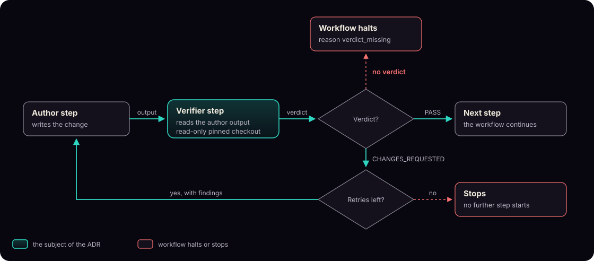

# ADR-0010: Agentic context assembly, scoped learnings, and verification pipeline

- Status: Accepted
- Date: 2026-11-24

## Context

Launching a coding or reasoning agent with only a raw user prompt leaves the agent cold: it misses team conventions, prior operator corrections, repository state, and earlier Conclave artifacts. Having the same agent verify its own output inherits the author's blind spots, and retrying a failed task without structured failure evidence repeats the same mistake.

## Decision

Sablecourt adopts a five-part context and verification pipeline inside the control plane.

Figure: the verifier verdict and the retry loop of the closed-loop failure handoff.

### 1. Scoped learnings on Court Memory

Corrections and team rules are stored under reserved namespaces (`learning:global`, `learning:repo:<name>`, `learning:path:<glob>`). Operators can create learnings on `/memory` or save any Conclave message as a learning in one click.

### 2. Deterministic context assembler (`internal/contextpack`)

Before dispatching a non-deterministic workload, `Reconciler.launchTask` builds a bounded, redacted `context-packet.md` combining task intent, matching Scoped Learnings, recent Conclave Relics and Decrees, and an optional read-only repository pre-check (`git status --short`, `git diff --stat`, and `go vet ./...` when applicable, capped at 10 seconds and 16 KiB).

### 3. Independent verifier workflow steps

`WorkflowStep` accepts `role` (`author` | `verifier` | `fast`), `tier` (`fast` | `coding` | `critic`), and `maxRetries`. A `verifier` step receives the author's output and artifacts with an independent verification prompt requiring a `VERDICT: PASS` or `VERDICT: CHANGES_REQUESTED` line backed by evidence.

### 4. Closed-loop failure handoff

On task failure or verifier rejection, Sablecourt builds a standardized `failure-handoff.md` with failure reason, redacted artifacts, and recent events. Automatic remediation is opt-in (`maxRetries` or `auto_remediate`, defaulting to 1 retry when enabled). Operators can also trigger a handoff retry manually via `POST /api/v1/tasks/{id}/retry?handoff=true`, the Web UI ("Fix from failure"), or `sablectl task retry --handoff`.

### 5. Role-based model tiering

`/providers` and `GET/POST /api/v1/providers/tiers` map `fast`, `coding`, and `critic` roles to provider/model pairs persisted in `system:model-tiers`. Workflow steps that declare a `tier` without an explicit `provider` or `model` resolve from this table at dispatch time.

## Consequences

- Agents start with repository state, team rules, and prior artifacts without manual copy-paste from the operator.
- Authoring and verification can run on different models or CLI harnesses with deterministic pass/fail gating.
- All pre-checks remain read-only, time-bounded, and redacted through `internal/redact`, preserving Sablecourt's secret-isolation invariant.
- Automatic remediation stays opt-in and retry-capped, avoiding runaway loops or unexpected model spend.
