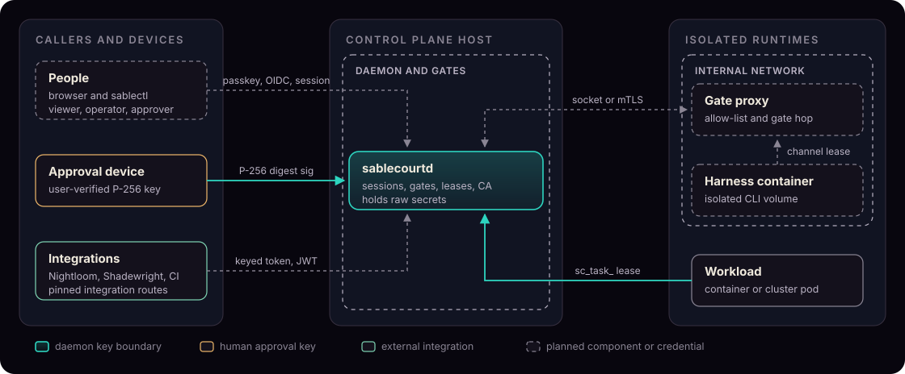
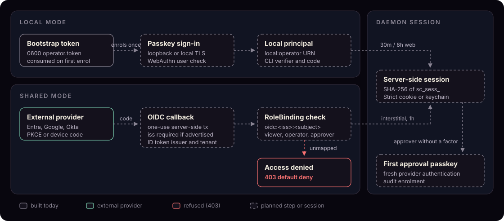
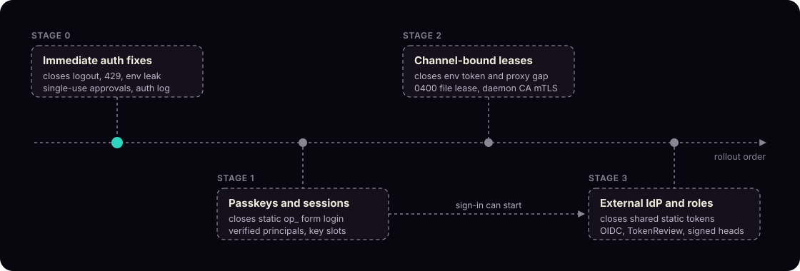

# ADR-0014: Identity and authentication

- Date: 2026-11-25
- Status: Proposed

## Summary

- On a workstation, you enrol a passkey once on `localhost` and sign in with Touch ID, a platform authenticator, or a security key instead of pasting `operator.token`.
- From a terminal, `sablectl` shows a short code that you confirm in your signed-in browser; on a headless machine without a browser, `sablectl` exchanges the `0600` bootstrap token for a short session.
- Browser and CLI sessions live as SHA-256 hashes on the server, so signing out or running `sablectl session revoke` cuts off access at once.
- In a shared Kubernetes installation, you sign in through Microsoft Entra ID, Google Workspace, Okta, or Keycloak and receive `viewer`, `operator`, or `approver` permissions from declarative `RoleBinding` manifests.
- People are never identified by email; tasks, approvals, learnings, takeovers, and audit rows record immutable principal URNs such as `local:operator` or `oidc:<issuer>:<subject>`.
- Approvals bind to your verified session or hardware-backed P-256 device key, run at most once when claimed at execution, and optionally require a second person when `preventSelfApproval` is set on a policy rule.
- Task leases move out of environment variables into `0400` files bound to the per-launch socket or container proxy channel, so a copied `sc_task_` token fails from any other caller.
- Container proxies and remote runtimes verify `sablecourtd` before forwarding any lease, moving from a per-launch proof in Stage 0 to daemon-issued mutual TLS in Stage 2.
- External integrations replace static shared secrets with per-caller dual-slot rotating credentials first, and later with short-lived workload identity tokens verified under `TrustPolicy`.
- Losing a passkey on a workstation is fixed by a local console command run as the same OS user, which resets enrolment without ever approving pending work.

## Context

Sablecourt runs one control-plane binary (`sablecourtd`) across single-person workstations (`sanctum`) and shared Kubernetes clusters (`citadel`). Five distinct identity paths exist in the codebase today, and each carries structural gaps that block multi-operator governance, container harness isolation, or clean revocation.

First, human operator authentication relies on one shared bearer file in [token.go](../../internal/operatortoken/token.go), [operator_auth.go](../../cmd/sablecourtd/operator_auth.go), [main.go](../../cmd/sablecourtd/main.go), and [cmd/sablectl/main.go](../../cmd/sablectl/main.go). On startup in every mode, `operatortoken.LoadOrCreate` writes `op_<64 hex>` into a `0600` `operator.token` file inside a `0700` state directory (`--operator-auth-required` is deprecated and ignored). Every valid request sets the caller string to literal `"operator"` with no individual principal, no role separation, and no external identity provider. `POST /login` exchanges that token for a 30-minute stateless HMAC `sablecourt_session` cookie signed with an in-memory key; there is no `/logout` endpoint and no way to revoke one stolen cookie without restarting the daemon. On loopback, `loginLimiter` keys failures on the remote host before checking token format, so ten bad guesses from a local process lock out browser sign-in for a minute. Meanwhile, `sablectl` still accepts `--token` on the command line, exposing the secret in process tables.

Second, human approvals and paired devices live in [approval.go](../../internal/approval/approval.go), [device.go](../../internal/approval/device.go), [macos_oob.go](../../internal/approval/macos_oob.go), [gate.go](../../internal/gate/mcp/gate.go), and [main.go](../../cmd/sablecourtd/main.go). `POST /api/v1/approvals/{id}/approve` and `/deny` accept `decidedBy` from the untrusted JSON request body, and `POST /api/v1/tasks/{id}/takeover`, `/stdin`, and `/detach` accept `operator` from the body in the same way. Both `Queue.Approve` and `Queue.ApproveWithSignature` accept an empty `expectedSha256`, while `MacOSDialogApprover` truncates the canonical JSON summary at 220 bytes. At execution time in `mcpgate.Gate.ActionHandler`, the gate checks `apr.Status == ApprovalApproved` against task, capability, and digest, yet neither checks `apr.ExpiresAt` nor transitions the row to a `consumed` state, allowing a task to replay an approved `approvalId`. `PairingManager` registers P-256 keys without proof of possession or confirmation from an already authenticated factor, which is why `/api/v1/devices/pair/start` and `/complete` currently return `503 Service Unavailable` on `main`.

Third, workload task leases live in [model/gate.go](../../internal/gate/model/gate.go), [mcp/gate.go](../../internal/gate/mcp/gate.go), [reconciler.go](../../internal/controlplane/reconciler.go), [launch.go](../../internal/runtime/coding/launch.go), [docker.go](../../internal/runtime/docker/docker.go), and [k8s.go](../../internal/runtime/k8s/k8s.go). `MintTaskTokenUntil` generates `sc_task_<64 hex>` with a 1-hour TTL (`taskLeaseTTL`) and stores only `SHA-256(token)` in `leases`. Runtimes inject `SABLECOURT_TASK_TOKEN` as an environment variable rather than a `0400` file, `domain.Lease` binds neither an attempt number nor a transport channel, and `docker.Adapter.Start` configures `host.docker.internal:host-gateway` on an `Internal: true` bridge that does not route to host loopback ([ADR-0011](0011-sanctum-scope-trust-and-cli-harnesses.md)).

Fourth, daemon-to-runtime and harness boundaries span [coding.go](../../internal/runtime/coding/coding.go), [wrapper.go](../../internal/runtime/coding/wrapper.go), [sandbox.go](../../internal/runtime/coding/sandbox.go), and [providers.go](../../internal/providers/providers.go). Host coding runs track `(PID, ProcessStartTime)` under macOS Seatbelt, yet `CheckSandbox` executes `/usr/bin/true` under the probe profile without verifying that a private host canary file is actually unreadable. Outside task launches, `Registry.syncCLIModels` runs `agy models` with the daemon's unstripped environment and reads the host's `.codex/models_cache.json`. No container proxy or daemon certificate authority exists on `main` to prove the upstream is `sablecourtd` before forwarding a lease.

Fifth, external integrations and audit persistence live in [operator_auth.go](../../cmd/sablecourtd/operator_auth.go), [shadewright.go](../../internal/integrations/shadewright.go), [handler.go](../../internal/a2a/handler.go), [github.go](../../internal/webhook/github.go), [secret.go](../../internal/secret/secret.go), and [sqlite.go](../../internal/store/sqlite/sqlite.go). Nightloom (`observer_bearer_token`), Shadewright (`shadewright_bearer_token`, which already stamps `integration:shadewright`), A2A (`a2a_bearer_token`), and GitHub webhooks (`github_webhook_secret` on `POST /api/v1/hooks/github`) use unprefixed, non-expiring shared secrets from `SecretStore`, whose fallback `FileStore` writes plaintext `0600` JSON. Authentication checks emit no `auth` rows to `audit_log`, and `SQLiteStore.AppendAudit` reads `prev_hash` in a default deferred transaction rather than locking the chain head first.

## Decision

One authorisation model governs both `sanctum` and `citadel`: every caller resolves to a stable typed principal URN and a credential class, and each HTTP or socket route accepts named classes with default deny. Moving from a laptop to Kubernetes changes how a caller proves its identity without changing what a verified principal may do. Rulings explicitly marked as decided on 2026-11-25 were confirmed on that date; all remaining rulings in this record stand as Proposed.

### Principals

Every authenticated caller maps to one of five typed URN forms persisted on tasks, approvals, learnings, and audit records:

- `local:operator` for the person running `sanctum` locally.
- `oidc:<issuer>:<subject>` for a person authenticated by an external OpenID Connect provider in shared mode. For Microsoft Entra ID, `<subject>` is `<tid>:<oid>` rather than `sub`, because Entra's v2.0 `sub` claim is pairwise per client application ([ID token claims reference](https://learn.microsoft.com/en-us/entra/identity-platform/id-token-claims-reference)).
- `device:<id>` for an enrolled hardware-backed P-256 approval device bound to a person principal.
- `workload:<name>:<task>` for a launched task attempt calling `/gate/*` routes.
- `integration:<name>` for external machine callers such as `integration:observer` and `integration:shadewright`.

In the principal architecture above, callers and devices sit outside the control plane host, `sablecourtd` and its capability gates sit inside the daemon and gates trust boundary, and isolated runtimes sit in their own zone where a harness container on an internal network reaches `sablecourtd` only through a gate proxy over a per-launch socket or mutual TLS while general workloads present `sc_task_` leases. Dashed elements in all three diagrams mark components and flows designed in this ADR that are not yet built on `main`. A person is never identified by email address in any mode.

### People in local mode

**Decided on 2026-11-25:** Local sign-in uses a passkey ([WebAuthn](https://www.w3.org/TR/webauthn-2/), user verification required, relying party ID `localhost`, exact configured origin) wherever a browser and authenticator are available. `operator.token` becomes a bootstrap and recovery credential only and is refused for routine `/login` form sign-in as soon as a passkey is enrolled. On a headless host with no browser, `sablectl` reads the `0600` bootstrap token from the `0700` state directory and exchanges it for a short server-side session.

For interactive terminal sign-in in local mode, `sablectl` displays a short single-use code and the person confirms that request in their already authenticated browser, receiving a `sc_sess_<64 hex>` session token stored in the OS keychain (`zalando/go-keyring`) or a `0600` state file. Local web UI sessions expire after 30 minutes idle and 8 hours absolute; local CLI sessions expire after 12 hours. WebAuthn verification uses `github.com/go-webauthn/webauthn` rather than custom CBOR or ECDSA assertion parsing.

Browser sessions keep a host-only `HttpOnly`, `SameSite=Strict`, `Path=/` cookie (`__Host-sablecourt_session` with `Secure` behind TLS; plain HTTP `sablecourt_session` only on configured loopback). Mutating browser requests retain exact `Origin` and Fetch Metadata (`Sec-Fetch-Site`) checks and add a session-bound CSRF token. Only `SHA-256(sc_sess_...)` is stored in SQLite or PostgreSQL, and `POST /logout` or `sablectl session revoke <principal>` revokes sessions immediately.

### People in shared mode with external providers

Shared installations run one `sablecourtd` per team rather than a multi-tenant daemon. Both local mode (bootstrap token enrolment into passkey sign-in for `local:operator`) and shared mode (external provider sign-in through an OIDC callback and `RoleBinding` check, refusing unmapped callers with `403 default deny`) end at the same hashed server-side session store in `sablecourtd`.

Web sign-in uses the [OpenID Connect Core 1.0](https://openid.net/specs/openid-connect-core-1_0.html) Authorization Code flow with S256 PKCE ([RFC 7636](https://www.rfc-editor.org/rfc/rfc7636)) and issuer validation ([RFC 9207](https://www.rfc-editor.org/rfc/rfc9207)), implemented with `github.com/coreos/go-oidc/v3` and `golang.org/x/oauth2`. Starting OIDC login sets a separate 5-minute `HttpOnly`, `Secure`, `SameSite=Lax` state cookie holding the provider name, `state`, `nonce`, PKCE `code_verifier`, and canonical relative return path. Because browsers withhold `SameSite=Strict` cookies on cross-site redirects returning from an identity provider, the callback sets `__Host-sablecourt_session` (`SameSite=Strict`) and returns a same-origin interstitial page so the Strict session cookie accompanies the next navigation.

For `sablectl` in shared mode, login defaults to a loopback redirect with PKCE ([RFC 8252](https://www.rfc-editor.org/rfc/rfc8252)) and offers the OAuth 2.0 Device Authorization Grant ([RFC 8628](https://www.rfc-editor.org/rfc/rfc8628)) behind `--device`, because enterprise conditional access rules for managed devices frequently block device-code flows. Shared web sessions have a 1-hour absolute lifetime and CLI sessions have an 8-hour lifetime; `sablecourtd` discards provider tokens after login and never stores provider refresh tokens, rechecking `RoleBinding` manifests on every request and provider membership at session renewal.

External providers are declared through two Git-tracked `sablecourt.io/v1alpha1` manifest kinds loaded alongside `Policy` and `Budget` and sealed from workloads: `IdentityProvider` (discovery URL, client ID, optional `clientSecretRef`, subject template, groups or roles claim name, required claims, and allowed tenants) and `RoleBinding` (mapping provider groups, roles, or subject IDs to Sablecourt roles). Provider-specific code is restricted to Entra ID's multi-tenant issuer template and group-overage handling, plus a later GitHub OAuth adapter.

**Decided on 2026-11-25:** Microsoft Entra ID is the first external provider verified end to end, using a single app registration across the web UI, `sablectl` ([auth code](https://learn.microsoft.com/en-us/entra/identity-platform/v2-oauth2-auth-code-flow), [device code](https://learn.microsoft.com/en-us/entra/identity-platform/v2-oauth2-device-code)), and machine callers via the [v2.0 OIDC authority](https://learn.microsoft.com/en-us/entra/identity-platform/v2-protocols-oidc). Installations default to [single-tenant](https://learn.microsoft.com/en-us/entra/identity-platform/single-and-multi-tenant-apps) and allow multi-tenant sign-in only against an explicit `allowedTenantIDs` list matched to `tid`. Role mapping uses [app roles](https://learn.microsoft.com/en-us/entra/identity-platform/howto-add-app-roles-in-apps) (`roles` claim) or ["Groups assigned to the application"](https://learn.microsoft.com/en-us/security/zero-trust/develop/configure-tokens-group-claims-app-roles) (which covers direct group members and requires at least Entra ID P1) rather than unfiltered directory security groups. Entra caps JWT `groups` claims at 200 entries and substitutes `_claim_names` and `_claim_sources` (or `hasgroups`) on overage ([ID token claims reference](https://learn.microsoft.com/en-us/entra/identity-platform/id-token-claims-reference)); `sablecourtd` fails closed (`403`) on any group overage indicator and logs an error telling the administrator to configure app roles instead of holding Microsoft Graph credentials. Guest accounts identified by optional claim `acct == 1` ([optional claims reference](https://learn.microsoft.com/en-us/entra/identity-platform/optional-claims-reference)) are refused unless explicitly enabled, while MFA and device posture stay in [Entra Conditional Access](https://learn.microsoft.com/en-us/entra/identity-platform/v2-conditional-access-dev-guide).

**Decided on 2026-11-25:** Google sign-in ([Google OpenID Connect](https://developers.google.com/identity/openid-connect/openid-connect), [loopback native app](https://developers.google.com/identity/protocols/oauth2/native-app), [limited-input device](https://developers.google.com/identity/protocols/oauth2/limited-input-device)) restricts access to a Workspace domain by validating the `hd` claim and binds roles per person: the initial `RoleBinding` matches a verified email (`email_verified == true`) once at first sign-in and pins the immutable `sub` claim from then on. Google ID tokens carry no `groups` claim; querying memberships through the [Cloud Identity API](https://cloud.google.com/identity/docs/how-to/query-memberships) remains a later opt-in feature, off by default because it places a directory credential inside `sablecourtd`. No intermediate identity broker is required.

Okta ([authorization servers](https://developer.okta.com/docs/concepts/auth-servers/), [custom group claims](https://developer.okta.com/docs/guides/customize-tokens-returned-from-okta/main/), [device grant](https://developer.okta.com/docs/guides/device-authorization-grant/main/)) and Keycloak ([OIDC endpoints](https://www.keycloak.org/securing-apps/oidc-layers), [server administration](https://www.keycloak.org/docs/latest/server_admin/)) run through the generic `IdentityProvider` path with conformance tests; Okta machine-to-machine tokens require a Custom Authorization Server rather than the built-in Org server, Okta `groups` claims require a configured Groups filter or Expression, and Keycloak requires a group mapper to emit group memberships. GitHub human sign-in is a later adapter because [GitHub OAuth apps](https://docs.github.com/en/apps/oauth-apps/building-oauth-apps/authorizing-oauth-apps) and [GitHub Apps](https://docs.github.com/en/apps/creating-github-apps/authenticating-with-a-github-app/refreshing-user-access-tokens) issue OAuth access tokens (with 8-hour expiry on GitHub Apps and optional 8-hour expiry on OAuth Apps) rather than OIDC ID tokens, requiring `/user` numeric ID and `/user/teams` lookups.

### Authorisation

Three human roles govern `/api/v1/*` and `/ui/*` routes, with default deny for any authenticated caller whose claims match no `RoleBinding`:

- `viewer` grants read-only inspection of tasks, Conclaves, budgets, audit history, and live redacted `Scry` streams.
- `operator` adds task submission, cancellation, retry, suspension, Conclave opening and Decrees, `Takeover`, proposing learnings, and denying pending approvals.
- `approver` adds approving pinned action digests, accepting or retiring [ADR-0012](0012-learning-evidence-and-expiry.md) learnings, and enrolling or revoking approval devices.

Workload execution stays governed by deterministic `Policy` (`allow`, `approve`, `deny`, default `deny`) and the closed action catalog. Human sessions are never accepted on `/gate/*`, and workload leases or integration credentials are never accepted on operator routes.

**Decided on 2026-11-25:** Requiring a different person from the task initiator to approve an action is a per-rule option on `PolicyRule` (`preventSelfApproval`, alongside optional `approverGroups`), off by default. `Task` records the authenticated initiator principal (`SubmittedBy`) and preserves it across retries and child tasks; `Approval.DecidedBy` and the `Takeover` operator come exclusively from the verified session or verified device principal, never from the request body. At execution time, the gate atomically transitions the approval row from `approved` to `consumed` while rechecking task ID, capability, canonical payload SHA-256, and `expires_at` so every approval executes at most once.

Approval devices use an ECDSA P-256 key with user verification, enrolled only after cryptographic proof of possession and independent confirmation from an already authenticated factor; device pairing endpoints remain disabled (`503`) until that flow lands. Subscription CLI logins permitted by [ADR-0011](0011-sanctum-scope-trust-and-cli-harnesses.md) (`claude`, `codex`, `agy`) remain a local-mode (`sanctum`) feature only; shared installations route all inference through Model Gate keys or an upstream gateway.

### Service to service

When `sablecourtd` and the container runtime share a host filesystem, `sablecourtd` mounts a per-launch Unix domain socket serving only `/gate/*` into the gate proxy container, never directly into the harness container. Where a VM boundary such as Docker Desktop prevents Unix socket sharing, Stage 0 requires the daemon to prove a per-launch secret to the proxy before the proxy forwards any task lease (in progress in pull request 84).

Stage 2 replaces that per-launch secret with [TLS 1.3](https://www.rfc-editor.org/rfc/rfc8446) mutual authentication backed by an internal certificate authority run by `sablecourtd`, authenticating both the container gate proxy and remote container runtimes with short-lived leaf certificates following the certificate-binding pattern in [RFC 8705](https://www.rfc-editor.org/rfc/rfc8705). In Kubernetes (`Stage 3`), pods keep `automountServiceAccountToken: false` by default; runtimes and proxy hops that call `sablecourtd` present [bound service account tokens](https://kubernetes.io/docs/reference/access-authn-authz/service-accounts-admin/) verified through the cluster [Kubernetes TokenReview](https://kubernetes.io/docs/reference/access-authn-authz/authentication/#webhook-token-authentication) API against an exact Sablecourt audience.

### Leases

Task leases stay opaque 256-bit random tokens (`sc_task_<64 hex>`) checked online against SQLite or PostgreSQL, storing only `SHA-256(token)`. Runtimes deliver each lease in a `0400` file on private tmpfs (`SABLECOURT_TASK_TOKEN_FILE`) instead of process or container environment variables. Every lease row binds to `(task_id, attempt, workload_name, channel_id)`, where `channel_id` identifies the per-launch Unix socket or mutual-TLS proxy certificate issued for that run, so a token copied out of logs or memory fails from any other socket, container, or host.

Lease lifetime drops from 1 hour to a 15-minute rolling window renewed on fresh runtime heartbeats and capped by the task or council deadline. Stopping, retrying, failing, or tripping a circuit breaker revokes the task's leases immediately. OAuth 2.0 Demonstrating Proof of Possession ([DPoP, RFC 9449](https://www.rfc-editor.org/rfc/rfc9449)) is not built now; it is the candidate if Sablecourt later adds a runtime adapter whose transport cannot be channel-bound.

### Integrations

Stage 1 replaces shared static secrets (`observer_bearer_token`, `shadewright_bearer_token`, `a2a_bearer_token`) with per-caller hashed credentials carrying an explicit prefix and key ID (`kid`), two concurrent key slots for overlap during rotation, a 30-to-90-day lifetime, and pinned route sets per `integration:<name>` principal, alongside delivery-ID replay caching and dual-secret rotation on GitHub webhooks.

Stage 3 adds a declarative `TrustPolicy` manifest so external callers authenticate without pre-shared secrets using [Kubernetes projected service account tokens](https://kubernetes.io/docs/tasks/configure-pod-container/configure-service-account/), [GitHub Actions OIDC tokens](https://docs.github.com/en/actions/concepts/security/openid-connect) from `https://token.actions.githubusercontent.com` (pinned to `repository_id` and `job_workflow_ref`), or Microsoft Entra workload identities exchanging federated assertions via [OAuth 2.0 client credentials](https://learn.microsoft.com/en-us/entra/identity-platform/v2-oauth2-client-creds-grant-flow), each pinned by exact issuer, subject, and audience. HTTP Message Signatures ([RFC 9421](https://www.rfc-editor.org/rfc/rfc9421)) are not built now.

### Bootstrap and recovery

In `sanctum`, `operator.token` (`0600` inside the `0700` state directory) bootstraps initial passkey registration and headless local `sablectl` sessions. If all passkeys are lost on a workstation, a local console command (`sablectl auth recover`) run as the same OS user under the state-directory file lock revokes active sessions and passkeys, writes `auth.recovery` to the audit chain, and reopens passkey enrolment.

In shared mode, an administrator may optionally mount a `0400` break-glass token file that mints a short, rate-limited session, appends `auth.break_glass` to the audit chain, and sends an outbound alert through `internal/notify`. Neither local recovery nor break-glass can approve pending actions or widen `Policy`.

### Audit

Every authentication allow and denial appends a serialized `auth` record to the SHA-256 `audit_log` chain containing timestamp, verified principal URN or `anonymous`, credential class, non-secret credential or key ID, HTTP route or socket, task ID when present, outcome, and reason. Credential issuance, session renewal, revocation, passkey or device enrolment, break-glass use, and console recovery write the same structured category without recording raw tokens, cookies, PKCE verifiers, or OIDC assertions. In Stage 3, `sablecourtd` signs and exports periodic audit chain heads to an independent sink so tail deletion is detectable outside the primary database.

## Threat model

| Attack | Control | Stage |
| --- | --- | --- |
| Cross-site browser write, stolen unrevocable cookie, or loopback login lockout | Prefix check before per-client limiter and `POST /logout` in Stage 0; server-side hashed sessions, `SameSite=Strict` cookies, session-bound CSRF tokens, and WebAuthn passkeys in Stage 1 | 0, 1 |
| Local script or stolen token silently enrols an approving P-256 device | Pairing routes kept disabled (`503`) and unconfirmed `CompletePairing` rejected in Stage 0; proof of possession plus confirmation by an already authenticated factor in Stage 1 | 0, 1 |
| Replayed or expired approval ID, spoofed `decidedBy`, or initiator self-approval | Mandatory `expectedSha256`, execution-time expiry check, and atomic `approved -> consumed` claim in Stage 0; session-derived `SubmittedBy`/`DecidedBy` and `preventSelfApproval` rules in Stage 1 | 0, 1 |
| Impostor upstream on a container bridge collects forwarded `sc_task_` leases | Proxy refuses to forward leases until the daemon proves a per-launch secret in Stage 0; daemon CA with TLS 1.3 mutual authentication in Stage 2 | 0, 2 |
| Compromised harness reads host credentials or replays a leaked lease elsewhere | Stripped provider-sync env and canary-checked Seatbelt probe in Stage 0; container volumes, `0400` file leases, and socket or proxy channel binding in Stage 2 | 0, 2 |
| Leaked integration secret crosses into operator routes or outlives staff turnover | Enforced token prefixes in Stage 0; per-caller `kid` slots with 30-to-90-day expiry and pinned routes in Stage 1; audience-pinned `TrustPolicy` OIDC and `TokenReview` JWTs in Stage 3 | 0, 1, 3 |

## Stages

In the rollout timeline above, the four planned stages advance along the rollout order from immediate local fixes (`Stage 0`) to local passkeys and sessions (`Stage 1`), container and remote channel-bound leases (`Stage 2`), and shared external identity providers and workload federation (`Stage 3`). Because `Stage 3` human sign-in (`IdentityProvider`, `RoleBinding`, OIDC) does not depend on container mutual TLS, sign-in can start directly after `Stage 1` in parallel with `Stage 2`.

- Stage 0 (`Immediate auth fixes`, standard library only): land the reviewed operator authentication, logout, CLI `--token`, and provider-sync environment fixes (issue 68); require daemon proof before the container proxy forwards any lease (pull request 84) and verify Seatbelt confinement against a private canary; keep pairing closed while requiring non-empty `expectedSha256` and atomic single-use `consumed` claims on approvals (issues 5 and 9); serialize `AppendAudit` chain-head reads and write `auth` audit records. Not built in Stage 0: WebAuthn passkeys, server-side `sessions` tables, external OIDC, human roles, `0400` file leases, or the daemon CA.
- Stage 1 (`Passkeys and sessions`, local mode complete): introduce typed principal URNs and server-side hashed `sessions`; add `localhost` WebAuthn passkeys, browser short-code CLI login, session-bound CSRF tokens, and refusal of `operator.token` on routine form login; ship per-caller dual-slot rotating integration credentials; stamp verified principals on tasks, approvals, learnings, and takeovers with optional `preventSelfApproval` and confirmed P-256 device pairing; add `sablectl auth recover`. Not built in Stage 1: external OIDC providers, `RoleBinding` manifests, per-launch container gate sockets, daemon-issued mutual TLS, DPoP, or Kubernetes `TokenReview`.
- Stage 2 (`Channel-bound leases`, containers and remote runtimes): deliver `sc_task_` leases via `0400` tmpfs files on a 15-minute rolling window; mount per-launch `/gate/*` Unix sockets into the proxy container on shared filesystems; run the `sablecourtd` TLS 1.3 mutual-authentication CA for container proxies and remote runtimes and bind leases to their channel. Not built in Stage 2: external human OIDC, `TrustPolicy` JWT federation, Kubernetes `TokenReview`, DPoP, or RFC 9421 message signatures.
- Stage 3 (`External IdP and roles`, shared installation): load `IdentityProvider` and `RoleBinding` manifests; ship generic OIDC PKCE web login and RFC 8252 / RFC 8628 CLI login with Microsoft Entra ID verified end to end, Okta and Keycloak conformance suites, and Google Workspace step-1 bindings; enforce `viewer`, `operator`, and `approver` role checks across operator routes; add optional `0400` break-glass sessions, `TrustPolicy` workload federation, Kubernetes `TokenReview` validation, and signed exported audit chain heads. Not built in Stage 3: multi-tenant daemons, SCIM provisioning, SPIRE, a policy DSL engine, Cloud Identity group sync by default, DPoP, or RFC 9421 signatures.

## Consequences

This ADR adds two new direct Go dependencies (`github.com/go-webauthn/webauthn` for WebAuthn registration and assertion verification, and `github.com/coreos/go-oidc/v3` for OIDC discovery and ID token validation) and promotes `golang.org/x/oauth2` from indirect to direct in `go.mod` for PKCE and RFC 8628 device flows. All container CA, mutual TLS, session hashing, and token-binding paths stay on the Go standard library.

First-time workstation setup gains one interactive passkey enrolment step, OIDC browser sign-in adds a lightweight same-origin interstitial response to preserve `SameSite=Strict` cookies, and operators running shared installations must maintain `IdentityProvider` and `RoleBinding` manifests plus rotate 30-to-90-day integration keys until `TrustPolicy` federation is configured. Running container proxies on non-shared filesystems or remote hosts requires `sablecourtd` to manage and rotate its internal CA keys.

Known limits remain explicit: providers without back-channel logout rely on the 1-hour web / 8-hour CLI session cap or explicit `sablectl session revoke <principal>` when someone leaves a team; `FileStore` on headless Linux hosts without an OS keyring still stores secrets in a `0600` file on disk; Google Workspace roles bind per person until Cloud Identity group queries are explicitly enabled; and local database audit verification cannot detect deletion of trailing rows until Stage 3 signed chain heads are exported.

## Alternatives rejected

- Signed self-contained leases (JWTs or Macaroons): rejected because `/gate/*` already queries SQLite or PostgreSQL on every call for live task state and budgets, and lease revocation on cancel or Ward trip must take effect with zero clock-skew delay.
- SPIRE: rejected because operating a SPIFFE server and node agents is too heavy for single-workstation `sanctum` setups and duplicates Kubernetes bound service account tokens in `citadel`.
- A policy engine (OPA or Cedar): rejected because three fixed human roles plus Sablecourt's deterministic `allow`/`approve`/`deny` `Policy` manifests cover the authorisation model without a third-party DSL runtime.
- SCIM ([RFC 7644](https://www.rfc-editor.org/rfc/rfc7644)): rejected because Sablecourt holds no pre-login user state, serves solo setups to mid-sized engineering teams, and evaluates roles just in time from sign-in claims.
- A broker for Google groups (Dex or Keycloak in front of Google): rejected because `hd` validation plus per-person `sub` bindings work with zero extra infrastructure to run and patch.
- Hand-written WebAuthn on `crypto/ecdsa` and CBOR: rejected because authenticator data, CBOR structures, origin hashes, and assertion flags are subtle protocol surfaces where custom parsers fail unsafely.
- Relaxing the session cookie to `SameSite=Lax`: rejected because a separate 5-minute `Lax` OIDC transaction cookie plus a same-origin callback interstitial keeps `sablecourt_session` `SameSite=Strict` against cross-site navigation requests.
- Mounting a Unix socket straight into the harness container: rejected because exposing `sablecourtd`'s socket directly to untrusted harness processes widens their attack surface compared to terminating the socket inside the separate gate proxy container.

## Open questions

1. Before accepting this ADR, verify whether any Google Workspace or Cloud Identity OpenID Connect sign-in configuration can include group memberships directly in the issued token without placing a Cloud Identity API credential in `sablecourtd`.
2. Confirm as a product decision that the [ADR-0011](0011-sanctum-scope-trust-and-cli-harnesses.md) exception permitting subscription CLI logins (`claude`, `codex`, `agy`) stays restricted to local mode (`sanctum`), requiring shared installations to use Model Gate API keys or an upstream AI gateway.
