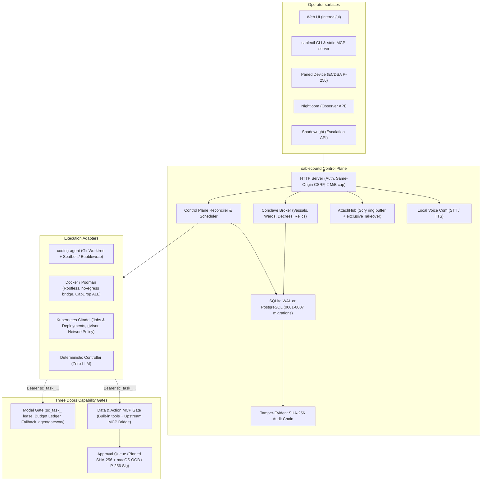

# Sablecourt technical architecture

Sablecourt is a single-binary Go control plane (`sablecourtd`) and operator CLI (`sablectl`) that runs heterogeneous workloads (`coding-agent`, `long-lived-agent`, `deterministic-controller`) and multi-agent `Conclaves` behind deterministic capability gates, cost ceilings, and a tamper-evident SHA-256 audit chain.

## System overview

## Package map

| Package | Responsibility |
| :--- | :--- |
| `cmd/sablecourtd` | HTTP server, operating modes (`sanctum` / `citadel`), auth and CSRF middleware, GitOps manifest watcher, REST/SSE APIs, Prometheus `/metrics`, graceful shutdown |
| `cmd/sablectl` | Operator CLI (`init`, `doctor`, `task`, `conclave`, `approval`, `audit`, `memory`, `pair`, `device`, `voice`, `service`, `tailscale`, `mcp-server`) |
| `internal/config` | YAML manifest parser (`sablecourt.io/v1alpha1`), cross-reference and security zone validator, hot-reload `GitSyncer` |
| `internal/domain` | Core structs for `Workload`, `Policy`, `Budget`, `Workflow`, `Schedule`, `Conclave`, `Task`, `Lease`, `Approval`, `AuditRecord`, `MemoryEntry` |
| `internal/store` | `Store` interface implemented by `internal/store/sqlite` (WAL + FTS5) and `internal/store/postgres` (`pgx/v5`) |
| `internal/secret` | `SecretStore` interface backed by macOS Keychain, encrypted local file, or Kubernetes `0400` volume mount |
| `internal/policy` | Deterministic `allow` / `approve` / `deny` evaluator (fail-closed default `deny`) and failure `CircuitBreaker` |
| `internal/redact` | Linear-time RE2 secret redactor scrubbing API keys, bearer tokens, and private keys before storage or broadcast |
| `internal/gate/model` | HTTP/SSE proxy for OpenAI, Anthropic, Gemini, local endpoints, and upstream `agentgateway`; enforces `sc_task_` leases, budgets, SSRF protection, and `openai <-> local` fallback |
| `internal/gate/mcp` | MCP Streamable HTTP server for allowlisted built-in tools (`conclave.*`, `memory.*`, `sablecourt.*`), closed GitOps actions (`git.create_branch`, `git.open_pr`), and proxied upstream MCP servers |
| `internal/approval` | Pinned SHA-256 approval queue, macOS native `osascript` out-of-band prompt, and ECDSA P-256 device signature verification |
| `internal/conclave` | Multi-agent room broker enforcing `canMessage` graphs, `always-on` vs `on-mention` activation, `Wards` (`maxMessages`, `maxPingPong`, `budgetRef`), operator `Decrees`, and shared `Relics` |
| `internal/attach` | 64 KiB redacted ring buffer (`Scry` SSE streaming) and exclusive operator `stdin` lock (`Takeover`) |
| `internal/runtime/*` | Execution adapters: `coding` (Git worktrees + Seatbelt/Bubblewrap), `docker` (Docker/Podman/OrbStack/Colima/Rancher), `k8s` (hardened Jobs and Deployments), `controller` (zero-LLM) |
| `internal/notify` | Outbound alerts to Slack, Discord, ntfy, or generic webhooks on approvals, Ward pauses, and task failures |
| `internal/voice` | Local-first OpenAI-compatible Whisper STT and Kokoro/Piper/macOS `say` TTS for voice Decrees and Conclave readback |
| `internal/ui` | Server-rendered HTML/HTMX cockpit (`/` dashboard, `/tasks/{id}`, `/conclaves`, `/conclaves/{id}`, `/schedules`, `/audit`, `/memory`, `/providers`, `/studio`) |
| `internal/telemetry` | Prometheus metrics registry (`/metrics`) and structured logging |

## Operating modes: Sanctum and Citadel

| Aspect | Sanctum (`--mode=sanctum`, default) | Citadel (`--mode=citadel`) |
| :--- | :--- | :--- |
| Target host | Personal macOS or Ubuntu workstation | Hardened Kubernetes cluster (`deploy/k8s/overlays/citadel/`) |
| Default bind address | `127.0.0.1:7432` | `0.0.0.0:7432` behind TLS ingress or Tailscale |
| Operator auth | Optional on loopback (same-origin CSRF still enforced) | Fail-closed `--operator-auth-required` (`operator_bearer_token`) |
| Database | Embedded SQLite WAL (`~/.sablecourt/sablecourt.db`) | PostgreSQL (`--postgres-dsn`) |
| Container / sandbox | Auto-discovered Podman, Docker, OrbStack, Colima, Rancher Desktop, plus Seatbelt / Bubblewrap | Kubernetes `batch/v1 Job` and `apps/v1 Deployment` with `RuntimeClassName: gvisor`, `NetworkPolicy`, and `AutomountServiceAccountToken: false` |
| Upstream AI routing | Direct provider keys in Keychain / `0400` file, or local Ollama/vLLM | Optional `--model-gateway-url` fronting Linux Foundation `agentgateway` |

## Request and execution lifecycle

| Stage | Behavior |
| :--- | :--- |
| 1. Manifest load | `sablecourtd` loads local YAML files or syncs a GitOps repository (`--manifests-git-repo`). `validateBundle` rejects any `sandbox`-zone workload that requests mutating GitOps actions, runtime-zone Conclave messaging, or external Agent Card advertisement. |
| 2. Task creation | An operator (UI, CLI, webhook, Schedule, A2A, or Shadewright Escalation API) submits a task with an idempotency key. `sablecourtd` persists the task in `submitted` state. |
| 3. Lease minting | The control plane reconciler mints a scoped task bearer token (`sc_task_<64 hex>`) and stores only its SHA-256 hash in `leases`. Raw provider keys never enter the workload environment. |
| 4. Isolated launch | The matching runtime adapter starts the workload. Local `coding-agent` runs write a read-only `.sablecourt-session.json` marker so Nightloom recognizes the session as Sablecourt-managed. |
| 5. Capability mediation | Model requests hit `/gate/model/{provider}/...` with `Authorization: Bearer sc_task_...` (checked against leases, grants, and budgets). Tool and action requests hit `/gate/mcp` or `/gate/action/{name}` and pass through deterministic policy (`allow`, `approve`, `deny`) and the Approval Queue. |
| 6. Observation and steering | Operators watch live redacted output via `Scry`, claim exclusive `stdin` via `Takeover`, or steer multi-agent rooms via `Decree` (text or voice). |
| 7. Tamper-evident audit | Every state transition, policy decision, approval, and model call is appended to `audit_log` chained with `SHA-256(prev_hash \|\| record \|\| created_at)`. `sablectl audit verify` recomputes the chain from `genesis`. |
