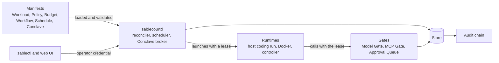

# Concepts

The nouns Sablecourt uses, where each one lives (a manifest, the store, a runtime) and how they connect. Each section says whether the concept is built. The statuses are defined on the [home page](index.md#status-words). Short definitions are in the [glossary](glossary.md).

The daemon (`sablecourtd`) reads manifests, keeps tasks in the store and launches workloads through a runtime. A workload reaches models, tools and approvals through a gate, with a lease the daemon minted for that task. The one exception is council inference, which runs on each harness's own subscription login (see below). The gates run inside the daemon process. The gates, the reconciler, the Conclave broker and the approval queue append most decisions to the audit chain, but not all: an ordinary dispatch of a task is recorded as a task event only. The whole picture is the [system context diagram](how-it-works/index.md).

## Manifests

Status: built.

Declared intent is written as YAML manifests with `apiVersion: sablecourt.io/v1alpha1` and one of six kinds: `Workload`, `Policy`, `Budget`, `Workflow`, `Schedule` and `Conclave`. `sablecourtd --manifests` takes a file or a directory, or `--manifests-git-repo` syncs a Git repository (branch `main`, every 60 seconds by default). Runtime state (tasks, leases, budget entries, approvals, audit rows) is not in the manifests: it is in the store. The loader decodes each document strictly, so an unknown field or kind is an error, and validates the whole bundle before the daemon uses it, so a bad manifest never loads partly. Among other checks it rejects a missing budget, workload or delegation target that a workload, workflow, schedule or Conclave refers to, a workload that breaks the zone and grant rules below, and a Policy whose `defaultEffect` is not `deny`. It does not check that a policy rule names a declared workload. Fields are in the [manifest reference](reference/manifests.md).

## Workload, class and zone

Status: built, except the Kubernetes runtime (built, parked by ADR-0011).

A workload is a unit that Sablecourt may launch. Its `class` is one of three:

- `coding-agent`: a coding CLI harness (`claude`, `codex` or `agy`) in a Git worktree. It needs a `coding` block with the harness and `repoPath`.
- `long-lived-agent`: a stateful agent in a container.
- `deterministic-controller`: a non-model program in a container. The loader refuses a model grant on it.

Its `runtime.type` is `docker` (which needs an image) or `worktree-cli`. Its `zone` is `runtime` or `sandbox`. A sandbox workload cannot hold `actions` or `delegateTo` grants, and the policy engine denies it any `action:` or `delegate:` capability. It also cannot message a runtime-zone Vassal. Moving a workload from sandbox to runtime is a change to its manifest that goes through Git review; `sablectl promote` asks the daemon to create the Git branch `sablecourt/promote-<name>` and does not change the zone. The names `claude`, `codex` and `agy` are reserved for the built-in council panel. See [workloads and runtimes](how-it-works/workloads-and-runtimes.md).

## Grant and policy

Status: built.

A grant on a workload names what it may ask for: the Model Gate (`modelGate.allowed`, `providers`, and a `budgetRef` that is required when the grant is allowed), MCP tools, typed actions and delegation targets. A policy decides each request against those grants. A `Policy` has rules of `workload`, `capability` and `effect` (`allow`, `approve` or `deny`), and its `defaultEffect` must be `deny`. Evaluation is deterministic: a capability the workload has no grant for is denied, an explicit `deny` wins over `approve`, `approve` wins over `allow`, and no matching rule means deny. Capabilities starting with `policy:`, `secret:` or `rbac:` are always denied. Model output never changes any of this (invariant 1). See [tools and actions](how-it-works/tools-and-actions.md).

## Task, state and reconciler

Status: built. Suspend and resume are partly built (#14).

A task is one run of a workload, with an idempotency key and a parent task if it is a child. A task proposed as a child carries a budget ceiling. The launch records a heartbeat, and the reconciler refreshes it from observed runtime state. Its states are `submitted`, `working`, `input-required`, `suspended`, `completed`, `failed` and `cancelled`. The reconciler observes tasks and launches `submitted` ones up to `--max-concurrent` (4 by default); the daemon runs a pass every 2 seconds and recovers running tasks after a restart. A scheduler starts tasks from `Schedule` manifests and workflows run steps in order. See [tasks](how-it-works/tasks.md).

## Lease

Status: built.

A lease is the identity a workload holds: a bearer token `sc_task_` plus 64 hex characters, bound to one task and workload. The store keeps only its SHA-256 hash. It lasts one hour (shorter near a council deadline) and is revoked when the task ends or is suspended. The workload never holds a provider key, a Git credential or the operator token (invariant 2); the one exception is in ADR-0011, below.

## Gates and approvals

Status: Model Gate and MCP Gate built, with known faults tracked in #8 and #9. Approval Queue partly built (device pairing disabled, no single-use claim yet).

The Model Gate forwards inference to a provider with the key it holds, after checking the lease, the grant and the budget. The Data and Action Gate, called the MCP Gate in this documentation, serves allowed tools over MCP and runs the closed set of typed actions after policy. An action whose effect is `approve` goes to the Approval Queue: the task waits in `input-required`, the payload is pinned by a SHA-256 digest, and a person confirms through a native macOS dialog. Approving needs the native dialog, which exists on macOS only, and fails closed elsewhere. Denying needs no dialog. See [model gate](how-it-works/model-gate.md) and [approvals](how-it-works/approvals.md). ADR-0004 calls the gates the Three Doors.

## Budget

Status: built (faults in #8).

A `Budget` has per-task limits (`maxInputTokens`, `maxOutputTokens`, `maxCostUSD`) and a daily `maxCostUSD`, and at least one limit must be positive. The Model Gate reserves an estimate of tokens and cost from the request before forwarding it. It settles with the usage the provider reports, or with the reserved estimate when a successful response reports none. It releases the reservation when the upstream status is not 2xx. A task proposed as a child carries its own ceiling of the three per-task limits, which the Model Gate checks as well, and a child without a valid ceiling is denied. The daily limit is counted per workload. Inference that a subscription harness runs on its own login is outside this accounting (ADR-0011).

## Conclave and the terms around it

Status: built. Voice and live Takeover are parked.

A Conclave is a room where several workloads, called Vassals, work on one topic. Each Vassal has a `role`, a `workload`, an `activation` and a `canMessage` list. An `always-on` Vassal is launched once when the room opens; an `on-mention` Vassal is launched when another member addresses it. Wards are limits: `maxRuns`, `maxMessages` and `maxPingPong` (the last two default to twice the number of Vassals when unset, `maxRuns` to 6 and never above 6), plus the budget in `spec.budgetRef`. A tripped Ward moves the room to `input-required`. The operator steers with a Decree, and Vassals and the operator share named, redacted Relics. A room is `active`, `input-required`, `completed` or `cancelled`. See [Conclaves](how-it-works/conclaves.md).

## Council and harness

Status: partly built (#28, #36, #80 open).

A council is a Conclave of the harnesses `claude`, `codex` and `agy` (all three by default, a subset with `--with`) that answer one question in bounded rounds (two by default, `--rounds`). `sablectl council` opens it through the daemon. A harness is the coding CLI itself. In Sanctum a council turn runs in its own container when a Docker engine is configured, on a login the user made once inside that harness's container. See [council](how-it-works/council.md) and [harness containers](how-it-works/harness-containers.md).

## Court Memory, context packet and learning

Status: Court Memory and context packets built. Learning partly built.

Court Memory is a key-value store in the store, shown on `/memory`, with MCP tools `memory.get`, `memory.put`, `memory.search` and `memory.delete`. Before a task starts, the daemon assembles a redacted context packet, except for tasks of a deterministic controller, which get none. Optional sections are dropped to keep it within 32 KiB; the required sections stay whole and can take it past that size. A learning is a rule the operator wants future runs to follow. Today matching entries from `learning:*` memory namespaces enter packets. The dedicated record of ADR-0012 (states `proposed`, `accepted`, `retired`, a 90-day review clock) exists in the SQLite store, but nothing proposes, accepts or injects through it yet (#43 to #47). See [context and learning](how-it-works/context-and-learning.md).

## Audit chain

Status: built, with limits. Signed heads are decided only.

Each audit row written now stores the hash of the previous row, anchored at the word `genesis`. `sablectl audit verify` asks the daemon, which has the store recompute the chain over all rows. Verification skips rows without a hash (older rows) and cannot see deletion of the last rows (#10); ADR-0009 claims more than this, and the code is what is described here. See [audit](how-it-works/audit.md).

## Mode

Status: Sanctum built. Citadel built, parked.

`--mode` is `sanctum` (the default: one user, loopback `127.0.0.1:7432`, SQLite) or `citadel` (Kubernetes runtime, listen address `0.0.0.0:7432`, PostgreSQL when `SABLECOURT_POSTGRES_DSN` is set, SQLite otherwise). `local` and `enterprise` are aliases. In Citadel mode the host coding adapter and councils are off. ADR-0011 limits current work to Sanctum; see the [overview](overview.md#parked-parts).

## Not built yet

- Learning acceptance, scoped matching and injection through the ADR-0012 record (decided in [ADR-0012](adr/0012-learning-evidence-and-expiry.md), not built).
- Passkeys, server-side sessions and roles (decided in [ADR-0014](adr/0014-identity-and-authentication.md), Proposed, not built).
- Signed audit heads (ADR-0014 Stage 3, Proposed).

## In depth

- [ADR-0002](adr/0002-heterogeneous-mvp-workload-adapters.md), [ADR-0004](adr/0004-in-house-capability-gates-three-doors.md), [ADR-0006](adr/0006-hub-and-spoke-a2a-task-envelope.md), [ADR-0008](adr/0008-conclaves-wards-and-live-attach.md), [ADR-0010](adr/0010-agentic-context-learnings-and-verification-pipeline.md), [ADR-0013](adr/0013-bounded-council-rounds.md)
- Code: `internal/domain/types.go`, `internal/config/loader.go`, `internal/policy/policy.go`
