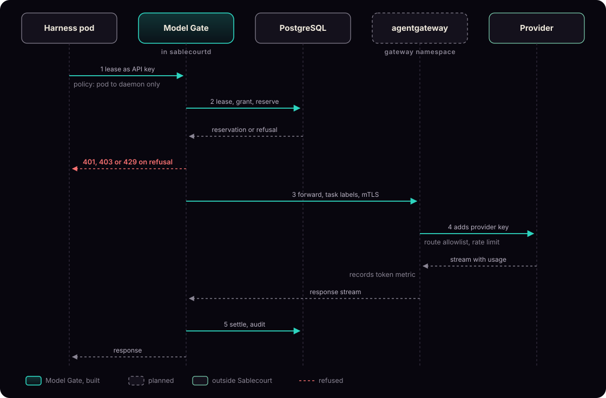
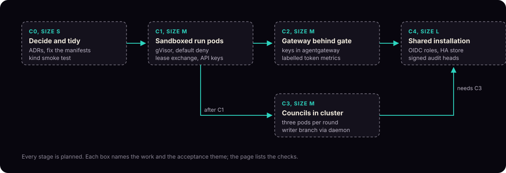

# Kubernetes model (Citadel)

> **Status: planned.** Nothing on this page is built unless a sentence says so. Citadel and the Kubernetes runtime are parked by [ADR-0011](../adr/0011-sanctum-scope-trust-and-cli-harnesses.md). This page is a design for discussion. It decides nothing; the decisions it needs are listed under [Open decisions](#open-decisions) and [New ADRs this would need](#new-adrs-this-would-need).

Sablecourt runs today in Sanctum, the single-machine mode: one daemon on a workstation, SQLite, harness containers on the local container engine. This page describes how the same product would run in a Kubernetes cluster (Citadel): where the daemon goes, how a harness runs in a sandboxed pod, what an agent gateway takes over from the Model Gate and what it cannot take over, how the network and identities work, and how usage becomes a signal another tool can turn into cost. Facts about outside projects were read on 2026-11-25; the [sources](#sources) list gives each page with the version it describes.

## What exists today

Some Kubernetes code is in the tree. It is parked, has two unit tests against a fake client, and has never run against a cluster in CI. Every sentence in this section describes code on `main`.

### The daemon in Citadel mode

`sablecourtd --mode=citadel` (alias `enterprise`) changes these things in [cmd/sablecourtd/main.go](../../cmd/sablecourtd/main.go):

- It selects the Kubernetes runtime when `--runtime` is empty or `docker`, and listens on `0.0.0.0:7432` instead of `127.0.0.1:7432` when the listen address was left at its default.
- It registers no host coding adapter and disables councils, so `claude`, `codex` and `agy` cannot run in Citadel at all.
- It configures no out-of-band approver. `Queue.Approve` then fails with "no out-of-band approver configured", and device pairing returns 503, so no approval can be granted in Citadel today: every `approve`-gated action stays blocked. This fails closed, but it also means Citadel cannot run a workflow that needs an approval.
- It logs a warning when it runs on SQLite instead of PostgreSQL.
- Operator authentication is always required in every mode; the `--operator-auth-required` flag is deprecated and ignored.

With `--runtime=k8s` the Kubernetes adapter handles the `long-lived-agent` class and, wrapped by the controller adapter, the `deterministic-controller` class. It reads `--kubeconfig`, or the in-cluster configuration, or the default kubeconfig rules. If it cannot build a client it logs a warning and those classes have no adapter.

The Model Gate takes `--model-gateway-url` (or `SABLECOURT_MODEL_GATEWAY_URL`). When it is set, [internal/gate/model/gate.go](../../internal/gate/model/gate.go) replaces the base URL of every provider with that one URL and stops requiring a provider key; it still attaches a key when one is in its secret store. The provider prefix is dropped from the forwarded path, so the gateway receives `/v1/messages`, `/v1/responses` or `/v1beta/models/...` with no other hint of which provider was meant.

### The Kubernetes adapter

[internal/runtime/k8s/k8s.go](../../internal/runtime/k8s/k8s.go) turns a launch into a `batch/v1` Job named `sc-<task id>` in one namespace (`--k8s-namespace`, default `default`):

| Area | What the adapter sets |
| --- | --- |
| Job | `backoffLimit: 0`, `ttlSecondsAfterFinished: 3600`, `restartPolicy: Never` |
| Pod security | `automountServiceAccountToken: false`, `runAsNonRoot`, seccomp `RuntimeDefault` |
| Container `workload` | image from `runtime.image` (required), `allowPrivilegeEscalation: false`, all capabilities dropped, `readOnlyRootFilesystem` from the workload's `readOnlyRootfs` |
| Sandbox | `runtimeClassName` only when `--k8s-runtime-class` is set; with the flag empty the pod runs under the node's default runtime |
| Environment | `SABLECOURT_MANAGED`, `SABLECOURT_TASK_ID`, `SABLECOURT_WORKLOAD`, `SABLECOURT_INPUT_JSON`, `SABLECOURT_DATA_GATE_URL`, `SABLECOURT_TASK_TOKEN` (the lease) and, with a model grant, `SABLECOURT_MODEL_GATE_URL` |
| Labels | `app.kubernetes.io/managed-by: sablecourt`, `sablecourt.io/workload`, `sablecourt.io/zone`; the Job (not the pod) also carries `sablecourt.io/task-id` |
| Not set | resource requests or limits, volumes, a named service account, `activeDeadlineSeconds` |

`Observe` reads only the Job status: succeeded means completed, failed means failed with exit code 1, `suspend` means suspended, anything else is running. It reads no heartbeat from the pod. `Suspend` and `Resume` flip `spec.suspend`, `Stop` deletes the Job with background propagation, and `CollectArtifacts` returns nothing. When live attach is wired, the adapter waits up to 60 seconds for the pod to leave `Pending`, then attaches to stdin, stdout and stderr over SPDY or falls back to following the logs, for at most 30 minutes.

The adapter also has a branch that creates a `Deployment` for `runtime.type` `k8s-deployment` (or `deployment` for a non-coding class). It cannot be reached: the manifest loader accepts only `docker` and `worktree-cli`, and the Role in `deploy/k8s` grants nothing on Deployments.

The lease travels as an environment variable, so it is stored in the Job object and anyone who can read Jobs or pods in that namespace can read it. [ADR-0014](../adr/0014-identity-and-authentication.md) already plans to move leases into `0400` files.

### The manifests in `deploy/k8s`

- `base/`: a `sablecourt` namespace with Pod Security `restricted` enforced; a `sablecourtd` service account with a Role over Jobs, pods, `pods/log` and `pods/attach` and no access to Secrets; one Deployment replica with the `Recreate` strategy, SQLite on a 1 GiB `ReadWriteOnce` claim, the secret file mounted `0400`, an optional PostgreSQL DSN, and the image `ghcr.io/shadewright-labs/sablecourtd:0.1.0`; a NetworkPolicy `workloads-gate-only-egress` that lets pods labelled `managed-by: sablecourt` send only to the daemon on TCP 7432 and to cluster DNS on UDP 53, with no ingress allowed.
- `overlays/tailscale` and `overlays/public` expose the daemon through the Tailscale operator or a public ingress with cert-manager.
- `overlays/citadel` adds `--mode=citadel`, `--k8s-runtime-class=gvisor`, `--model-gateway-url=http://agentgateway.sablecourt.svc:3000`, a PodDisruptionBudget and an `agentgateway` Deployment.

Defects a Citadel slice would have to fix first:

- The `agentgateway` image is `:latest`, not pinned, and the Deployment mounts no configuration, so it starts with no routes and no provider keys.
- The PodDisruptionBudget asks for `minAvailable: 1` on a single replica, which blocks every voluntary eviction, including node drains.
- The NetworkPolicy does not select the daemon pod, so the daemon's egress is open. It also leaves DNS over TCP blocked, which breaks large DNS answers.
- Run pods reach the daemon on the same listener that serves operator routes (`/api/v1/*`, `/login`); the NetworkPolicy cannot tell them apart.
- One replica only: the session signing key is random per process, there is no leader election, and SQLite sits on a `ReadWriteOnce` volume.
- The PostgreSQL store has migrations up to `0010_budget_reservations.sql` but none of the council and learning migrations that SQLite has (`0010` to `0013`).

## Goals and non-goals

Goals:

- Run the council and coding tasks for a team in a cluster, with every invariant in [AGENTS.md](../../AGENTS.md) intact and no exception that Sanctum does not already have.
- Treat a harness pod as hostile: a sandbox runtime between it and the node, no route to the internet, no provider or Git credential, one short lease.
- Use what the ecosystem ships for routing, provider keys, sandboxing and telemetry, and keep in Sablecourt only the checks a generic component cannot make.
- Emit usage with labels that let another tool compute cost per team.

Non-goals:

- A multi-tenant daemon. ADR-0014 already says shared installations run one `sablecourtd` per team.
- Cost reporting. Sablecourt emits usage; Nightloom, the organisation's cost watch tool, reads it.
- Self-hosted model serving. The [Gateway API inference extension](#sources) routes to model servers inside the cluster (InferencePool is `v1`), which is a different problem from calling hosted providers. It becomes relevant only if a team runs its own models.
- Subscription logins in the cluster (see [The login problem](#the-login-problem)).
- A Sablecourt operator with its own CRDs for runtime state.

## The target picture

The picture has four namespaces, each its own trust zone:

- Control namespace. `sablecourtd` keeps every role it has in Sanctum: reconciler, Model Gate, MCP Gate, approval queue, audit chain, web UI and API. People reach it through an ingress with an OIDC session (ADR-0014 Stage 3); it verifies ID tokens with the identity provider, stores state in PostgreSQL, opens pull requests on the Git host and asks the Kubernetes API to create Jobs. It is the only component that talks to the Kubernetes API.
- Run namespace. One Job per harness launch. Every pod runs under a sandbox runtime class (gVisor by default), holds a lease file and a checkout, holds no provider or Git key, and makes lease calls only to the daemon's gate listener. A namespace-wide NetworkPolicy denies everything else, including the internet.
- Gateway namespace. `agentgateway` holds the provider keys, routes to providers and records token usage. It accepts calls only from the daemon.
- Monitoring namespace. A metrics store (Prometheus or an OpenTelemetry collector) scrapes the gateway and the daemon. Nightloom reads the labelled usage from there.

### CRDs or not

Recommendation: no Sablecourt CRDs for tasks, leases, budgets, approvals or audit. They stay in PostgreSQL.

- A budget reservation, a lease check and an audit append happen in one transaction today ([internal/store](../../internal/store)). Spread over CRDs, that becomes several objects with optimistic concurrency and no transaction.
- Leases are stored as hashes and checked online on every gate call (ADR-0014 rejects self-contained tokens for this reason). etcd is a poor place for a credential table that every cluster administrator with read access to the CRD can list.
- Task and audit rows are high churn and append-only. CRDs would add watch traffic and object-count pressure on the API server for no reader that needs them.

Declared intent (`Workload`, `Policy`, `Budget`, `Conclave`) stays as files from Git, mounted from a ConfigMap that Flux or Argo CD applies, as `deploy/k8s` does today. The alternative is to publish those kinds as CRDs, so `kubectl apply` and GitOps health checks work on them directly. That costs a controller-runtime dependency, admission validation, and a second source of truth during migration. It is listed as an open decision; nothing in this design depends on it.

Runtime objects are another matter. Using someone else's CRD for the sandbox (agent-sandbox `Sandbox`) is fine: Sablecourt creates and deletes them as it creates Jobs now.

### Where the daemon's roles go

Recommendation: one binary and one Deployment in the first stages, with one active replica. Two splits are worth their cost later (stage C4):

- A Git executor Deployment with its own service account holds the Git App key and runs the typed Git actions. The daemon that faces untrusted pods then holds no Git credential, which serves invariant 4 (separate identities for mutating executors).
- Gate replicas: the Model Gate and MCP Gate scale out behind a Service while the reconciler stays single-active with a Kubernetes `Lease` for leader election. This needs server-side sessions (ADR-0014 Stage 1) and PostgreSQL before a second replica can exist.

### The store

PostgreSQL is required in Citadel; SQLite on a `ReadWriteOnce` volume cannot move between nodes without downtime and cannot serve two replicas. The PostgreSQL store needs the council and learning migrations before councils can run (stage C3). Whether to run it with an operator such as CloudNativePG or as a managed database is the installer's choice and out of scope here. The audit chain head needs a serialized append (a row lock or advisory lock), which ADR-0014 Stage 0 asks for on SQLite as well.

## Harness pods

### Image per harness

One image per harness (`claude`, `codex`, `agy`), built from a pinned base, referenced by digest, never by tag. In Sanctum the images are built locally by `sablectl harness build` ([internal/harnessimages](../../internal/harnessimages)). In a cluster they must come from a registry, which raises a licensing question for the CLI binaries inside: the recommendation is that Sablecourt publishes the Dockerfiles and a build command, and each installation builds and pushes the images to its own registry. Each image states in a label what it can reach (network, loopback, Docker, Git metadata), because the [harness notes](../harnesses.md) and later runs showed that the same task succeeds or silently degrades depending on that.

### The login problem

The three CLIs are built for one person's subscription login: an interactive device or browser flow that leaves a refresh token in the CLI's state directory. ADR-0011 allows that in Sanctum as a narrow exception to invariant 2, with one login volume per harness on the user's own machine. In a cluster the honest options are:

| Option | What it means | Cost |
| --- | --- | --- |
| A. API keys through the Model Gate (recommended) | The CLI's base URL points at the Model Gate and its "API key" is the lease. The real key sits in the gateway. | Per-token API pricing instead of a flat subscription. Every call is budgeted, audited and labelled. |
| B. Subscription login volumes as PVCs | Copy the Sanctum model: one PersistentVolume per person and harness holding the refresh token. | Widens the invariant 2 exception into a shared cluster. Anyone who can create pods in the namespace can mount the volume. One person's seat serves a team, which provider terms may forbid. Usage is invisible to the Model Gate. |
| C. Forward a person's OAuth token per run | Pass `CLAUDE_CODE_OAUTH_TOKEN` or similar into the pod. | A raw provider credential inside a hostile pod. Refused by invariant 2. |

ADR-0014 already states that subscription logins stay Sanctum-only and that shared installations route inference through the Model Gate or an upstream gateway; its open question 2 asks for that to be confirmed as a product decision. This design assumes option A.

Option A fits the Model Gate as built. It serves `/gate/model/anthropic/v1/messages`, `/gate/model/openai/v1/chat/completions`, `/gate/model/openai/v1/responses` and the Gemini `generateContent` and `streamGenerateContent` paths, and it accepts the lease as `Authorization: Bearer`, `x-api-key` or `x-goog-api-key`, stripping all three before it forwards. What has not been tested, per CLI and pinned version:

- whether `claude`, `codex` and `agy` accept a custom base URL with an API key and run headless with nothing else;
- which other endpoints they call (token counting, model lists, `codex`'s WebSocket transport, the plugin clone from `github.com` and the `play.googleapis.com` call seen on startup in the harness spike), all of which the Model Gate or the network policy would refuse;
- whether an organisation's API key is accepted at all: one CLI refused the key of an organisation enrolled in a monthly credits programme during internal runs, so paid use had to go through plain API calls.

Each of these is a stage C1 acceptance check, and a CLI that fails one runs only in Sanctum.

### Sandbox runtime class

| Choice | State on 2026-11-25 | Fit |
| --- | --- | --- |
| gVisor (`runsc`), recommended default | Weekly releases, latest `release-20261123.0`. The `systrap` platform is the default and needs no nested virtualisation. GKE Sandbox offers it as RuntimeClass `gvisor` on Standard and Autopilot. | User-space kernel and network stack. Implements a subset of syscalls; iptables support is partial; resource limits are not enforced inside the sandbox, so limits come from the pod; GKE Sandbox refuses privileged pods and hostPath. A harness needs none of those. |
| Kata Containers | 4.4.0 (2026-11-17), needs containerd 2.3 or newer, nested virtualisation or bare metal. AKS Pod Sandboxing `kata-vm-isolation` is GA; v2 is in preview. | A VM per pod. Higher memory overhead (AKS lists 600 MiB fixed for v1, 32 MiB for v2). The choice where gVisor is not offered, such as AKS. |
| runc with seccomp only | Always available. | No kernel boundary between untrusted code and the node. Not acceptable for harness pods. |

RuntimeClass itself is stable since Kubernetes 1.20 and its pod overhead field since 1.24; its `scheduling` field is still beta. The daemon should refuse to launch a harness when the configured RuntimeClass does not exist or is empty. Today the flag is optional and an empty value runs the pod under the default runtime.

kubernetes-sigs `agent-sandbox` adds `Sandbox`, `SandboxTemplate`, `SandboxClaim` and `SandboxWarmPool` on top of a RuntimeClass. Version 1.0.12 shipped on 2026-11-20, but the API is `v1beta1`: the 1.x number does not mean a stable API. Recommendation: plain Jobs through the existing adapter in stages C1 to C3, and agent-sandbox in C4 if warm pools are needed to cut start latency, once its API reaches `v1`. Its cost is one more controller to install and trust.

### What each CLI needs

The workspace notes record what each CLI needed in real runs. In a pod:

| Need | In the pod |
| --- | --- |
| Network | Only the daemon's gate listener. No internet, no DNS (see [Network model](#network-model)). |
| Loopback sockets | Available: gVisor gives each pod its own network stack with loopback, so tests that open a local listener run. This is better than the host sandboxes of `codex` and `agy`, which blocked loopback. |
| Docker | Not available. Running Docker inside gVisor needs privileges the pod does not get. Tests that need Docker or a cluster (envtest, kind) run in a separate deterministic workload class with its own image, never in the harness pod. |
| Git writes | The harness commits to its own clone in the pod's scratch volume. It cannot push: the daemon fetches the result and creates the branch through the typed Git actions, so no Git credential reaches the pod. |
| Quotas | No subscription quota to watch. Every call is metered by the Model Gate against a `Budget`. |

### Checkout delivery

| Option | Cost |
| --- | --- |
| Init container clones from the Git host | Needs a Git credential in the pod. Refused by invariant 2. |
| Shared `ReadWriteMany` volume with the daemon's worktrees | Needs RWX storage, and every pod on the volume sees every other checkout. |
| The daemon serves a `git bundle` of the pinned commit (recommended) | The init container fetches the bundle over a lease-authenticated gate route into an `emptyDir` and verifies the commit ID. No credential, the commit is pinned, and the size can be capped. |

The writer in a council returns its work the same way in reverse: it uploads a bundle or patch through a gate route with its lease, and the daemon pushes the branch and opens the pull request. Reviewers get the read-only bundle only.

### Resource limits

Every container gets CPU, memory and `ephemeral-storage` requests and limits, set from the workload manifest with defaults. The Job gets `activeDeadlineSeconds` from the task or council deadline, so the kubelet kills a run the daemon has lost track of. The scratch volume is an `emptyDir` with a `sizeLimit`; the lease volume is an `emptyDir` with `medium: Memory`. The RuntimeClass overhead (Kata's in particular) counts against node capacity and must be in the scheduler's numbers.

## The agent gateway

### What it is

agentgateway is a Linux Foundation project, not in the CNCF. Version 1.7.0 shipped on 2026-10-27 with about one minor release a month. It proxies LLM providers (OpenAI, Anthropic, Gemini, Bedrock and others, converting between request formats), MCP and A2A. On Kubernetes it has its own controller that serves configuration to the proxies over xDS from Gateway API resources plus `AgentgatewayPolicy` and `AgentgatewayBackend`; its 1.7 support matrix lists Kubernetes 1.32 to 1.37 and Gateway API 1.4 to 1.6. kgateway (CNCF Sandbox, 2.5.2) used to host that controller; since kgateway 2.3 the agentgateway control plane lives in the agentgateway repository and kgateway is Envoy only, so this design needs agentgateway alone.

What it gives for free:

- Provider keys held outside every Sablecourt pod: a backend `secretRef` reads the key from a Secret in the gateway's namespace and sets it on the upstream request.
- Routing, format conversion and provider failover.
- Request and token rate limits and token budgets per key, user or header, and USD cost from a model catalog (1.7).
- Token usage metrics on `/metrics` (port 15020) and OpenTelemetry traces and logs.
- Authorization in CEL over headers, JWT claims, source and MCP tool names, JWT authentication, and external authorization over gRPC.

### Placement: behind the Model Gate

Recommendation: the gateway sits behind the Model Gate. The harness pod calls the Model Gate; the Model Gate checks, reserves and forwards to the gateway; the gateway adds the key and calls the provider. The forwarding exists today as `--model-gateway-url`. The strategy notes already describe the Model Gate "fronting" agentgateway.

The checks at each hop of one request:

1. Harness pod to Model Gate. NetworkPolicy lets the pod reach only the gate listener. The pod sends its lease as the API key.
2. Model Gate. It checks the lease (hash lookup, task running, not expired), the workload's model grant and provider, and reserves budget in PostgreSQL in one transaction. Any failure returns 403 and nothing leaves the daemon. All of this is built.
3. Model Gate to gateway. The Model Gate forwards with headers that name the team, workload, zone and task, and proves its own identity (see [Identity](#identity)). The gateway's NetworkPolicy admits only the daemon.
4. Gateway to provider. The gateway checks its route allowlist and rate limit, adds the provider key and calls the provider. Its egress reaches only the provider hosts.
5. Back. The provider streams the answer with usage. The gateway records its token metric and streams to the Model Gate, which parses usage as it does today, settles the reservation, writes the audit record and streams to the pod.

The alternative puts the gateway in front: pods call agentgateway directly, and agentgateway asks Sablecourt through external authorization whether to admit each request. That takes streaming traffic off the daemon, but external authorization runs only before the request. The Model Gate would see the reservation and never the actual usage, so settlement would depend on reading the gateway's logs or metrics afterwards, and a budget could overrun by whatever was in flight. It would also need a gRPC external authorization server in Sablecourt (new dependencies) and would put the lease in front of a component that does not store it. The gateway's own token limits do not close the gap: its documentation says a streamed response cannot be stopped mid-stream, so a token limit applies only to later requests. This alternative is an open decision for when traffic volume makes the daemon a bottleneck.

### What stays in Sablecourt

A generic gateway cannot make these checks, because the facts they need live only in Sablecourt's store:

- Task lease. Is this caller a running task attempt, is the lease unexpired and unrevoked (stop, retry, Ward trip, circuit breaker)?
- Budget reservation and settlement. A per-task and per-day budget reserved before the call and settled after it, with child tasks refused at or past their ceiling.
- Approval digest. An action that needs approval runs only against an approval whose SHA-256 payload digest matches and that a person proved out of band.
- The MCP Gate as a whole: tool filtering by grant, policy (`allow`, `approve`, `deny`, default deny), the typed action catalog, the circuit breaker and redaction at the boundary. agentgateway can federate MCP servers and authorise tool calls in CEL, but it has no approval queue, no action catalog and no redaction that matches Sablecourt's. If the parked upstream MCP bridge returns, the gateway can sit behind the MCP Gate as it does behind the Model Gate.
- The council proxy. In a cluster it has no job left: the run pod needs no provider hosts (option A), so the NetworkPolicy and the gate listener replace the per-launch proxy container and its internal network.

### Changes the Model Gate needs for this

- Keep the provider in the forwarded path (for example `/anthropic/v1/messages`), so one gateway listener can route each provider; today the prefix is dropped.
- Never hold provider keys in Citadel: refuse to start with a provider key in the secret store when a gateway URL is set, so the "key still attached when present" fallback cannot apply.
- Send the label headers and the daemon's identity on every forwarded request.

## Network model

| From | To | Rule |
| --- | --- | --- |
| Run pod | Daemon gate listener (TCP) | Allowed, by a namespace NetworkPolicy |
| Run pod | Cluster DNS | Denied. The gate address is passed as a Service IP, because a resolver that forwards external names is a channel out of the pod. |
| Run pod | Anything else, including other run pods, the Kubernetes API and the internet | Denied (default deny for ingress and egress) |
| Daemon | PostgreSQL, Kubernetes API, gateway, Git host, identity provider | Allowed, by a NetworkPolicy on the daemon (today the daemon has none) |
| Gateway | Provider hosts on 443 | Allowed only from the gateway pods |
| Metrics store | Gateway and daemon metrics ports | Allowed |

Two changes on the daemon side make this enforceable:

- A separate gate listener in Citadel serving only `/gate/*` and the checkout bundle routes, on its own port. The NetworkPolicy then admits run pods to that port only, and the operator routes are unreachable from a run pod even with a stolen session.
- A preflight canary: before the first launch, and periodically, the daemon starts a pod in the run namespace that tries to reach an outside address and a second run pod. If either succeeds, it refuses harness launches. Kubernetes accepts NetworkPolicy objects even when the CNI does not enforce them, so the objects alone prove nothing (invariant 5).

Per-launch egress allowlists. Core NetworkPolicy matches IPs and labels, not names; the Kubernetes documentation for 1.37 lists no FQDN support. Name-based egress needs a specific CNI or mesh:

| Option | State on 2026-11-25 |
| --- | --- |
| Cilium `toFQDNs` | Cilium 1.20.5. Needs a companion DNS rule so its proxy learns the addresses. The egress gateway feature needs kube-proxy replacement. |
| Calico | DNS policy is in the commercial editions only; Calico Open Source does not support domain names in policy. |
| Istio egress gateway | Istio's own docs say it cannot securely enforce that traffic goes through the gateway, so a NetworkPolicy is still needed. |
| ClusterNetworkPolicy (network-policy-api) | Release 0.3.1 (2026-11-19) carries `v1beta1`; FQDN egress (NPEP-133) is experimental. |

Recommendation: in option A, harness pods need no outside name at all, so the default is no egress beyond the gate listener. A workload that needs a package registry gets an in-cluster pull-through cache, reached by label. The daemon creates a per-launch NetworkPolicy (selecting the pod by its task label) only for that, and FQDN rules are an optional capability on Cilium: a workload that asks for one is refused at launch when the cluster cannot enforce it. The gateway's own egress to provider hosts is the one place where FQDN rules or a fixed egress IP are worth requiring.

## Identity

The model follows [ADR-0014](../adr/0014-identity-and-authentication.md), which is Proposed. Its stages carry over; the cluster changes how callers prove who they are, not what a principal may do.

### People

ADR-0014 Stage 3: one `sablecourtd` per team, OIDC sign-in (Microsoft Entra ID first), `viewer`, `operator` and `approver` from `RoleBinding` manifests, principals as `oidc:<issuer>:<subject>`. Approvals need fresh proof over the approval ID and payload digest from a user-verified passkey or a paired device (Stage 1). Until that lands, Citadel cannot approve anything, as it cannot today. This design adds nothing to the human side.

### Machines

- Run pods get a lease through an exchange instead of an environment variable. The pod has a projected service account token with audience `sablecourt` and the minimum lifetime (Kubernetes requires at least 10 minutes), mounted only into an init container. The init container sends it to a gate route; the daemon validates it with the TokenReview API at an endpoint and CA from its own configuration, checks the returned audience, the service account and the pod name and UID (bound pod claims have been GA since Kubernetes 1.32), checks that the pod belongs to the Job it created for this task attempt, refuses a second exchange for the same pod, and returns the lease into the memory-backed lease volume. The harness container never mounts the service account token and receives no environment variable with a secret. The run service account has no RBAC. The daemon needs permission to create TokenReviews, which is a cluster-scoped grant (`system:auth-delegator`) and must be stated in the install.
- Leases are those of ADR-0014: `sc_task_` tokens stored as hashes, a 15-minute rolling window renewed on heartbeats, revoked on stop, retry, failure or a tripped breaker, and bound to a channel. In the cluster the channel is the pod UID verified at exchange plus the NetworkPolicy that admits only run pods to the gate listener. A copied lease used from another pod in the run namespace is still accepted in this first version; closing that needs a per-call proof (next item).
- Channel binding, later. Kubernetes 1.37 made pod certificates (`PodCertificateRequest`, KEP-4317) and `ClusterTrustBundle` GA. A pod could then present a kubelet-issued certificate on every gate call, and the daemon would bind the lease to it. That replaces ADR-0014 Stage 2's daemon-run CA inside a cluster, at the cost of writing a signer and requiring Kubernetes 1.37. Open decision.
- The daemon toward the gateway presents its own projected token (audience `agentgateway`) as a JWT; agentgateway's JWT authentication validates it against the cluster issuer's keys, and the gateway NetworkPolicy admits only the daemon. No shared secret. Whether agentgateway's JWT provider works with the cluster issuer's discovery document is a stage C2 check.
- Integrations (Shadewright, Nightloom) use ADR-0014 Stage 3's `TrustPolicy`: their own projected tokens, verified by TokenReview.

SPIFFE is a CNCF graduated project and SPIRE 1.16.0 shipped on 2026-11-05, but ADR-0014 rejects SPIRE as too heavy for Sanctum and a duplicate of bound service account tokens in Citadel. Nothing here needs it.

## Audit in a cluster

- The chain lives in PostgreSQL with a serialized head. Every launch record names the pod UID, node, RuntimeClass, image digest and the checkout commit, so a reader can tell what ran where.
- Authentication allows and denials (lease exchange included) are `auth` records, as ADR-0014 specifies.
- The Kubernetes API audit log records what the daemon's service account did (Job creates and deletes, TokenReviews). It belongs to the cluster administrator and is not part of Sablecourt's chain; the two correlate by task label and pod UID.
- The gateway's access log and trace spans carry the task ID as an attribute (agentgateway can add CEL-computed attributes to logs and spans), so a provider call can be traced back to an audit row.
- Signed chain heads exported to storage outside the database (ADR-0014 Stage 3) are required in Citadel, because a database administrator in a cluster is not the person who reads the chain. Until then, deleting the last rows is not detected, as in Sanctum.

## Cost and usage signals

Cost reporting is not Sablecourt's job. Sablecourt emits usage with labels; Nightloom, the organisation's cost watch tool, reads those metrics and turns them into cost per team. OpenCost (CNCF incubating, 1.121.5) is the matching tool for the compute side: it allocates pod cost by label (`aggregate=label:...`), and it can take outside spend through plugins (OpenAI, Datadog and MongoDB Atlas are listed; no Anthropic plugin is). Run pods therefore carry the same team and workload labels as the metrics.

### Label set

Sablecourt would emit these on every forwarded model request (as headers to the gateway) and on every run pod (as Kubernetes labels):

| Label | Value | Metric label | Pod label |
| --- | --- | --- | --- |
| `sablecourt_installation` | name of the daemon installation (one per team) | yes | `sablecourt.io/installation` |
| `sablecourt_team` | team that owns the budget; a new manifest field | yes | `sablecourt.io/team` |
| `sablecourt_workload` | workload name | yes | `sablecourt.io/workload` (exists) |
| `sablecourt_zone` | `runtime` or `sandbox` | yes | `sablecourt.io/zone` (exists) |
| `sablecourt_class` | workload class | yes | `sablecourt.io/class` |
| `sablecourt_harness` | `claude`, `codex`, `agy` or empty | yes | `sablecourt.io/harness` |
| `gen_ai.provider.name`, `gen_ai.request.model`, `gen_ai.response.model`, `gen_ai.operation.name` | from the request and response | yes | no |
| task ID, council ID, round, attempt | identifiers | no: span and log attributes only | `sablecourt.io/task-id` |

Task, council and attempt identifiers are not metric labels. Each task would create its own time series, and series counts would grow without bound; they belong on traces and access logs, where the cost per task can still be found.

### Where the numbers come from

agentgateway 1.7 exports `agentgateway_gen_ai_client_token_usage` (a histogram) and `agentgateway_gen_ai_client_cost_usd_total`, labelled with `gen_ai_token_type`, `gen_ai_operation_name`, `gen_ai_system`, `gen_ai_request_model` and `gen_ai_response_model`. Its documentation shows a `user_id` label when virtual keys with per-user limits are configured, but it does not document turning arbitrary request headers into metric labels. Two consequences:

- Whether the gateway's metrics can carry the team and workload labels is a stage C2 check. If they cannot, the Model Gate emits its own labelled counters. It already parses usage for settlement, so this is the more reliable source in any case; the gateway metrics then serve as a cross-check, and their totals must match the Model Gate's settled usage over a test run.
- The OpenTelemetry names are moving. The GenAI conventions left the main repository and had their first release in their own repository, semantic-conventions-genai 0.1.0, on 2026-11-21, still at Development status. That release replaces `gen_ai.client.token.usage` and `gen_ai.token.type` with `gen_ai.client.inference.operation.input_tokens` and `...output_tokens` histograms and `gen_ai.client.inference.usage.*` counters, and core conventions 1.45.0 deprecate `gen_ai.system` in favour of `gen_ai.provider.name`. agentgateway's names follow the older convention. Sablecourt should pin the convention version it emits, publish the label contract above as a versioned document Nightloom reads, and expect a rename.

The current Sablecourt metrics (`sablecourt_budget_input_tokens_total` and the like, from [internal/telemetry/metrics.go](../../internal/telemetry/metrics.go)) carry no labels at all, so this contract is new work.

## The six security laws in the cluster

The organisation's six security laws, and where the cluster model keeps each one:

| Law | How the cluster model keeps it |
| --- | --- |
| 1. Model output is never authorization | Unchanged. Harness output is a proposal. The MCP Gate's policy and the approval queue stay in Sablecourt, and an approval needs out-of-band proof over the payload digest. A gateway authorization rule never replaces Sablecourt policy. |
| 2. Evidence over inference | `Observe` gains pod facts (phase, container exit codes, the heartbeat behind lease renewal) instead of Job status alone. The NetworkPolicy and RuntimeClass are proven by the preflight canary and by refusing launches without the RuntimeClass, never assumed from objects existing. |
| 3. Zero raw credentials in untrusted contexts | Provider keys live only in the gateway's Secret, Git credentials only in the daemon (later the Git executor). Run pods hold one lease in a memory volume, obtained by exchange; the service account token never reaches the harness container. Subscription logins stay in Sanctum. |
| 4. Linear-time boundary redaction | Unchanged and still in Sablecourt: tool results, Conclave messages, Relics and Scry streams pass through `internal/redact`. The Model Gate does not redact model request or response bodies today, and the gateway does not change that. |
| 5. Out-of-band confirmation | No macOS dialog exists in a cluster. Approval requires a passkey assertion or a paired device signature (ADR-0014 Stages 1 and 3). Until then approvals fail closed in Citadel, as they do today. |
| 6. Tamper-evident audit and identity separation | The audit chain in PostgreSQL with signed heads exported outside it. Distinct identities: people (OIDC), the daemon's service account, the run service account (no RBAC), the gateway, and later a Git executor with its own service account. |

## Threat sketch: a compromised harness pod

Assume code execution inside one harness pod, for example through prompt injection in repository content that makes the harness run a command.

What it can reach:

- its own checkout, scratch volume and lease;
- the Model Gate, as that task, within the workload's grant and remaining budget, until the lease expires or is revoked;
- the MCP Gate, within the workload's policy; `approve` actions wait for a person and `deny` actions are refused;
- the provider, indirectly: anything it puts in a prompt leaves the cluster through the gateway. This is accepted, as it is in Sanctum;
- the writer's branch, as a proposal that a person reviews before merge.

What it cannot reach, and what stops it:

- provider keys: in the gateway's namespace, never in the pod or the daemon;
- Git credentials: in the daemon;
- the internet, other pods, the Kubernetes API, cluster DNS: default-deny NetworkPolicy, proven by the canary;
- operator routes: served on another listener;
- the node: the gVisor sandbox, then the pod security context;
- another task's lease: leases are per attempt, and exchange refuses pods the daemon did not create for that attempt.

Residual risks: a sandbox escape in gVisor or the kernel; a CNI that silently stops enforcing policy between two canary runs; a stolen lease reused from another run pod in the same namespace until channel binding exists; budget spent on garbage until the per-task budget stops it; a compromised daemon or gateway, which hold everything this page keeps out of pods.

## Stages

| Stage | Size | Work | Acceptance checks |
| --- | --- | --- | --- |
| C0 Decide and tidy | S | Accept the ADRs below. Fix the existing manifests: pin or remove `agentgateway`, drop the PodDisruptionBudget or add a second replica, add a NetworkPolicy for the daemon, add a gate-only listener, require a RuntimeClass in Citadel, remove the unreachable Deployment branch. | A kind cluster test in CI creates a Job, sees it complete, and finds no lease in `kubectl get job -o yaml`. The daemon refuses to start in Citadel without a RuntimeClass. |
| C1 Sandboxed run pods | M | Harness images, lease exchange with TokenReview, bundle checkout, default-deny run namespace with the canary, resource limits and deadlines, option A inference through the Model Gate. | `claude`, `codex` and `agy` each finish a headless coding task in gVisor through the Model Gate, or are recorded as Sanctum-only with the reason. A budget refusal returns 403 and the task stops. The canary pod cannot resolve names or reach the internet or another run pod. A second lease exchange for the same pod is refused. Stopping a task deletes its Job and revokes its lease. |
| C2 Gateway behind the Model Gate | M | agentgateway installed and pinned, provider keys moved to its Secret, the daemon's JWT toward it, provider-preserving paths, the label headers and Sablecourt's labelled counters. | The daemon's secret store holds no provider key and calls still succeed. The gateway refuses a call without the daemon's token. Token totals from the gateway and from Model Gate settlement agree over a test run. Nightloom reads usage by team from the metrics store. |
| C3 Councils in the cluster | M | The council driver launches three run pods per round with the barrier, the writer bundle upload and the daemon's push, PostgreSQL council migrations. | A two-round council with three harnesses completes. Restarting the daemon mid-round neither drops nor duplicates a start. Only the daemon pushes the writer's branch. |
| C4 Shared installation | L | ADR-0014 Stage 3 in the cluster (OIDC, roles, passkey approvals, `TrustPolicy`), server-side sessions, leader election and gate replicas, the Git executor split, signed audit heads exported, and agent-sandbox warm pools if start latency needs them. | Killing the active replica hands over without a duplicate launch. An approval with a passkey runs once and a replay is refused. Deleting the last audit rows is detected against the exported heads. |

C2 and C3 can run in parallel after C1.

## Open decisions

1. When to unpark Citadel. ADR-0011 builds the Sanctum council first, then the Shadewright escalation and learning work, and parks Citadel without naming when it returns. This page assumes Citadel comes after both.
2. Subscription logins in the cluster. Confirm ADR-0014's open question 2: Sanctum only, with API keys and per-token pricing in Citadel (option A). Recommended: yes.
3. Gateway placement. Behind the Model Gate (recommended) or in front with external authorization and settlement read afterwards.
4. Source of the cost numbers. Gateway metrics with labels, if agentgateway can carry them, or the Model Gate's own counters with the gateway as cross-check (recommended). Also where the `team` field lives: on `Budget`, on `Workload`, or on the installation.
5. CRDs for declared manifests. Keep Git files in a ConfigMap (recommended) or publish `Workload`, `Policy` and `Budget` as CRDs.
6. Egress. Require Cilium for any name-based allowlist, or support only the no-internet model plus an in-cluster cache (recommended to start).
7. Sandbox runtime. gVisor as the default with Kata as the supported alternative, and runc refused for harness pods (recommended), or allow runc with a warning.
8. agent-sandbox. Adopt when its API is `v1` and warm pools are needed (recommended), or adopt the `v1beta1` API now.
9. Channel binding in the cluster. Pod UID at exchange plus NetworkPolicy first (recommended), then pod certificates, or the daemon CA of ADR-0014 Stage 2.
10. Minimum Kubernetes version. 1.33 covers bound pod claims and node binding; 1.37 adds pod certificates. agentgateway 1.7 supports 1.32 to 1.37.
11. Harness images. Installations build them from published Dockerfiles (recommended), or Sablecourt publishes images, which needs the CLI licences checked.
12. Splitting the daemon. A separate Git executor and gate replicas in C4 (recommended), earlier, or never.

## New ADRs this would need

None are written here. Each would come before code depends on it:

- Citadel scope: unparks Citadel and the Kubernetes runtime (amends ADR-0011's parked list), confirms subscription logins as Sanctum-only, and states the namespace layout and the one-installation-per-team rule.
- Harness pods in Kubernetes: required RuntimeClass and the refusal without it, the pod spec, bundle checkout and return, resource limits, image build and distribution. Extends the evolution options of ADR-0003.
- Agent gateway behind the Model Gate: adds agentgateway as an external dependency (ADR-0004 lists it as an evolution option), states which checks stay in Sablecourt, the provider-preserving paths, and the refusal to hold provider keys in Citadel.
- Cluster network model: default deny, the separate gate listener, no DNS for run pods, the canary and its failure mode, per-launch policies and the optional FQDN capability.
- Workload identity in the cluster: projected token exchange through TokenReview, the cluster-scoped grant it needs, and the later channel binding. Extends ADR-0014 Stage 3.
- Usage telemetry contract: metric names, the label set, the pinned OpenTelemetry convention version, and what Nightloom may read. It sits on the boundary of ADR-0007, so both products agree on it.
- Store in Citadel: PostgreSQL required, migration parity with SQLite, serialized audit head, leader election.

## Sources

Outside projects, read on 2026-11-25:

- agentgateway: [README](https://github.com/agentgateway/agentgateway), [v1.7.0 release](https://github.com/agentgateway/agentgateway/releases/tag/v1.7.0), [LLM providers](https://agentgateway.dev/docs/kubernetes/latest/documentation/llm/about.md), [authorization](https://agentgateway.dev/docs/kubernetes/latest/documentation/security/authorization.md), [external authorization](https://agentgateway.dev/docs/kubernetes/latest/documentation/security/extauth/byo-ext-auth-service.md), [backend key from a Secret](https://agentgateway.dev/docs/kubernetes/latest/documentation/security/backend-authn/key/), [rate limits](https://agentgateway.dev/docs/kubernetes/latest/documentation/llm/rate-limit.md), [budget limits](https://agentgateway.dev/docs/kubernetes/latest/documentation/llm/cost-controls/budget-limits.md), [metrics overview](https://agentgateway.dev/docs/kubernetes/latest/documentation/observability/metrics/overview/), [LLM observability](https://github.com/agentgateway/website/blob/main/assets/agw-docs/pages/agentgateway/llm/observability.md), [architecture](https://agentgateway.dev/docs/kubernetes/latest/documentation/about/architecture.md), [supported versions](https://agentgateway.dev/docs/kubernetes/latest/release-notes/versions.md).
- kgateway: [README](https://github.com/kgateway-dev/kgateway), [releases](https://github.com/kgateway-dev/kgateway/releases), [supported versions](https://kgateway.dev/docs/envoy/latest/reference/versions/).
- Gateway API: [v1.7.0 release](https://github.com/kubernetes-sigs/gateway-api/releases/tag/v1.7.0). Inference extension: [site](https://gateway-api-inference-extension.sigs.k8s.io/), [releases](https://github.com/kubernetes-sigs/gateway-api-inference-extension/releases).
- agent-sandbox: [releases](https://github.com/kubernetes-sigs/agent-sandbox/releases), [v1.0.0 notes](https://github.com/kubernetes-sigs/agent-sandbox/releases/tag/v1.0.0), [site](https://agent-sandbox.sigs.k8s.io/).
- gVisor: [containerd quick start](https://gvisor.dev/docs/user_guide/containerd/quick_start/), [platforms](https://gvisor.dev/docs/architecture_guide/platforms/), [networking](https://gvisor.dev/docs/user_guide/networking/), [compatibility](https://gvisor.dev/docs/user_guide/compatibility/), [GKE Sandbox](https://docs.cloud.google.com/kubernetes-engine/docs/concepts/sandbox-pods).
- Kata Containers: [4.4.0 release](https://github.com/kata-containers/kata-containers/releases/tag/4.4.0), [install](https://github.com/kata-containers/kata-containers/blob/main/docs/install/README.md), [limitations](https://github.com/kata-containers/kata-containers/blob/main/docs/Limitations.md), [AKS Pod Sandboxing](https://learn.microsoft.com/en-us/azure/aks/use-pod-sandboxing), [AKS sandboxing considerations](https://learn.microsoft.com/azure/aks/considerations-pod-sandboxing).
- Kubernetes: [releases](https://github.com/kubernetes/kubernetes/releases) (1.37.3 is current), [RuntimeClass](https://kubernetes.io/docs/concepts/containers/runtime-class/), [NetworkPolicy](https://kubernetes.io/docs/concepts/services-networking/network-policies/), [service account tokens](https://kubernetes.io/docs/tasks/configure-pod-container/configure-service-account/), [service accounts administration](https://kubernetes.io/docs/reference/access-authn-authz/service-accounts-admin/), [TokenReview v1](https://kubernetes.io/docs/reference/kubernetes-api/authentication-resources/token-review-v1/), [PodCertificateRequest feature gate](https://github.com/kubernetes/website/blob/main/content/en/docs/reference/command-line-tools-reference/feature-gates/PodCertificateRequest.md).
- Egress: [Cilium DNS policy](https://docs.cilium.io/en/stable/security/dns/), [Cilium egress gateway](https://docs.cilium.io/en/stable/network/egress-gateway/egress-gateway/), [Calico egress controls](https://docs.tigera.io/use-cases/egress-access-controls), [Istio egress gateway](https://istio.io/latest/docs/tasks/traffic-management/egress/egress-gateway/), [network-policy-api](https://network-policy-api.sigs.k8s.io/) and its [0.3.1 release](https://github.com/kubernetes-sigs/network-policy-api/releases/tag/v0.3.1).
- SPIFFE and SPIRE: [CNCF project page](https://www.cncf.io/projects/spiffe/), [SPIRE 1.16.0](https://github.com/spiffe/spire/releases/tag/v1.16.0).
- OpenTelemetry: [GenAI metrics page (moved notice)](https://opentelemetry.io/docs/specs/semconv/gen-ai/gen-ai-metrics/), [semantic-conventions-genai](https://github.com/open-telemetry/semantic-conventions-genai) and its [changelog](https://github.com/open-telemetry/semantic-conventions-genai/blob/main/CHANGELOG.md), [core 1.45.0 GenAI attributes](https://github.com/open-telemetry/semantic-conventions/blob/v1.45.0/docs/registry/attributes/gen-ai.md).
- OpenCost: [1.121.5 release](https://github.com/opencost/opencost/releases/tag/v1.121.5), [CNCF project page](https://www.cncf.io/projects/opencost/), [plugins](https://www.opencost.io/docs/integrations/plugins), [API](https://www.opencost.io/docs/integrations/api).

In this repository: [ADR-0001](../adr/0001-local-first-control-plane-with-k8s-adapters.md), [ADR-0003](../adr/0003-hybrid-workload-isolation.md), [ADR-0004](../adr/0004-in-house-capability-gates-three-doors.md), [ADR-0009](../adr/0009-sanctum-citadel-audit-chain-and-crypto-approvals.md), [ADR-0011](../adr/0011-sanctum-scope-trust-and-cli-harnesses.md), [ADR-0014](../adr/0014-identity-and-authentication.md); [harness containers](../how-it-works/harness-containers.md), [Model Gate](../how-it-works/model-gate.md), [identity and access](../how-it-works/identity-and-access.md), [threat model](../threat-model.md); code in [internal/runtime/k8s](../../internal/runtime/k8s), [internal/gate/model](../../internal/gate/model), [cmd/sablecourtd](../../cmd/sablecourtd) and [deploy/k8s](../../deploy/k8s).
