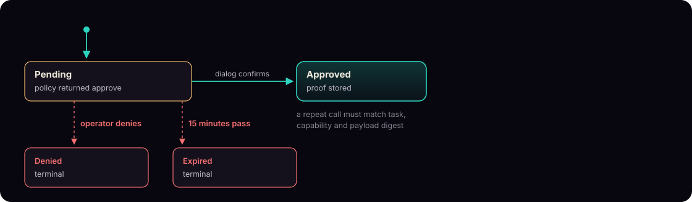
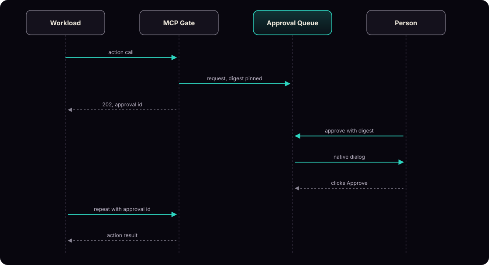

# Approvals

Some changes are too small for a pull request and too risky to allow outright. For those, policy returns `approve`: the task pauses, the exact payload is pinned by a SHA-256 digest, and a person confirms it outside the workload's reach. Code changes, policy changes and promotion from sandbox to runtime take the other path, a reviewed Git change.

Status: partly built. Device pairing is switched off (issue #5); see [Known gaps](#known-gaps).

## Two paths

| Change | Path |
| --- | --- |
| Manifests, policies, code, promotion of a workload to the runtime zone | Git branch, pull request, checks, human merge ([ADR-0005](../adr/0005-dual-path-human-in-the-loop.md)). No workload may change its own policy. |
| A single bounded action whose policy effect is `approve` | The runtime approval queue, described here. |

## The life of an approval

1. The gate decodes the payload once, strictly, into the action's typed input (duplicate, case-colliding and unknown keys, `null` values and trailing data are refused) and encodes that value with Go's encoder. The SHA-256 of those bytes is the digest, and the same value is what the action runs with. The approval stores the canonical JSON, the digest, the task, the workload, the capability and an expiry 15 minutes ahead. The queue then tries to append an `approval` audit row (`pending`), ignoring a write error, and calls the daemon's callback, which sends a notification in the background when a notifier is configured; a failure of either does not fail the request.
2. The task moves from `working` to `input-required`. The reconciler returns it to `working` when every approval of that task is decided and none is pending, whether approved, denied or expired. It marks a pending approval past its expiry as `expired` on its next pass.
3. The operator approves with `sablectl approval approve <id> --digest <full sha256>`, the web UI, or `POST /api/v1/approvals/{id}/approve`. The queue refuses a request without `expectedSha256` (`sablectl` requires `--digest`), a non-pending or expired approval, and an `expectedSha256` that differs from the stored digest. It then asks the approver to confirm.
4. On macOS the approver runs `/usr/bin/osascript` with the message as an argument, with no shell. The dialog shows workload, capability, task and approval ID, then the action's target fields in full (for `git.open_pr` owner, repo, head and base), the full digest, and up to 12 other fields with long text shortened to 160 bytes. Every value is quoted, so a newline in the payload cannot fake a line. The buttons are Deny (default) and Approve. It waits up to 60 seconds. A cancel, a timeout, a failure or a different operating system confirms nothing. The proof records the method, the time and the digest, and a changed digest is refused.
5. The workload repeats the action with `approvalId`. The gate spends the approval in one conditional update: it moves from `approved` to `consumed` only if it belongs to the same task, the same capability and the same payload digest and has not expired by the database's own clock, read inside that update after the lock is held. PostgreSQL locks the approval's row first in the same transaction; SQLite's update takes the database write lock before it reads the clock. Either way the clock is read after the lock is held; if the lock cannot be taken, the update returns an error and spends nothing. The refusal is audited with the reason `approval_not_found` for an unknown ID, `approval_mismatch_or_unapproved` when the approval is not `approved` or belongs to another task, capability or digest, and `approval_expired` when it is `approved` and matches but is past its expiry. A refusal changes nothing in the approval: an expired one stays `approved` with its past expiry, and the update keeps refusing it. The approval is spent before the action runs; the gate then writes a `consumed` audit row, and if that write fails, or the request was cancelled by then, the action does not run and the caller is told the approval is spent. A failed or interrupted action needs a new approval.

An approval left `approved` by a version before single use is marked `expired` by a migration when the daemon starts, because nothing recorded whether it had been used.

Denying needs only an operator credential: `sablectl approval deny <id> --reason ...`, or the UI. A denial cannot widen anything, so it needs no dialog. An approval that is no longer pending cannot be decided again.

## What a session may and may not do

An operator session or token can list approvals, deny them, and ask for confirmation. It cannot approve by itself: the approval is stored only after the dialog proof. A same-user local process that posts to the approve route only makes the dialog appear. The workload holds a task lease, which does not reach `/api/v1/approvals`.

## Devices

The code can verify an ECDSA P-256 signature from an enrolled device over `sablecourt-approve:<id>:<digest>` and approve without a dialog. Enrolment is closed: `POST /api/v1/devices/pair/start` and `/pair/complete` answer 503 "device enrollment requires independent confirmation". Devices can be listed and revoked.

## Known gaps

What the code does today, where it falls short of the design.

- The consumption and its `consumed` audit row are two writes, not one transaction. A crash between them leaves a consumed approval without its audit row.
- An approval that expires after it was approved and is never used stays `approved` in listings. Nothing marks it `expired`: the reconciler and the approve call mark only pending ones.
- The dialog shortens free text and lists at most 12 fields besides the target; read the full `PayloadCanonicalJSON` with `sablectl approval list --json` before approving a long payload.
- On Linux no approver exists, so an `approve` effect cannot be confirmed there.

## Not built yet

- Device enrolment with a person present, and with it the signature path (issue #5).

## In depth

- [Tools and actions](tools-and-actions.md), identity and access (page planned), [how to review an approval](../how-to/review-an-approval.md)
- [ADR-0005](../adr/0005-dual-path-human-in-the-loop.md), [ADR-0009](../adr/0009-sanctum-citadel-audit-chain-and-crypto-approvals.md), [ADR-0014](../adr/0014-identity-and-authentication.md)
- Code: `internal/approval/approval.go`, `internal/approval/macos_oob.go`, `internal/approval/device.go`, `cmd/sablecourtd/main.go` (approval routes)
