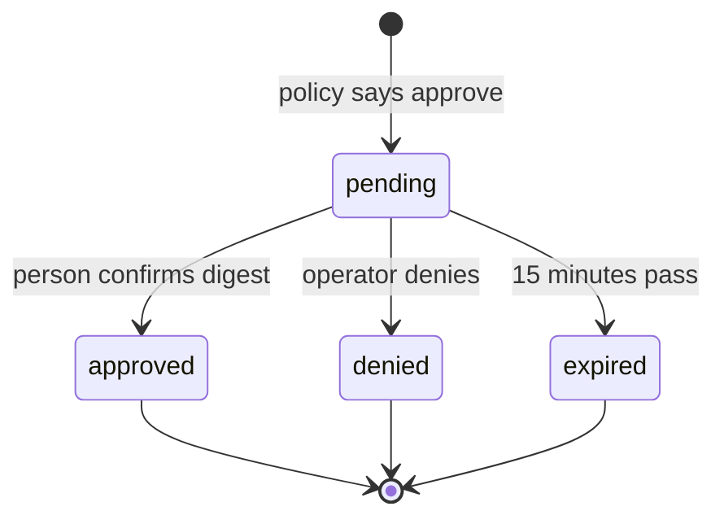
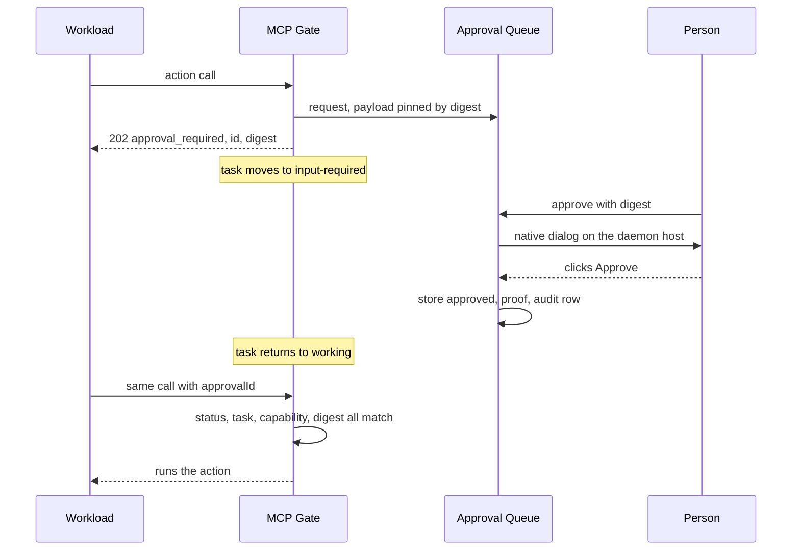

# Approvals

Some changes are too small for a pull request and too risky to allow outright. For those, policy returns `approve`: the task pauses, the exact payload is pinned by a SHA-256 digest, and a person confirms it outside the workload's reach. Code changes, policy changes and promotion from sandbox to runtime take the other path, a reviewed Git change.

Status: partly built. Device pairing is switched off (issue #5) and an approval can be reused (issue #9); see [Not built yet](#not-built-yet).

## Two paths

| Change | Path |
| --- | --- |
| Manifests, policies, code, promotion of a workload to the runtime zone | Git branch, pull request, checks, human merge ([ADR-0005](../adr/0005-dual-path-human-in-the-loop.md)). No workload may change its own policy. |
| A single bounded action whose policy effect is `approve` | The runtime approval queue, described here. |

## The life of an approval

1. The gate canonicalizes the payload: it decodes the JSON and encodes it again with Go's encoder, so object keys are sorted and there is no extra whitespace. The SHA-256 of those bytes is the digest. The approval stores the canonical JSON, the digest, the task, the workload, the capability and an expiry 15 minutes ahead. The queue appends an `approval` audit row (`pending`) and sends a notification when a notifier is configured.
2. The task moves from `working` to `input-required`. The reconciler returns it to `working` when every approval of that task is decided and none is pending, whether approved, denied or expired. It marks a pending approval past its expiry as `expired` on its next pass.
3. The operator approves with `sablectl approval approve <id>`, the web UI, or `POST /api/v1/approvals/{id}/approve`. The queue refuses a non-pending or expired approval, and a supplied `expectedSha256` that differs from the stored digest. It then asks the approver to confirm.
4. On macOS the approver runs `/usr/bin/osascript` with the message as an argument, with no shell. The dialog shows workload, capability, task, the first 16 characters of the digest and the first 220 characters of the canonical payload, with buttons Deny (default) and Approve. It waits up to 60 seconds. A cancel, a timeout, a failure or a different operating system confirms nothing. The proof records the method, the time and the digest, and a changed digest is refused.
5. The workload repeats the action with `approvalId`. The gate runs it only if that approval is `approved` for the same task, the same capability and the same payload digest. A mismatch is refused and audited as `approval_mismatch_or_unapproved`.

Denying needs only an operator credential: `sablectl approval deny <id> --reason ...`, or the UI. A denial cannot widen anything, so it needs no dialog. An approval that is no longer pending cannot be decided again.

## What a session may and may not do

An operator session or token can list approvals, deny them, and ask for confirmation. It cannot approve by itself: the approval is stored only after the dialog proof. A same-user local process that posts to the approve route only makes the dialog appear. The workload holds a task lease, which does not reach `/api/v1/approvals`.

## Devices

The code can verify an ECDSA P-256 signature from an enrolled device over `sablecourt-approve:<id>:<digest>` and approve without a dialog. Enrolment is closed: `POST /api/v1/devices/pair/start` and `/pair/complete` answer 503 "device enrollment requires independent confirmation". Devices can be listed and revoked.

## Not built yet

- Single use: an approved approval is not marked consumed and its expiry is not checked when it is used, so the same action can run again while the lease lasts. [ADR-0014](../adr/0014-identity-and-authentication.md) decides an atomic single-use claim in its first stage; ADR-0014 is Proposed.
- An empty `expectedSha256` is accepted on the dialog path; the dialog is then the only check. ADR-0014 decides to require it.
- Device enrolment with a person present, and with it the signature path.
- The dialog truncates long payloads, so a long `body` can hide fields such as `head` or `repo`; compare the full digest with `sablectl approval list --json`.
- On Linux no approver exists, so an `approve` effect cannot be confirmed there.

## In depth

- [Tools and actions](tools-and-actions.md), [identity and access](identity-and-access.md), [how to review an approval](../how-to/review-an-approval.md)
- [ADR-0005](../adr/0005-dual-path-human-in-the-loop.md), [ADR-0009](../adr/0009-sanctum-citadel-audit-chain-and-crypto-approvals.md), [ADR-0014](../adr/0014-identity-and-authentication.md)
- Code: `internal/approval/approval.go`, `internal/approval/macos_oob.go`, `internal/approval/device.go`, `cmd/sablecourtd/main.go` (approval routes)
