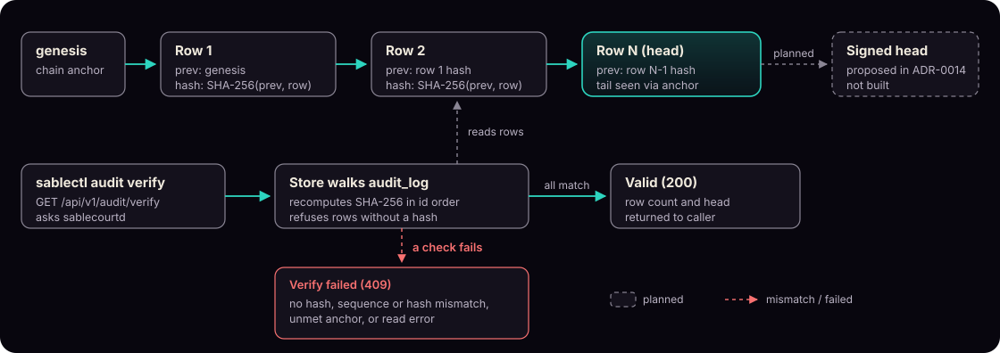

# Audit

Sablecourt keeps one append-only table, `audit_log`, in its store. Each row holds the SHA-256 hash of the row before it, so an edit to a stored row, a deleted row in the middle or a reordered pair breaks the chain, and `sablectl audit verify` says where. The hashes carry no key: anyone who can write to the database can also recompute them. What the chain can and cannot show follows from that.

Status: built. Signed chain heads are proposed in ADR-0014 only, not built. The row encoding, the sequence numbers and the anchor described here come from the [ADR-0009 amendment of 2026-11-27](../adr/0009-sanctum-citadel-audit-chain-and-crypto-approvals.md#amendment-2026-11-27-accepted-2026-11-28), accepted on 2026-11-28.

## Who appends rows

The daemon is the only writer. The Model Gate, the MCP Gate, the reconciler, the Conclave broker, the approval queue, the Shadewright integration and several HTTP handlers in `sablecourtd` call the store's `AppendAudit` with a category (for example `approval`, `model_gate`, `data_action_gate`, `conclave`, `controlplane`, `integration`), the task and workload where there is one, an action, an outcome and a JSON detail. Closing a Conclave, and the Ward pauses that are audited (see [Conclaves](conclaves.md)), write their rows inside the same store transaction as the state change.

Not every outcome gets a row. A task moving from `submitted` to `working` on dispatch is a task event only, and an upstream error status that the Model Gate passes through leaves no audit row. No HTTP route, CLI command or workload capability edits or deletes audit rows.

## What a row holds

| Field | Meaning |
| --- | --- |
| `id` | Row ID assigned by the database. |
| `seq` | Position in the chain, starting at 1. |
| `hash_version` | `2` for every row written now; `1` for rows written before the version 2 migration. |
| `category`, `task_id`, `workload_name`, `action`, `outcome`, `detail_json` | What happened. `detail_json` defaults to `{}`. |
| `prev_hash` | The `row_hash` of the previous row, or the word `genesis` for the first one. |
| `row_hash` | SHA-256 of this row, as lowercase hex. |
| `created_at` | UTC time in RFC 3339 with nanoseconds. |

## How a version 2 row is hashed

The hash is SHA-256 over eleven fields in this order, each written as its length in 8 bytes (big-endian) followed by its bytes:

1. the tag `sablecourt-audit-row-v2`
2. the row ID, as decimal text
3. `seq`, as decimal text
4. `prev_hash`
5. `category`
6. `task_id`
7. `workload_name`
8. `action`
9. `outcome`
10. `detail_json`
11. `created_at`, as stored

The length prefix makes the encoding unambiguous: moving bytes from one field to the next changes the hash. Because the row ID is part of the hash, the store inserts the row with an empty hash, reads the ID the database gave it, and writes the hash in the same transaction.

Before it inserts, the store reads the newest row in that transaction and takes its hash as `prev_hash` and its `seq` plus 1 as the new sequence. An empty table starts at `genesis` and sequence 1. If the newest row has no hash or no sequence, the append writes nothing and returns an error: a second chain never starts at `genesis`. On PostgreSQL the transaction first locks `audit_log` in `SHARE ROW EXCLUSIVE` mode, so two appends cannot read the same head. The SQLite store uses one database connection, so its writes run one at a time. On both, a unique index on `seq` (for rows with a sequence above 0) refuses a second row with the same number.

## Rows from before version 2

Version 1 hashed `prev_hash` and the same row fields joined with an unescaped `|`, and left out the row ID and the sequence. Migration `0017_audit_chain_v2.sql` (SQLite) and `0013_audit_chain_v2.sql` (PostgreSQL) add `seq` and `hash_version`, number every existing row that has a hash in ID order from 1, and mark them version 1. Those rows keep their stored hash and are checked with the version 1 rule, so a `|` moved between two of their fields, or an edited ID, still goes unseen in them. Verification reports how many there are.

Rows written before `0005_audit_chain.sql` have no hash. They keep sequence 0 and fail verification, and no code can tell them from rows whose hash was blanked later. The hashed rows after them were chained from `genesis` past them, so for these pre-chain rows the chain verifies once an operator deletes them. Deleting a numbered row whose hash was blanked later does not repair the chain: its sequence leaves a gap, and verification still fails. Rows appended after the migration are version 2 and chain onto the last version 1 row.

## How verification works

`sablectl audit verify` calls `GET /api/v1/audit/verify` on the daemon. The store reads every row in ID order and checks each one against the row before it. It refuses:

- a row with an empty `row_hash` or `prev_hash`
- a `seq` that is not the previous one plus 1
- a `prev_hash` that is not the previous row's `row_hash` (`genesis` for the first)
- a `hash_version` other than 1 or 2, or a version 1 row after a version 2 row
- a `row_hash` that differs from the hash recomputed from the stored fields

If every row passes, the daemon answers 200 with `valid: true`, `verifiedRows`, `legacyRows` (version 1 rows) and the `head`: the newest row's `seq`, `id` and `hash`. On the first failed check, or a read error, it answers 409 with `valid: false`, the number of rows that passed and the error text. `sablectl` prints the row count and the head as `SEQ:HASH`, and exits with an error when the chain is not valid. The audit page of the web UI runs the same check without an anchor and shows the head next to the result.

### Anchors

A head printed by one run can be kept outside the database and passed back later with `sablectl audit verify --anchor SEQ:HASH` (or `?anchor=SEQ:HASH` on the API). `SEQ` must be a positive integer and `HASH` 64 lowercase hex characters; anything else is refused before the walk, with 400 from the API. With an anchor, verification also fails when the chain ends before that sequence, or when the row at that sequence has another hash. That catches deletion of the newest rows up to the anchor, and a chain recomputed after an edit at or before it. The answer carries `anchored: true`, and `sablectl` fails if the daemon does not report it, so a daemon that ignores the parameter cannot pass an unchecked chain as anchored.

## What verification cannot see

- Deletion of the newest rows. Without an anchor, a chain cut short at any row verifies clean, and so does an empty table (0 rows). With an anchor, rows deleted after the anchored sequence still go unseen.
- A recomputed chain. The hash uses no secret, so someone with write access to the database can edit a row and recompute every hash after it. Only an anchor kept elsewhere shows this, and only for edits at or before the anchored row.
- A `|` moved between fields, or an edited row ID, in version 1 rows.
- Actions that never got a row: dispatch, passed-through upstream errors, and actions whose audit write failed while the caller went ahead (next section).

Signed chain heads, which would close the first two without an operator keeping the head by hand, are proposed in [ADR-0014](../adr/0014-identity-and-authentication.md) and not built.

## When an audit write fails

Version 2 of the chain changed the rows and the checks, not how callers treat a failed write. A few paths fail closed:

- The MCP Gate spends an approval, then writes its `consumed` row. If that write fails, or the request was cancelled by then, the action does not run, and the caller gets 500 saying the approval is spent and a new one is needed.
- Closing a Conclave and an audited Ward pause write their rows in the state change's transaction, so a failed audit write rolls the state change back.
- A `denied` row for a changed or unreadable repository origin that cannot be written stays owed, and later reloads write it in order (at most 16 are kept).

The Shadewright integration returns 500 when its `conclave.open`, `shadewright.incident_escalated` or `shadewright.verification_posted` row cannot be written, but each row is written after the step it records, and the step is not undone. A 500 can mean the Conclave is already open, the incident already posted and its vassals woken, or the verification report already posted, with no row for it. When the `conclave.open` row fails, the escalation stops there and the incident is not posted. The same request sent again finds the earlier work, skips it, and writes only the missing row, so the gap stays until the caller retries.

Most other callers ignore the error and go ahead without a row, among them the Model Gate's `audit` helper, the reconciler and the approval queue. Once the newest row has lost its hash, every append fails, so those actions keep running unaudited until an operator repairs the chain, and `sablectl audit verify` keeps reporting it broken.

## In depth

- [ADR-0009](../adr/0009-sanctum-citadel-audit-chain-and-crypto-approvals.md) and its amendment of 2026-11-27 (accepted 2026-11-28), [ADR-0014](../adr/0014-identity-and-authentication.md)
- [HTTP API](../reference/http-api.md) for the audit routes, [approvals](approvals.md), [tools and actions](tools-and-actions.md)
- Code: `internal/domain/audit_chain.go` (hash and verifier), `internal/store/audit.go` (chain head for appends), `internal/store/sqlite/sqlite.go` and `internal/store/postgres/postgres.go` (`AppendAudit`, `VerifyAuditChain`), `cmd/sablecourtd/main.go` (audit routes), `cmd/sablectl/main.go` (`audit verify`)
