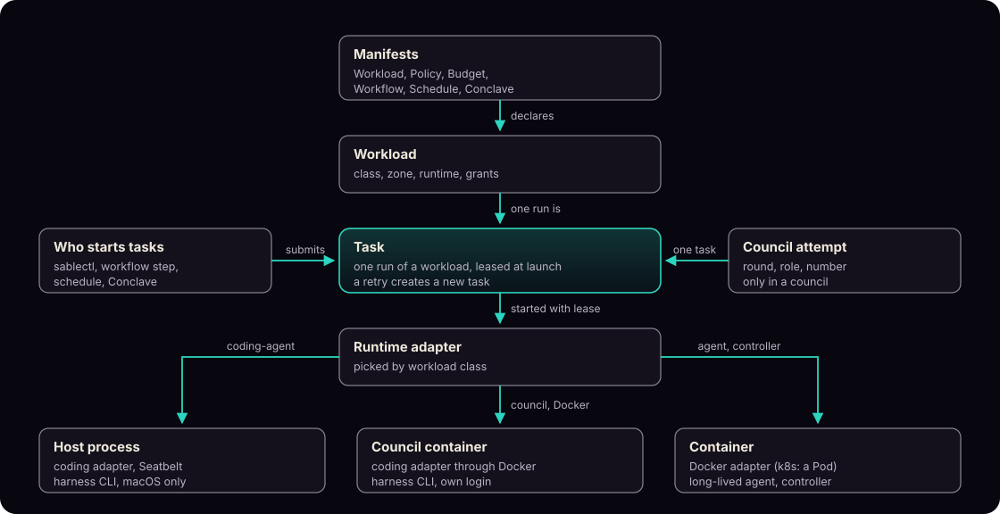
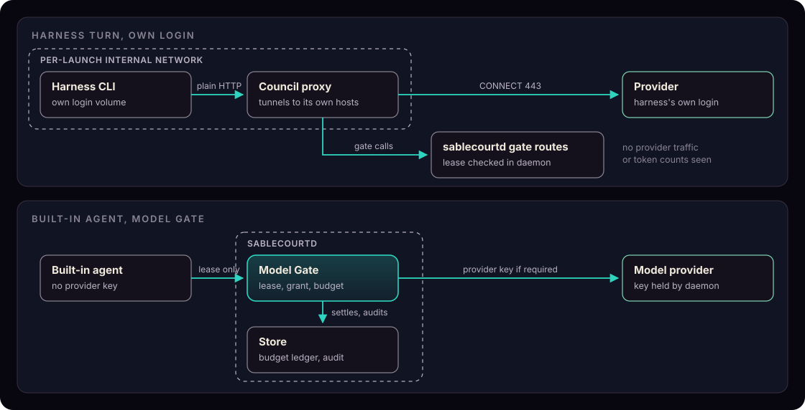

# Building blocks

This page names each part of Sablecourt once: what it is, where it lives in the code, what it is easily mistaken for, and one example. Several words in these docs ("runtime", "agent", "attempt") mean more than one thing in the code; each section says which meaning is which. Read it before the other how-it-works pages, or keep it open next to them.

Status: partly built. Missing: the preflight that checks harness images and logins before a council round (#79), posting a harness's final message to its room (#28) and checkpointed suspend and resume (#14). See "Not built yet".

## Daemon and CLI

`sablecourtd` (`cmd/sablecourtd`) is the one long-running process. It loads the manifests, keeps the store, runs the reconciler and scheduler, serves the HTTP API, the web UI and the gate routes on its listener (`127.0.0.1:7432` by default), and launches workloads through runtime adapters. The gates run inside this process, not as separate services. For a council turn in a container the daemon also opens a per-launch gate listener (a Unix socket or a loopback TLS port) for that turn's proxy. The council proxy itself is a separate binary that runs in its own container per council turn.

`sablectl` (`cmd/sablectl`) is an HTTP client of the daemon. It does not run tasks itself. It sends requests to `--api` (default `http://127.0.0.1:7432`) and attaches the operator token, read from `SABLECOURT_OPERATOR_TOKEN` or, for a local daemon, from the state directory. It refuses to send the token to a daemon that is neither local nor HTTPS.

Not to be confused with: a workload. The daemon and the CLI are the control plane; neither is launched by Sablecourt.

Example: `sablectl task submit go-coder --input "fix the failing test"` posts to `POST /api/v1/tasks`; the daemon creates the task and its reconciler launches it.

## Manifest and its kinds

A manifest is a YAML document with `apiVersion: sablecourt.io/v1alpha1` and one of six kinds, defined in `internal/domain/types.go`: `Workload`, `Policy`, `Budget`, `Workflow`, `Schedule` and `Conclave`. `internal/config/loader.go` decodes them strictly and validates the whole bundle before the daemon uses any of it.

| Kind | Declares |
| --- | --- |
| `Workload` | Something the daemon may launch: class, zone, runtime, grants. |
| `Policy` | Rules of workload, capability and effect (`allow`, `approve`, `deny`). |
| `Budget` | Per-task token and cost limits and a daily cost limit. |
| `Workflow` | Ordered steps, each naming a workload. |
| `Schedule` | A cron expression that starts a workload or a workflow. |
| `Conclave` | A room template: its Vassals, Wards and budget. |

Not to be confused with: runtime state. Tasks, leases, budget entries, approvals and audit rows are in the store, never in a manifest.

## Workload, task and attempt

A workload (`domain.Workload`) is a declaration. Its `class` is `coding-agent`, `long-lived-agent` or `deterministic-controller`, and its zone is `runtime` or `sandbox`. A workload by itself runs nothing.

A task (`domain.Task`, table `tasks`) is one run of one workload. It has an ID, an idempotency key, a state (`submitted`, `working`, `input-required`, `suspended`, `completed`, `failed`, `cancelled`), its input and its artifacts. One task gets one lease and at most one runtime handle. Tasks are submitted by `sablectl` through the API, by a workflow step, by a schedule and by a Conclave when one of its Vassals is activated. See [tasks](tasks.md).

"Attempt" has no type of its own outside councils, and it is the word most often used loosely:

- Retrying a task does not restart it. Retry is allowed only on a task in a terminal state, and `Reconciler.RetryTaskWithHandoff` creates a new task whose input carries `retry_count` and `retried_from`. Outside a Conclave its idempotency key is `retry-<original id>-<n>`. The original task keeps its state.
- In a council, `store.CouncilAttempt` numbers the launches of one seat: a row of (council, round, role, attempt number) points at exactly one task. A turn that ended without an answer can be retried as attempt n+1, which is again a new task.
- Inside the code, a container create also carries a random `CreateAttempt` label, so that recovery after a restart removes only the container that launch created.

Example: a council turn for `codex` in round 2 that fails is attempt 1 of seat (round 2, `codex`) and task A. Its retry is attempt 2 and task B.

## Runtime adapter

A runtime adapter implements `runtime.Adapter` (`internal/runtime/runtime.go`): `Start`, `Observe`, `Suspend`, `Resume`, `Stop` and `CollectArtifacts`. The reconciler holds one adapter per workload class, and the daemon fills that map at startup in `cmd/sablecourtd/main.go`. The class picks the adapter. `runtime.type` (`docker` or `worktree-cli`) is checked by the loader, and `docker` requires an image, but it does not choose the adapter.

| Adapter | Package | Class | Launches |
| --- | --- | --- | --- |
| Coding | `internal/runtime/coding` | `coding-agent` | A harness CLI as a host process under macOS Seatbelt in a Git worktree, or, for a council turn with Docker configured, in a harness container. |
| Docker | `internal/runtime/docker` | `long-lived-agent` | A container from a local image (never pulled) on the internal bridge network `sablecourt-internal`, with all capabilities dropped and `no-new-privileges`. |
| Controller | `internal/runtime/controller` | `deterministic-controller` | Nothing of its own: it wraps the Docker adapter and refuses a workload of another class or one with a Model Gate grant, URL or token. |
| Kubernetes | `internal/runtime/k8s` | `long-lived-agent`, `deterministic-controller` | A Pod, only with `--runtime k8s`. Built and parked by [ADR-0011](../adr/0011-sanctum-scope-trust-and-cli-harnesses.md). |

The host coding adapter is registered only when the Seatbelt probe passes, which needs macOS; there is no Linux host sandbox. If the daemon cannot configure a Docker client and the runtime is not `k8s`, it does not start. Details are in [workloads and runtimes](workloads-and-runtimes.md).

Not to be confused with: the runtime zone (`zone: runtime`, a trust setting of a workload) and `runtime.type` (a manifest field). Three different things share the word.

## Harness

A harness is a vendor's coding CLI that Sablecourt launches as a black box: `claude`, `codex` or `agy`. The harness runs its own agent loop, edits files, and calls its vendor's model with its vendor's login. Sablecourt chooses where it runs, which checkout it sees, what prompt it gets and which lease it holds; it does not see or count the model calls the harness makes.

A harness runs one of two ways, both started by the coding adapter:

- Host process: `sandbox-exec` with a deny-by-default Seatbelt profile that allows outbound network, reading system files, the binary, the worktree and a scratch directory, and writing the scratch directory (and the worktree unless the run is read-only). `HOME` and `TMPDIR` point at that empty scratch directory, and the profile gives no read access to your home directory, so the harness does not see a login stored there. The environment carries the data gate URL and the lease.
- Container, for council turns when a Docker engine is configured: one container per turn, with the harness's own named volume `sablecourt-harness-<role>` mounted at `/home/harness`. The login in that volume is made once inside a container and is separate from your normal CLI login. The lease arrives on standard input. [Harness containers](harness-containers.md) shows what is mounted, the network and the proxy in its two diagrams; this page does not repeat them.

The harness list and its arguments are spread over several files, so a new harness touches all of them:

| What | Where |
| --- | --- |
| Allowed values of `coding.harness` | `internal/config/loader.go`, `internal/runtime/coding/coding.go` |
| Host arguments (`--permission-mode plan`, `--mode plan`, `exec --sandbox read-only`, `-p`) | `internal/runtime/coding/launch.go` (`launchInput.args`) |
| Container arguments (`--no-session-persistence`, `exec --sandbox danger-full-access --ephemeral`, `--sandbox`) | `internal/runtime/docker/council_config.go` (`councilCommand`) |
| CLI version, login command, image and volume names | `internal/harnessimages/images.go` (`Lookup`) |
| Provider hosts each harness may tunnel to | `internal/gate/councilproxy/proxy.go` |
| The council panel | `cmd/sablecourtd/councils.go` (`councilPanel`) |

Not to be confused with: a model called through the Model Gate. A harness gets no Model Gate URL from either launch path, and the built-in council workloads hold no Model Gate grant. Also not the same as a workload: a `coding-agent` workload names a harness in `spec.coding.harness`.

Example: in a council with a `ref` checkout, `claude` runs in its container as `claude --no-session-persistence --output-format text --permission-mode plan -p <prompt>` against a read-only checkout.

## Built-in agent

`cmd/sablecourt-agent` is Sablecourt's own small agent program, built into the image `sablecourt-agent:0.1.0` by `make agent-image`. A workload uses it by naming that image with class `long-lived-agent`, as the `llm-agent` workload in `examples/local-demo.yaml` does. It reads `SABLECOURT_TASK_TOKEN` and `SABLECOURT_MODEL_GATE_URL` and exits if either is missing, sends the conversation to the Model Gate for up to 4 turns, and may call MCP tools or typed actions in between when the model replies with a JSON directive. It posts replies to the task thread through `/gate/task/messages`.

Not to be confused with: a harness. The built-in agent holds no login and no provider key; every model call it makes goes through the Model Gate and is counted against the workload's budget.

"Agent" alone is ambiguous in the code: it can mean the classes `coding-agent` and `long-lived-agent`, this binary, or the `agentCard` of a workload (a description and skill list). These docs say which.

## Deterministic controller

A `deterministic-controller` workload runs a program that makes no model calls, in a container. The rule is enforced three times: the loader refuses a Model Gate grant on it, the reconciler gives it no Model Gate URL or token, and the controller adapter and the Model Gate each refuse it again. It can still use its lease for the MCP Gate within its grants.

Example: the `health-controller` step of the `issue-to-pr` workflow in `examples/local-demo.yaml` runs checks with no model.

## Gates

A gate is a checkpoint that a workload's request crosses, holding the credential the workload must not have.

| Gate | Code | What crosses in | What it adds or checks |
| --- | --- | --- | --- |
| Model Gate | `internal/gate/model`, route `/gate/model/<provider>/...` | An inference request (OpenAI and local chat completions or responses, Anthropic messages, Gemini generate content) with the lease as bearer token. | Lease, workload grant, provider allow-list, budget reservation; strips the caller's auth headers and adds the provider key from the secret store; settles usage and writes an audit row. |
| MCP Gate (Data and Action Gate) | `internal/gate/mcp`, routes `/gate/mcp` and `/gate/actions/<name>` | MCP tool calls and typed action payloads, with the lease. | Policy (grant, zone, circuit breaker, rules, default deny); `approve` sends the payload to the Approval Queue; redacts tool output; audits each decision. |
| Council proxy | `internal/gate/councilproxy`, one container per council turn | From the harness container: `CONNECT host:443` to that harness's provider hosts, and gate calls on a fixed route list. | Host allow-list and public addresses for tunnels; for gate calls, a single bearer header whose SHA-256 matches the lease it was started with. It relays tunnel bytes without reading them. |

Not to be confused with: the policy engine (`internal/policy`), which the MCP Gate consults, and the Approval Queue (`internal/approval`), where a person confirms an `approve` decision. See [model gate](model-gate.md), [tools and actions](tools-and-actions.md), [approvals](approvals.md).

## Task lease

A lease (`domain.Lease`) is the credential a task holds: `sc_task_` plus 64 hex characters, minted at launch by `model.MintTaskTokenUntil`. The store keeps only its SHA-256 hash, with the task and workload it is bound to. It expires after one hour, or at the council deadline if that is sooner, and the reconciler revokes it when the task ends, is cancelled or is suspended. The same lease authenticates the task at the Model Gate and the MCP Gate.

Not to be confused with: the operator token (the person's credential for the API) and a harness login (the vendor's credential, which Sablecourt never holds). See [identity and access](identity-and-access.md).

## Vassal, Conclave and council

These group workloads above the task level.

- A Conclave manifest is a room template. Opening it creates a room (`domain.ConclaveSession`) with states `active`, `input-required`, `completed` and `cancelled`, governed by Wards (run, message and ping-pong limits and the budget).
- A Vassal (`domain.ConclaveVassal`) is a seat in a room: a role bound to a workload, an activation (`always-on` or `on-mention`) and the roles it may message. Each time a Vassal is activated, the daemon submits a task for its workload.
- A council is a room opened by `POST /api/v1/councils` (`sablectl council`), with no Conclave manifest. Its policy (question, rounds, starts, deadline, checkout) is pinned when it opens. Its Vassals are the built-in workloads `claude`, `codex` and `agy`: sandbox zone, class `coding-agent`, no grants. The daemon accepts the panel only with all three, once each.

Example: a two-round council is one room and three Vassals. It has three seats of (round, role) in round 1 and three more in round 2 if round 2 starts (it does not when every member said it has nothing to add), and one task for each attempt at a seat. See [Conclaves](conclaves.md) and [council](council.md).

## Store and audit

The store (`internal/store`, interface `store.Store`) holds runtime state: tasks and task events, leases (as hashes), budget reservations and the ledger, approvals, the audit log, rooms and council attempts, memory and learnings. SQLite (`internal/store/sqlite`) is the default. PostgreSQL is used when `SABLECOURT_POSTGRES_DSN` is set; it is built and parked by ADR-0011.

The audit log is the `audit_log` table. Each row stores the hash of the row before it (`domain.ComputeAuditRowHash`, anchored at `genesis`). The gates, the reconciler, the Conclave broker, the approval queue and the integrations write rows. Verification cannot detect deletion of the newest rows (#10). See [audit](audit.md).

## Integrations

`internal/integrations/shadewright.go` serves `POST /api/v1/integrations/shadewright/incidents` and `.../verifications`, authenticated with a bearer token kept in the secret store as `shadewright_bearer_token`, and records what arrives in a room as the role `integration:shadewright`. For Nightloom the daemon serves `/api/v1/observer/snapshot` and `/api/v1/observer/stream` and marks managed sessions with `SABLECOURT_MANAGED=1` and the session file. See [integrations](integrations.md).

## How a harness run differs from a model call

The top lane is a council turn in a container; the bottom lane is the built-in agent. The comparison below is for those two; a host-mode harness differs from the top lane as noted.

| Step | Harness with its own login | Built-in agent through the Model Gate |
| --- | --- | --- |
| Who holds the provider credential | The harness, in its login volume, made inside its container. The daemon does not read it. In host mode Sablecourt gives the harness no login at all. | The daemon, in its secret store (`openai_api_key`, `anthropic_api_key`, `gemini_api_key`). The agent holds only the lease. |
| What the workload is given | A prompt, a checkout, the data gate URL and the lease (on standard input in a container, in the environment on the host). No Model Gate URL. | `SABLECOURT_MODEL_GATE_URL`, the data gate URL, the lease and its input, in the container environment. |
| Path to the provider | Harness to council proxy over plain HTTP on the per-launch internal network, then a `CONNECT` tunnel to one of its provider hosts; TLS runs end to end between harness and provider. On the host, direct outbound traffic, which Seatbelt allows. | Agent to the Model Gate in the daemon, which forwards to the provider over HTTPS. |
| What the daemon sees | Gate calls the harness makes, the turn's exit code, output and artifacts. Not the prompts it sends to the provider, the replies or token counts. | Every request and response body passes through the daemon; it reads the model name and usage. |
| Budget | None from the Model Gate. A council's budget Ward sums the ledger, which these turns do not write to. The turn is bounded by the council's rounds, starts and wall time, and the container's CPU, memory and process limits. | The workload's `Budget`: an estimate is reserved before forwarding and settled with reported usage (or the estimate if none is reported); per-task, daily and child ceilings apply. |
| Audit | No row for provider traffic: the proxy writes no audit and its log driver is `none`. Calls the harness makes to the MCP Gate are audited as for any workload. | One audit row per call: allowed (with model, tokens and cost), denied (with the reason) or error. |

[ADR-0011](../adr/0011-sanctum-scope-trust-and-cli-harnesses.md) accepts this as a narrow exception to invariant 2: only the three named harnesses may use their own provider login, and that inference runs outside Model Gate accounting.

## Not built yet

- A preflight that checks each harness image and its login volume before a council round, and a `sablectl harness login` command (#79).
- Posting a harness's final message to its room (#28), and checking subscription windows before a round (#36).
- Separate harness state directories for host mode, described in the host fallback amendment of [ADR-0011](../adr/0011-sanctum-scope-trust-and-cli-harnesses.md); today the host harness gets an empty scratch `HOME` (#17).
- Checkpointed suspend and resume (#14).
- A status and learnings the Shadewright side can read (#53, #54).

## In depth

- [Concepts](../concepts.md), [glossary](../glossary.md), [the court](../the-court.md)
- [Workloads and runtimes](workloads-and-runtimes.md), [harness containers](harness-containers.md), [council](council.md), [model gate](model-gate.md)
- [ADR-0002](../adr/0002-heterogeneous-mvp-workload-adapters.md), [ADR-0004](../adr/0004-in-house-capability-gates-three-doors.md), [ADR-0011](../adr/0011-sanctum-scope-trust-and-cli-harnesses.md), [ADR-0013](../adr/0013-bounded-council-rounds.md)
- Code: `internal/domain/types.go`, `internal/runtime/`, `internal/gate/`, `internal/harnessimages/images.go`, `cmd/sablecourt-agent/main.go`, `cmd/sablecourtd/councils.go`
