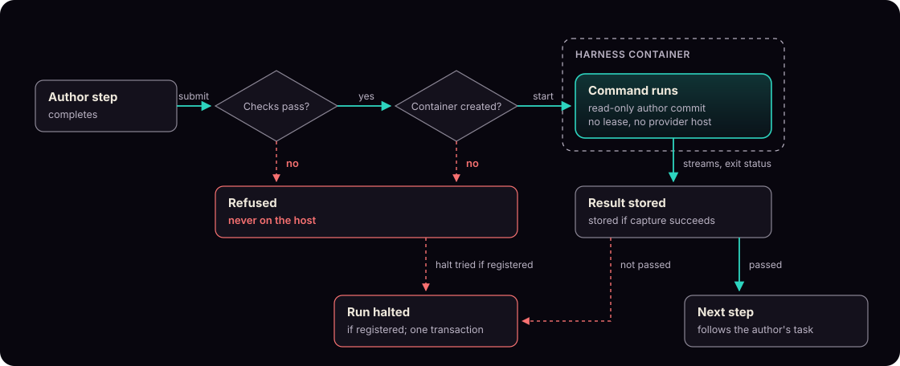

# Command steps

Status: built.

A command step is a workflow step that runs one command the operator allows, such as `make test` or a linter, against the commit of the step before it. It records the exit code and the output as evidence. No model takes part: the step has no prompt, no model and no task lease inside its container. The command runs in a harness container built by the same function as a coding task's container ([harness containers](harness-containers.md)), never as a host process.

[](../diagrams/command-step.svg "Open full size")

After the author step commits its change, the control plane checks that the step's command is in the allowed set of the workload's manifest, then that a harness container can be built. If either check fails, the step is refused before any container starts, never on the host, and the run is halted. Otherwise the command runs in the harness container on a read-only checkout of the author's commit. When it exits, its result is recorded, capped and redacted. A passed result moves the run to the next step, which follows the author's task; a failed result halts the run, with the reason recorded on the run.

## Declare a command

The allowed set is part of a `coding-agent` Workload, under `spec.coding.commands`. A Workflow step names one entry with `command` ([manifest reference](../reference/manifests.md)):

```yaml
apiVersion: sablecourt.io/v1alpha1
kind: Workload
metadata:
  name: builder
  zone: runtime
spec:
  class: coding-agent
  runtime:
    type: worktree-cli
  coding:
    harness: claude
    repoPath: /srv/repo
    commands:
      - name: check
        argv: ["make", "check"]
        timeoutSeconds: 600
        maxOutputBytes: 65536
        failureReason: "make check failed: fix the change before review"
---
apiVersion: sablecourt.io/v1alpha1
kind: Workflow
metadata:
  name: coding
spec:
  steps:
    - name: author
      workload: builder
      role: author
      prompt: Implement the change.
    - name: check
      workload: builder
      command: check
    - name: review
      workload: builder
      role: verifier
      prompt: Review the change.
```

The manifest loader refuses a command step that is the first step, that follows a `verifier` step, whose workload is not a `coding-agent` or does not list the command, or that sets `role`, `tier`, `provider`, `model`, `prompt` or `maxRetries`. It refuses a command whose name, argv, time limit, output cap or failure reason is outside the limits on the [limits page](../reference/limits.md#command-steps).

## What runs, and what is refused

| Case | What happens | Recorded as |
| --- | --- | --- |
| The command is in the allowed set and a container runtime is configured | The command runs in a harness container: the checkout mounted read-only, read-only root, user `10001:10001`, all capabilities dropped, a network whose only peer is the proxy, which allows no provider. Its output is capped and redacted before it is stored. | The step's `command-result` artifact. A failed command also halts the run. |
| The container cannot be built or started (for example an argv the container spec refuses, a missing image, or a proxy that fails to start) | Refused. There is no host fallback. | Step event `command_refused`, refusal `container_spec_refused`; run halted. |
| No container runtime is configured | Refused before any worktree or container is made, even when host mode is forced on. | Step event `command_refused`, refusal `no_container_runtime`; run halted. |
| A host process | Never: no code path runs a command step outside a container. | |
| The command is not in the allowed set, or a task's input names a command | Refused before any container starts. The argv comes only from the loaded manifest, found through the step registration the control plane wrote when it created the step; argv in a task's input is never read. A task that names a command without that registration (for example one submitted directly) is refused. | Step event `command_refused`, refusal `command_not_allowed`; run halted when the task is a workflow step. |

The adapter repeats the container and checkout checks, so a launch that reached it without a container runner, a pinned commit or a read-only checkout is refused there too.

## What the command container can read, write and reach

It uses the same container spec function, and so the same guards, as a coding task: the user, the read-only root, the dropped capabilities, `no-new-privileges`, the CPU, memory and process limits, the mount check and the environment allowlist. These differ:

- The argv is the manifest's, started under the same `timeout` entrypoint; there is no shell unless the argv names one.
- No login volume and no tool volume are mounted. `HOME` is `/scratch`, the `noexec` tmpfs.
- Standard input carries nothing and is closed: the command never receives the task lease, which the daemon still mints so the per-launch proxy can start.
- The proxy runs with the `command` profile, which allows no provider host, so every tunnel is refused. The gate route is there, but without the lease every gate call is refused.
- The checkout is a new worktree pinned to the author's commit and mounted read-only, with its own Git metadata directory, also read-only. The daemon deletes both when the step ends.
- The time limit (`timeoutSeconds`) starts when the daemon sets up the proxy and network, not when the command starts.

## The result

The command's standard output and standard error are each redacted by the runner, joined (output first) and redacted again, then capped. The step stores one artifact, `command-result` (`application/json`):

| Field | Meaning |
| --- | --- |
| `command` | The command's name. |
| `outcome` | `passed`, `failed` (nonzero exit, or output lost), `timeout` or `output_over_cap`. |
| `exit_code` | The command's exit status, or `-1` when it never exited (time limit, stop). |
| `output` | The redacted output, at most `maxOutputBytes`. |
| `output_truncated` | Set when the output passed the cap; only its last `maxOutputBytes` bytes are kept. |

Only `passed` completes the step. Any other outcome fails it, including `output_over_cap` with exit status 0. The step keeps no session log or final message, so no copy of the output exceeds the cap.

When a command step fails or is refused, the control plane adds an event to the run's first task and marks the run halted, so no later step starts:

| Event on the run | Fields |
| --- | --- |
| `workflow_halted_command_failed` | `command_task_id`, `step`, `command`, `outcome`, `exit_code`, `failure_reason` |
| `workflow_halted_command_refused` | `command_task_id`, `step`, `command`, `refusal`, `failure_reason` |

`failure_reason` is the command's `failureReason` from the manifest, so a workflow can say what to do instead, for example which other workflow to start.

## Steps after a command step

A step after a command step follows the author's task, not the command's: a verifier gets the author's artifacts in its prompt, the author's commit as its checkout, and the author's retry budget, and a `CHANGES_REQUESTED` verdict sends the author step back. A command step runs again after each author retry.

## Stated limits

- `/scratch` is mounted `noexec` and the checkout is read-only, so a command cannot run a program it builds. `go test`, for example, builds its test binary into a temporary directory and runs it there, and fails in a command step.
- The checkout's Git metadata holds only the objects reachable from the author's commit and `HEAD`, with no other branch. A command can compare the commit with its own ancestors (for example `git diff --name-only HEAD~1`), but the daemon does not tell it which commit the author started from.
- A proxy image built before command steps existed does not know the `command` profile, and the proxy name does not change with its code. Command steps are then refused with `container_spec_refused` until `sablectl harness build` builds the proxy again.
- If the daemon restarts while a command runs, its output is lost and the step fails with outcome `failed`.
- Standard output and standard error are kept apart and joined after the run, so their order relative to each other is lost. A stream longer than 1 MiB is dropped by the runner, which fails the step with `output_over_cap`.
