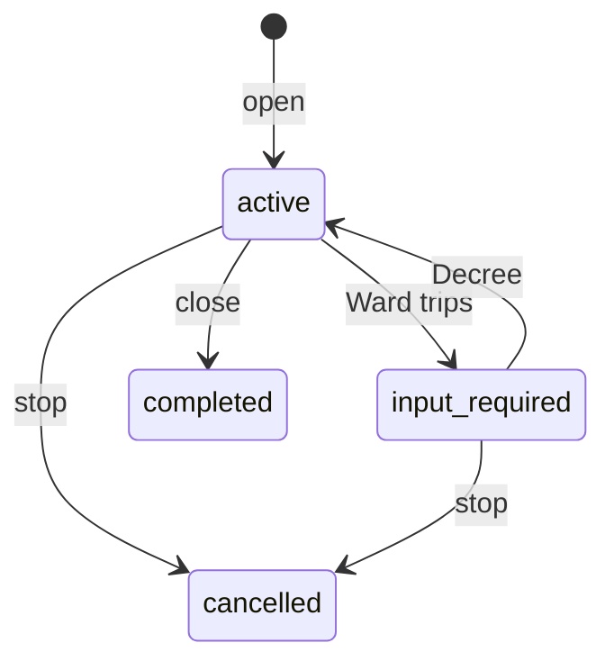

# Conclaves

Status: built, with Takeover parked by [ADR-0011](../adr/0011-sanctum-scope-trust-and-cli-harnesses.md).

A Conclave is a room where several workloads, called Vassals, exchange short messages and shared files on one topic. Limits called Wards keep the room from running away, and the operator steers it with Decrees. A [council](council.md) is a Conclave with a fixed panel and a round scheduler on top; this page covers the plain room declared in a `Conclave` manifest.

## Members and activation

A `Conclave` manifest lists Vassals. Each has a `role`, the `workload` it runs, an `activation` and a `canMessage` list. The loader rejects a room with no Vassals, a duplicate or reserved role (`operator`, `all`, `system`, or a name that starts with `@`), an activation other than `always-on` or `on-mention`, and a `canMessage` target that is not a role in the room.

- `always-on` Vassals get one turn when the room opens, with the opening Decree as their prompt. They are not started again by the room.
- `on-mention` Vassals get a turn each time a message is addressed to their role, or to `all`, by someone else. The prompt names the message, not its text, and says to treat it as untrusted peer context.

## Who may message whom

A Vassal posts only to roles in its own `canMessage` list (`all` and `operator` are allowed values). A sandbox-zone workload can never message a runtime-zone Vassal, and cannot use `all` when the room holds one. The loader checks this when manifests load, and the broker checks the route again on every post. A refused post is written to the audit chain as `conclave.post` with outcome `denied`. Message bodies are redacted and capped at 64 KiB.

## Wards

A Ward is a limit that pauses the room instead of failing it. Defaults are twice the number of Vassals for `maxMessages` and `maxPingPong`, and six for `maxRuns`, which is also the largest value the loader accepts.

- `maxMessages`: Vassal messages since the last Decree.
- `maxPingPong`: reached when that many recent messages came from two roles or fewer.
- `maxRuns`: Vassal turns started in the current run window.
- The budget named by `budgetRef`, and a 15-minute wall time for the whole room.

Tripping one moves the room to `input-required`, records the reason, posts a `system` message and writes a `conclave.ward` audit row. Further Vassal posts fail with a paused error.

## What a Decree resets

A Decree is a message from the operator (`sablectl conclave decree <id> <message>`). It resumes a Ward-paused room, restarts the message and ping-pong counts, and opens a new run window of `maxRuns` turns (audit row `conclave.run_window_reset`). It cannot resume a room that stopped on its wall time. For a council it does not reset the start ceiling or the deadline.

## States, Relics and Scry

The states are `active`, `input-required`, `completed` and `cancelled`. `sablectl conclave close` ends a room as `completed`, and the close call can also set `cancelled`. A plain room that reaches its wall time pauses in `input-required` with the reason `wall_time_reached`; a council is cancelled at its deadline instead.

A Relic is a named file (`sablectl conclave relic put <id> <name>`, or the gate for a Vassal). Its body is redacted and its SHA-256 is stored with it. Relics cannot be added to a paused or closed room.

Scry is a read-only, redacted view of a task's output (`sablectl task scry <task-id>`), kept in a 64 KiB ring buffer. It exists for tasks the daemon runs as host processes. A council turn in a container has no live stream: its answer appears when the turn exits. Takeover (exclusive input) is in the code and parked.

## Not built yet

Voice Decrees and Takeover are parked ([ADR-0011](../adr/0011-sanctum-scope-trust-and-cli-harnesses.md)). The room does not post a CLI Vassal's final message by itself (#28); a Vassal must call the gate.

## In depth

- [ADR-0008](../adr/0008-conclaves-wards-and-live-attach.md): the decision. The code differs on two points: a council turn in a container does not register with Scry, and ping-pong counts messages since the last Decree rather than consecutive turns.
- `internal/conclave/broker.go`, `internal/store/conclave.go`, `internal/attach/hub.go`, `internal/config/loader.go`.
- Next: [council](council.md), [watch and steer](../how-to/watch-and-steer.md).
