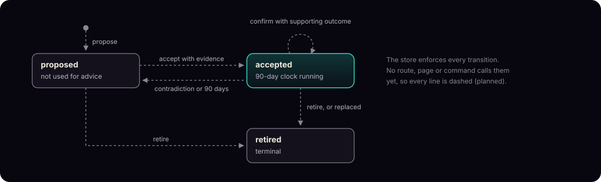

# Context and learning

Before a task starts, the daemon builds a redacted Markdown packet with the task intent, any failure handoff, matching standing rules and, for a workload with a repository, a read-only look at it, and puts it in the launch input of the workload. Learnings are the standing rules: advice that later packets carry when its scope matches. This page covers the packet, what is stored today, what the record of ADR-0012 adds, the verifier step and model tiers.

Status: partly built. The packet, the verifier step, the failure handoff and the tiers are built. The learning record exists in the SQLite store, but apart from the migration that imports old entries, nothing proposes, accepts, matches or injects through it yet, and no route, page or command reaches it (issues #43 and #46).

## What goes into a packet

The flow below shows how a task gets its packet: a deterministic controller outside a council gets none, a council turn gets the packet reserved for it, and every other task gets the required part plus optional parts, which are dropped whole, oldest first, while the packet is over 32 KiB.

[](../diagrams/context-packet.svg "Open full size")

`internal/contextpack` assembles the packet each time a task launches, apart from the two cases above. A `context_packet` field sent by a caller is deleted and the packet is rebuilt. A `repo_path` field sent by a caller is ignored by the assembler: the repository is the `coding.repoPath` of the workload. The original input is not erased, though. It stays in the task history, and Docker and Kubernetes workloads still receive it in their launch input. The built-in agent sends the task history to the Model Gate along with the rebuilt packet, and the Gate forwards the request body to the provider unchanged. So the caller's original input, including a `context_packet` or `repo_path` that was replaced, can still reach a model provider. The parts, in order:

1. The role card of the workload, if it has one.
2. A header with the task and workload, and the workflow step, role and Conclave when the task has them.
3. The intent: the `prompt` and `input` of the task, or the raw input when both are empty.
4. For a Vassal woken by a peer's mention, that message, wrapped as untrusted peer data. The prompt is then replaced by a fixed sentence.
5. The failure handoff, when the task is a retry with one.
6. Scoped learnings (up to 20), the last 5 Decrees and decisions that the operator posted in the room, the last 4 Relics of the room in name order (each cut at 2048 bytes, wrapped as untrusted data) and the pre-check. Decrees, decisions and Relics appear only for a task that belongs to a Conclave.

Parts 1 to 5 are required and are not cut. Part 6 is optional: while the packet is over 32 KiB, the oldest optional entry is removed whole and the size is checked again, the pre-check going last because it is stamped with the current time. When the required part leaves room, the packet ends with a marker that older context was omitted. A packet can exceed 32 KiB if the required part does. The required part and each optional entry pass through the redactor. Council turns use another packet, described in [council](council.md).

A deterministic controller outside a council gets no packet, and the controller adapter refuses a model grant for it. Every other task carries the packet in the `context_packet` field of its launch input. The host coding adapter uses it as the harness prompt and, outside a council checkout, also writes it to a session file in the worktree. The built-in `sablecourt-agent` container sends it as the first message to the Model Gate, together with the task history. Docker workloads receive it on stdin and Kubernetes workloads in `SABLECOURT_INPUT_JSON` (see [workloads and runtimes](workloads-and-runtimes.md#docker-adapter-and-controllers)), and use it only if their own code reads it.

## The repository pre-check

The pre-check runs only when the workload has a `coding.repoPath` that names an existing directory. It has 10 seconds in total and is cut at 16 KiB after redaction.

| Step | Runs when | Appears in the packet |
| --- | --- | --- |
| `git status --short` and `git diff --stat` | read-only, without filters or external diff tools; skipped when repository discovery or filter setup fails | when not empty |
| `go vet ./...` | the repository has a `go.mod` and `go` is on the path | only when it reports issues |
| `sg scan` | the repository has an `sgconfig.yml` and `sg` is on the path | only when it reports issues |

The paths from `git status` also decide which path-scoped learnings match. The daemon runs these commands itself in the repository directory, not inside the harness sandbox.

## Learnings today

A learning today is a Court Memory entry whose namespace starts with `learning:`. The matcher reads the 200 most recently updated Court Memory rows of any namespace, keeps those with such a namespace, and takes up to 20, so an entry that is not among those 200 rows is never seen:

- `learning:global` matches every task.
- `learning:repo:<name>` matches when `<name>` is the last element of the repository path.
- `learning:path:<glob>` matches when the glob fits a changed path. `dir/**` matches everything under `dir`; other globs match the whole path or its last element.

An entry appears in the packet as `[namespace / key] text`. The daemon no longer has a way to create such an entry. `memory.put` and `memory.delete` refuse the namespace and write a `denied` audit row with reason `reserved_namespace`. `POST /api/v1/memory`, `DELETE /api/v1/memory/{namespace}/{key}` and the save and delete forms of the `/memory` page answer 403, and `POST /api/v1/learnings` answers 410. `memory.get` and `memory.search` refuse these namespaces, and the page and `GET /api/v1/memory` hide them. `GET /api/v1/learnings?repo=&path=` (operator credential) still lists up to 100 matches. So rows written before the namespace was closed are the ones that reach packets.

The Conclave page has a "Save as learning" button next to each message. It writes a proposal as a Court Memory entry under `proposed:learning:...` with the redacted rule and its source message, and an audit row `learning.propose`. Nothing acts on these proposals, and they never reach a packet.

Migration 0012 imports each existing `learning:*` row once into the learning table as a `proposed` record with legacy provenance. Only `learning:global` keeps a scope. Every other scope is marked as needing an operator mapping. A row with an invalid timestamp, author, key, namespace or value is marked malformed and also needs a mapping, whatever its scope; its statement is replaced by a placeholder only when the statement text itself is invalid. The original rows stay in Court Memory and keep matching.

## The learning record of ADR-0012

[ADR-0012](../adr/0012-learning-evidence-and-expiry.md) replaces these entries with a versioned record. The store (`internal/store/learning.go`, `internal/store/sqlite/learning.go`, SQLite only) implements it and enforces the rules below. No daemon route, page or command calls it.

[](../diagrams/learning-states.svg "Open full size")

Every line is dashed because the store enforces the transitions but no route, page or command calls them yet (planned). Only the migration creates `proposed` records today.

- A record holds an immutable redacted statement (up to 4 KiB), a scope, a source kind (`operator`, `agent`, `verifier`, `shadewright`, `task`, `council` or `incident`, plus `legacy` for imported rows), an evidence reference such as `artifact:<name>` or `relic:<name>`, an author and a SHA-256 digest of the immutable fields (statement, scope, source, evidence reference, predecessor).
- Acceptance takes the expected digest and an operator in the request context. It needs evidence that resolves to a real artifact (sources `task`, `agent` and `verifier`) or Relic (sources `council`, `incident` and `shadewright`) of the source, so a record with source `operator` or `legacy` cannot be accepted yet. It also refuses a record whose scope still needs mapping. It starts a 90-day clock. Accepting a replacement retires its predecessor in the same transaction.
- A supporting outcome that the operator confirms restarts the clock. A contradiction with an evidence reference, or the 90 days, returns the record to `proposed` and the record is withheld from then on. An injection or an inconclusive outcome leaves the clock alone.
- Every transition is appended to a history table. The learning, history, outcome and injection tables refuse deletes.
- A scope is either global or a combination of narrower selectors: a repository remote URL, up to 16 path globs and incident selectors (cluster, namespace, workload kind, symptom). Global cannot be combined with any of them.

## Not built yet

- Proposing, accepting, confirming and retiring through a route, page or command. ADR-0014 would give acceptance to the `approver` role; it is Proposed.
- Proposing candidates when a run ends.
- Matching and injecting from the record: at most ten statements in an advisory section of at most 4 KiB, most specific first. The packet today takes up to 20 entries and only the 32 KiB cap applies. The 4 KiB in the store limits one statement.
- Keeping learnings out of remote model prompts, which the ADR decides. Today the packet, with any matching entry, is the harness prompt of a host coding task, and the built-in agent sends it to a model provider through the Model Gate.
- PostgreSQL has no learning table.

## Verifier steps

A workflow step with `role: verifier` is an independent run that checks the work of the author step before it. The example passes `sablectl validate`.

```yaml
apiVersion: sablecourt.io/v1alpha1
kind: Budget
metadata:
  name: daily
spec:
  perTask:
    maxCostUSD: 2.50
  daily:
    maxCostUSD: 15.00
---
apiVersion: sablecourt.io/v1alpha1
kind: Workload
metadata:
  name: go-coder
  zone: runtime
spec:
  class: coding-agent
  runtime:
    type: worktree-cli
  coding:
    harness: claude
    repoPath: .
    sandbox: seatbelt
  grants:
    modelGate:
      allowed: true
      providers: [anthropic]
      budgetRef: daily
---
apiVersion: sablecourt.io/v1alpha1
kind: Workflow
metadata:
  name: fix-and-verify
  zone: runtime
spec:
  description: Fix a bug, then have a second run check the result.
  steps:
    - name: fix
      workload: go-coder
      role: author
      tier: coding
      prompt: Fix the bug described in the task input and run the tests.
    - name: check
      workload: go-coder
      role: verifier
      tier: critic
      maxRetries: 2
      prompt: Check the change for regressions and missing tests.
```

- The verifier gets a prompt that tells it not to trust the author, with the text of the author's artifacts (each cut at 4096 bytes). It must run on a `coding-agent` workload. Its checkout is read-only and pinned to the author's commit, recorded as a `verifier_checkout_pinned` event. If the workload is not a coding agent, the runtime cannot pin a commit, or the author recorded no commit, the launch fails with "runtime cannot guarantee the author's checkout for this step".
- The verdict is the last line of the single `final-message` artifact (plain text, at most 64 KiB), exactly `VERDICT: PASS` or `VERDICT: CHANGES_REQUESTED`. A message that repeats the prompt does not count.
- `PASS` moves the workflow to the next step. With no valid verdict, the workflow halts with reason `verdict_missing` and an audit row `workflow.verify`. `CHANGES_REQUESTED` writes a `workflow.verify` audit row and runs the author step again with the redacted findings as its handoff while `retry_count` is below `maxRetries`; at the limit no further step starts. The `maxRetries` that counts is the one on the verifier step, or the author step's own when the verifier step sets none.
- A task of a step that has `maxRetries` set, or a task whose input sets `auto_remediate`, is retried with a handoff when it fails, up to that number (one retry if only `auto_remediate` is set). The retry happens only when the daemon saw the runtime exit (`runtime_exit_observed`). A task that fails to launch, or is lost on restart, is not retried. In the example above `maxRetries` is on the `check` step, so it limits the verdict loop and the `check` run itself, not a failure of the `fix` step. See [retry with handoff](../how-to/retry-with-handoff.md).

## Failure handoff

`contextpack.BuildFailureHandoff` writes the block that a retry carries: the failed task, workload and state, the reason, the last 6 lifecycle events, each captured artifact with text (the last 4096 bytes of it), the last 5 task messages (each cut at 1024 bytes) and a fixed instruction to fix the root cause and verify with tests. It is redacted. In the packet of a task that gets one it sits under "Failure Handoff" and is not cut. A deterministic controller gets no packet, so a retried controller receives the block only as the `failure_handoff` field of its input.

## Model tiers

A step may name a tier, `fast`, `coding` or `critic`, as shorthand for a provider and model. A provider or model set on the step itself replaces the route of the tier. The loader checks the tier name and route against the defaults, and the daemon resolves it at dispatch from Court Memory (`system:model-tiers`), which `GET` and `POST /api/v1/providers/tiers` and the `/providers` page edit. The defaults are `cli:agy` with `gemini-3.8-flash-high`, `cli:claude` with `claude-sonnet-5-5` and `cli:claude` with `claude-opus-5-5`. A route must suit the workload: a deterministic controller cannot use a tier, and a `coding-agent` workload needs a `cli:` provider of its own harness and a model that harness accepts. Other classes get no further check.

## In depth

- [ADR-0010](../adr/0010-agentic-context-learnings-and-verification-pipeline.md) and [ADR-0012](../adr/0012-learning-evidence-and-expiry.md)
- [Concepts: Court Memory, context packet and learning](../concepts.md#court-memory-context-packet-and-learning)
- Code: `internal/contextpack/`, `internal/controlplane/workflow_evidence.go`, `internal/store/learning.go`, `internal/store/sqlite/learning.go`, `internal/store/sqlite/migrations/0012_learnings.sql`
