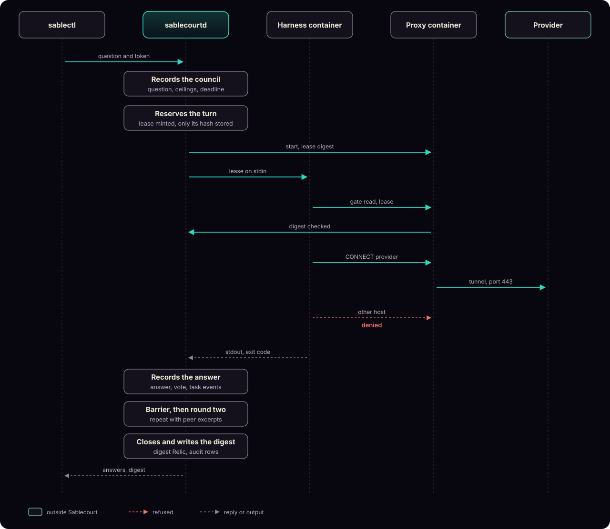
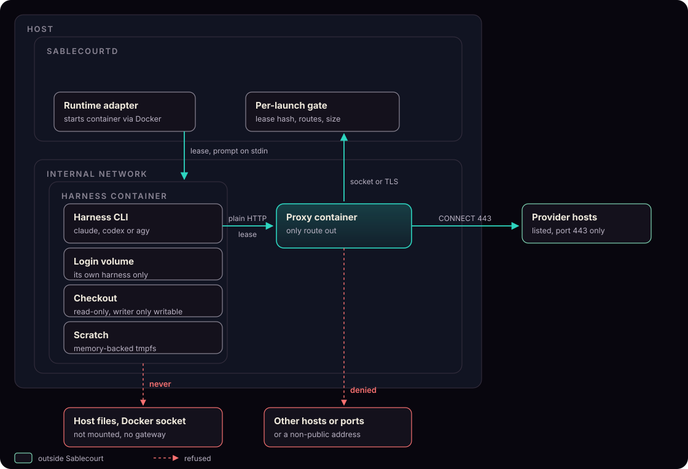
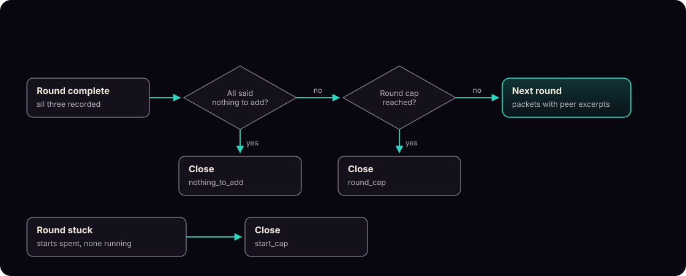
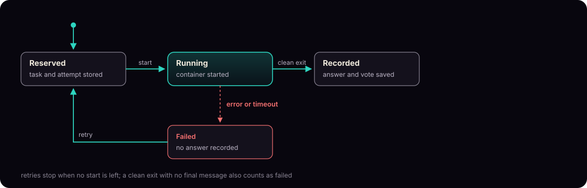

# Council

Status: partly built. Missing: a preflight that refuses a round when images or logins are absent, posting a harness's final message to the room (#28), knowledge of subscription windows (#36), and a recorded end-to-end run (#80). See "Not built yet".

A council puts one question to `claude`, `codex` and `agy` at once, lets each read the others' answers, and ends with a digest the daemon writes from the recorded answers. It is a [Conclave](conclaves.md) with a fixed three-seat panel, a scheduler that works in rounds, and hard ceilings on rounds, starts and time. Each turn is one launch of one harness, in its own [container](harness-containers.md). Nothing here is a model that decides: the daemon counts, reserves and records, and the harnesses only answer.

## What `sablectl council` does

`sablectl council "question"` (or a prompt for the question) opens a council, prints each answer as it is recorded, then prints the digest. With no flags it uses the current directory, the live working tree, two rounds, all three harnesses in parallel and the default ceilings. The question is capped at 30 KiB and is redacted before it leaves the CLI. The CLI sends `POST /api/v1/councils` with a random `Idempotency-Key`; the same key with the same request returns the same council, and with a different request it is refused with a conflict.

The daemon refuses to open a council in Citadel mode, when `claude`, `codex` or `agy` is not found on the daemon's `PATH` (this check runs even though turns run in containers), when the repository fails the checks under "Checkouts", when the macOS Seatbelt probe fails (it also runs on every platform, so a Linux host is refused with "council checkout confinement is unavailable"), or when the panel workloads are missing, outside the sandbox zone or hold any grant. The names `claude`, `codex` and `agy` are reserved for the panel.

## Rounds and the barrier

In round one each seat answers independently. Round two starts only when all three seats have a recorded answer for round one: a missing or failed turn holds the barrier, and a retry spends from the remaining starts. With `--sequential` the seats run inside each round in the order given by `--with` (claude, codex, agy by default), and each waits for its predecessor's answer.

The diagram shows one seat of one round. The three seats of a round run side by side. The lines:

1. `sablectl` sends the question with the operator credential. The daemon stores the council: question, panel, checkout, ceilings and deadline.
2. The daemon reserves a turn for `(council, round, role, attempt)` and creates its task in one transaction, then mints the task lease. The store keeps only the lease's SHA-256.
3. The daemon starts a per-launch proxy and gives it the lease digest, never the lease.
4. The daemon starts the harness container and hands it the lease and the prompt on standard input. This is the only place the lease travels in the clear; the container writes it to a private file in its memory-backed scratch directory.
5. A gate call goes harness, proxy, daemon, with the lease in a bearer header. The proxy checks the route list and the digest; the daemon checks the lease again against the store.
6. Inference leaves through the proxy as a tunnel to the harness's own provider hosts on port 443. Any other host is denied.
7. When the harness exits, the daemon has its standard output and exit code. It records the answer only for a clean exit.
8. When three answers are in, the daemon plans round two. At the end it writes the digest.

What is recorded: task state changes go to `task_events`. The audit chain gets `task.submit` for each turn, `conclave.ward` when a Ward pauses the room, `conclave.run_window_reset` when a Decree resumes it and `conclave.close` when it ends. Gate calls that reach the MCP Gate append their own audit rows. Answers, votes, reservations and the digest live in the council tables, not in the chain.

The boundaries around that container, its proxy and the daemon are drawn on the [harness containers](harness-containers.md) page and repeated here.

## What a turn sees

A turn gets a context packet: the question, the Decrees addressed to its role or to `all`, and redacted excerpts of earlier answers it may see. In parallel mode that is every recorded answer of earlier rounds. In sequential mode it also includes predecessors' answers in its own round. Peer text is capped at 16 KiB. When it does not fit, older rounds shrink to their first line (`[older detail omitted]`), then drop (`[older rounds omitted]`), and last the newest round is cut to equal-length excerpts (`[peer text omitted]`). The whole packet, JSON-encoded, stays under 63 KiB. Mentions never start council turns, and an answer is only visible after it is recorded. The harness may also read the same view through the gate; writes from a seat (messages and Relics) are refused, because a council has no manifest to resolve its role.

## Ceilings and how a council ends

| Ceiling | Default | Limit | Set by |
| --- | --- | --- | --- |
| Rounds | 2 | at least 1 | `--rounds`, API `rounds` |
| Starts, retries included | 6 | 1 to 6 | API `starts` |
| Wall time from opening | 15 minutes | positive seconds | API `durationSeconds` |

A zero or negative value is rejected, not replaced by the default. A Decree cannot raise any of them. A council ends by one of three rules. After a round completes it closes with `nothing_to_add` when all three seats voted to stop, and with `round_cap` at the round ceiling. Separately, a round that cannot finish because every start is spent and no turn is running closes with `start_cap`.

A seat votes to stop only when its entire trimmed final message is `NOTHING TO ADD`; silence or an empty answer never completes a turn. Ctrl-C in the CLI and the deadline end the council as `cancelled`; `sablectl conclave close` ends it as `completed`. All three cancel active turns and still write the digest. A Ward pauses the council in `input-required`: the CLI exits with an error naming the Ward, and the council waits for a Decree or its deadline.

A failed, cancelled or answerless turn is retried as the next attempt while starts remain. After a daemon restart a turn's container is removed, its lease revoked and its task failed as lost on restart; the council then retries or closes. `sablectl task retry` refuses council tasks.

## Checkouts

`--live` (the default) gives a read-only view of the working tree, uncommitted changes included. `--ref <ref>` pins a branch, tag, `HEAD` or full commit to one commit and mounts a read-only checkout of it. The two flags are mutually exclusive. The API also takes `writer` (one of the three roles, never with `live`): that role gets a writable worktree on a branch `sablecourt/council-<key>`, the others a read-only review checkout, and the writer's redacted diff is stored as a Relic for peers. There is no CLI flag for the writer. The daemon refuses a repository that is not a primary checkout owned by the daemon's user, one that overlaps its state or credential directories, an ambiguous ref, and a second writer.

## Digest

At close the daemon writes the Relic `digest`, authored by `system`: the stop reason, then each round and seat in panel order with the recorded answer or `Missing answer`, and the name and SHA-256 of any evidence Relic. It does not summarise or merge answers. The CLI prints it.

## Not built yet

- Refusing a round before it starts when a harness image or its login is missing (#79, decided in a dated working call on the issue; no ADR yet). Today a missing image or login fails at launch or in the harness. [Log in to harnesses](../how-to/log-in-harnesses.md) shows the manual steps. The decision: check for the credential files in each login volume from a short container with no network, create the volume with its label in a new `sablectl harness login <harness>`, and run that login through Docker from the CLI.
- The harness posting its own final message to the room (#28), knowing each subscription's usage windows before it starts a round (#36), and a recorded real run (#80).
- Model Gate accounting does not cover subscription inference ([ADR-0011](../adr/0011-sanctum-scope-trust-and-cli-harnesses.md)); only the ceilings above bound it.

## In depth

- [ADR-0013](../adr/0013-bounded-council-rounds.md) and [ADR-0011](../adr/0011-sanctum-scope-trust-and-cli-harnesses.md). The code departs from ADR-0013 on one point: the CLI and daemon still require the three binaries on the host.
- `cmd/sablectl/council.go`, `cmd/sablecourtd/councils.go`, `internal/conclave/rounds.go`, `internal/conclave/council_driver.go`, `internal/conclave/council_results.go`, `internal/contextpack/council.go`, `internal/store/council.go`.
- Next: [harness containers](harness-containers.md), [run a council](../how-to/run-a-council.md).
