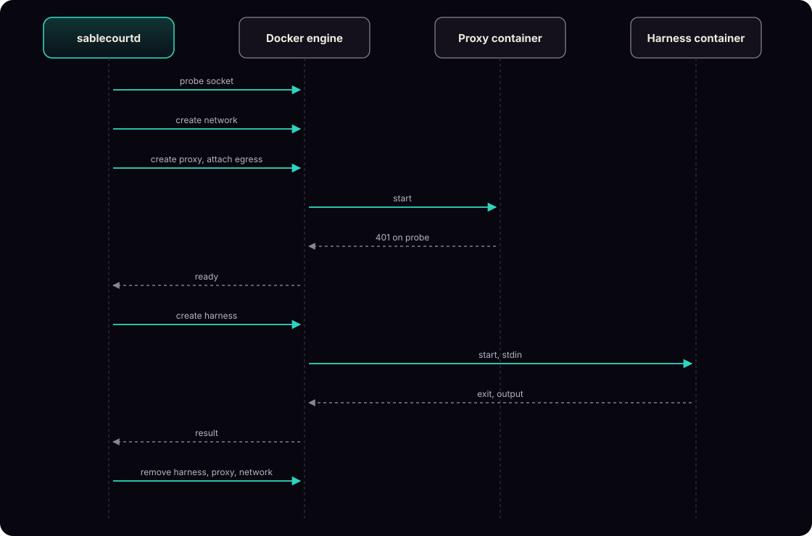

# Harness containers

Status: partly built. Missing: the check that refuses a round when an image or a login is absent (#79). See "Not built yet".

Each council turn runs one harness CLI in its own container, on its own network, behind its own proxy. The container can read its checkout and its own login, and it can reach two things: the daemon's gate and its provider's hosts, both only through the proxy. The point is that a prompt-injected harness has no route to the host, to the other harnesses' logins or to the internet at large. This page describes the Docker path, which the daemon uses when a Docker engine is configured (`DOCKER_HOST` set, or a Docker socket found). Without one, councils fall back to the weaker host mode (see the end).

## Images and the login volume

`sablectl harness build <role>` builds two local images from a Dockerfile embedded in the binary: the harness image (`sablecourt-harness-<role>:<cli version>-<revision>`) and the proxy image. The CLIs are pinned to exact versions, the base image is pinned by digest, the package index is dated, and the platform is `linux/arm64` only. The proxy binary is compiled on your machine with the local Go toolchain from the files in `--source` (default `.`, so run it in a Sablecourt checkout). The build context never contains your checkout, client configuration or logins. The daemon launches an image only by its local image ID and never pulls.

Each harness has its own named volume `sablecourt-harness-<role>`, mounted at `/home/harness`. The daemon refuses a volume that lacks the labels `app.kubernetes.io/managed-by=sablecourt` and `sablecourt.io/harness=<role>`, that uses a driver other than `local`, or that two harnesses share. A login is made once, inside a container, so Sablecourt never copies a credential from the host; see [log in to harnesses](../how-to/log-in-harnesses.md).

## What the container may read, write and reach

- User `10001:10001`, read-only root filesystem, all capabilities dropped, `no-new-privileges`, no logs kept, and a start command wrapped in `timeout` with a kill signal at the turn's wall time. Defaults: 2 CPUs, 2 GiB of memory (no extra swap), 256 processes.
- Mounts: the login volume; the checkout at `/workspace` (a non-recursive bind, read-only except for the writer's worktree); `/scratch` as a memory-backed tmpfs (`noexec`, `nosuid`, `nodev`). Nothing else: no host home, Keychain, Docker socket, daemon state or operator token. A checkout that is your home directory, one of its parents, or that contains the gate socket is refused.
- Environment: fixed `PATH`, `HOME` and `TMPDIR`, the proxy settings, `SABLECOURT_MANAGED`, task ID, workload name and the gate URL. The lease is not in the environment: it arrives on standard input, goes to a mode-0600 file in `/scratch`, and the harness CLI itself starts with standard input closed.
- Commands: `claude` runs in plan mode (accept-edits for the writer), `codex exec` with its own sandbox off, because the container is the boundary (its nested sandbox does not run here), and `agy` with `--sandbox`.

## Network and proxy

Each launch creates a bridge network marked internal, with the isolated gateway mode for IPv4 and IPv6. That mode needs Docker Engine 28.0 or newer; the daemon reads the network back and refuses to continue if the engine did not apply it or assigned a gateway. The harness joins only that network. The proxy joins it first and is then also attached to the default bridge, which makes it the only member with egress. Neither container publishes ports.

The proxy (read-only, non-root, no capabilities) listens on port 8888 inside the network and does two jobs:

- Provider tunnels: only `CONNECT host:443` to the harness's own hosts (claude: `api.anthropic.com`, `claude.ai`, `console.anthropic.com`, `platform.claude.com`; codex: `api.openai.com`, `auth.openai.com`, `chatgpt.com`; agy: six Google hosts). It resolves the name itself and refuses any private or special address. At most 16 tunnels at once, each at most 15 minutes. The tunnel is opaque, so the harness's login stays between it and the provider.
- Gate calls: only `/gate/mcp`, `/gate/task/messages`, `/gate/actions/<name>`, and `/gate/conclave/<id>/messages` and `/relics`, with one `Authorization: Bearer` lease whose SHA-256 equals the digest the proxy was started with. It strips cookies, refuses upgrades and redirects, and rewrites the host to a virtual gate name that no network listener serves.

The hop from harness to proxy is plain HTTP inside the per-launch network, so the lease crosses it unencrypted. The accepted reason is that nothing else can join that network; sharing it between launches would need a change. This is described in the proxy amendment of [ADR-0011](../adr/0011-sanctum-scope-trust-and-cli-harnesses.md), which is still Proposed.

## Reaching the daemon

Before it creates the proxy, the daemon probes how a container can reach it. On native Linux it listens on a per-launch Unix socket in a private directory it owns and mounts only that socket, read-only, into the proxy. On Docker Desktop a host socket cannot be mounted, so it serves the gate on a loopback port over TLS 1.3 with a fresh P-256 key, and the proxy pins the key's SHA-256 and takes no resumed sessions. Only a probe that explicitly reports "socket unsupported" selects TLS; any other failure stops the launch. The proxy never falls back to plain TCP. Either way the per-launch gate allows 32 connections, 2 MiB bodies and 30 seconds per request, checks the route list and lease again, and hands the request to the daemon in process.

## Cleanup

When a turn ends, is stopped or fails, the daemon closes the per-launch gate first (a surviving proxy then has nothing to talk to), then removes the proxy and the network. The proxy and the network carry a per-launch label, and the daemon removes only resources with that label. The login volume is never removed. After a restart, recovery removes leftovers and revokes the lease.

## Host mode

With no Docker engine, a council turn runs as a host process under a macOS Seatbelt profile. It is weaker, because there is no container and no proxy: the harness reaches the gate over loopback with its lease, and a host without Seatbelt is refused. The "Host fallback" amendment of [ADR-0011](../adr/0011-sanctum-scope-trust-and-cli-harnesses.md) lists what it cannot enforce.

## Not built yet

A preflight that checks each harness image and the credential files in its login volume before a round, and a `sablectl harness login` command that creates the labelled volume and runs the login ([council](council.md#not-built-yet) has the decision). Until then, a missing image or login fails when the turn launches.

## In depth

- [ADR-0011](../adr/0011-sanctum-scope-trust-and-cli-harnesses.md) and its amendments, [harness spike notes](../harnesses.md#harnesses-in-containers).
- `internal/gate/councilproxy/`, `internal/runtime/docker/council_config.go`, `internal/runtime/docker/council_proxy.go`, `internal/runtime/coding/container.go`, `internal/harnessimages/`.
- Next: [council](council.md), [log in to harnesses](../how-to/log-in-harnesses.md).
