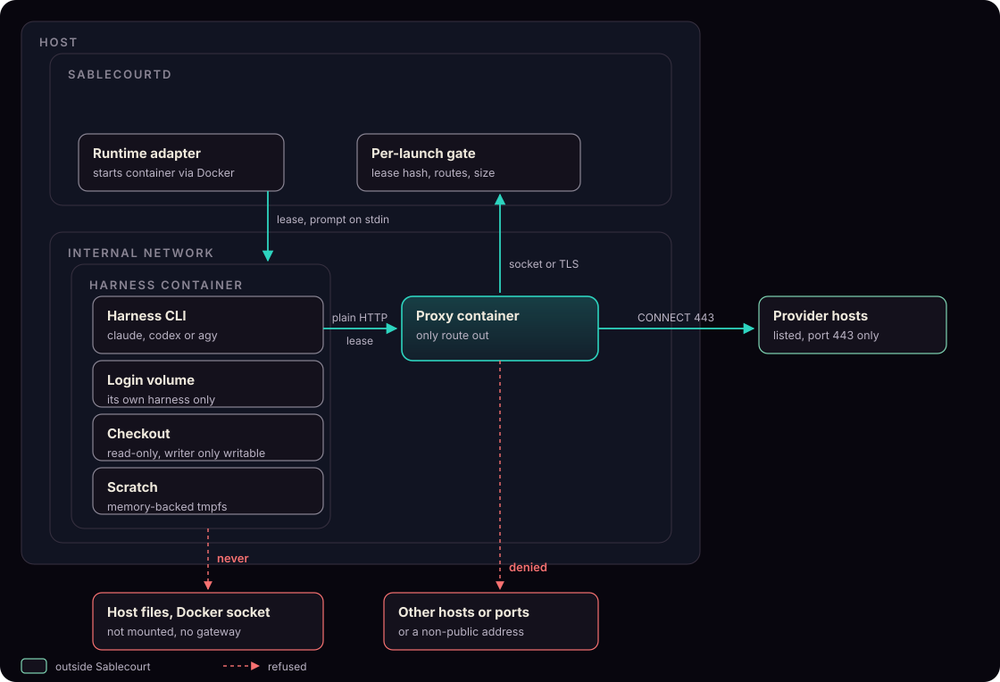

# Harness containers

Status: partly built. Missing: the check that refuses a round when an image or a login is absent (#79). See "Not built yet".

Each council turn runs one harness CLI in its own container, on its own internal network, behind its own proxy. The container can read its checkout and its own login volume. Its only network peer is the proxy, which forwards gate calls to the daemon and opens tunnels to the harness's provider hosts. The daemon mounts no host home directory, Docker socket or daemon state into it, and its network has no gateway. This page describes the Docker path, which the daemon uses when a Docker engine is configured (`DOCKER_HOST` set, or a Docker or Podman socket found in one of the usual locations). Without one, councils run in the weaker host mode (see the end).

## Images and the login volume

`sablectl harness build <role>` builds two local images from a Dockerfile embedded in the binary: the harness image (`sablecourt-harness-<role>:<cli version>-<revision>`) and the proxy image (`sablecourt-harness-proxy:<revision>`), where the revision is the SHA-256 of a deterministic tar archive of the embedded Dockerfile and the licence tree (including the image READMEs), without the compiled proxy. The `codex` image contains the Codex CLI, pinned to an exact version that the build checks after installing it. The `claude` and `agy` images contain no vendor software: `sablectl harness install` downloads the pinned tool on the machine that runs `sablectl`, checks its digest and installs it into the volume `sablecourt-harness-<role>-tool`, and `sablectl harness login` runs that step when the login volume does not exist yet or the tool is missing, of another version or does not match its digest ([harness images and tool install](../how-to/harness-images.md)). The base image is pinned by digest, the Debian package index is a dated snapshot, and the platform is `linux/arm64` only. The proxy binary is compiled on the machine that runs `sablectl` with the local Go toolchain from a fixed list of source files under `--source` (default `.`, so run it in a Sablecourt checkout), with module downloads turned off. The build context holds only the Dockerfile, the licence files under `internal/harnessimages/licenses/` and that binary. The daemon resolves each image name to its local image ID, launches that ID, and never pulls. It refuses an image that declares volumes or sets environment defaults other than `HOME`, `PATH` and `TMPDIR`.

Each harness has its own named volume `sablecourt-harness-<role>`, mounted at `/home/harness`. The daemon refuses a volume that lacks the labels `app.kubernetes.io/managed-by=sablecourt` and `sablecourt.io/harness=<role>`, that uses a driver other than `local` or has driver options, or that two harnesses share. It checks the volume again after creating the container and before starting it. A login is made inside a container; Sablecourt has no command that copies a credential from the host. See [log in to harnesses](../how-to/log-in-harnesses.md).

## What the container may read, write and reach

- User `10001:10001`, read-only root filesystem, all capabilities dropped, `no-new-privileges`, logging driver `none`, and an entrypoint `timeout --signal=KILL` set to the turn's wall time, which still applies if the daemon exits. Defaults: 2 CPUs, 2 GiB of memory with swap equal to it (no extra swap), 256 processes. The scratch tmpfs may grow to the memory limit.
- Mounts: the login volume; for `claude` and `agy`, the tool volume at `/opt/harness-tool`, read-only and with `volume-nocopy` (labels `app.kubernetes.io/managed-by=sablecourt` and `sablecourt.io/harness-tool=<role>`; it is checked like the login volume, except that it must carry exactly these two labels while a login volume may carry more, and it is never the same volume); the checkout at `/workspace` (a non-recursive bind, read-only except for the writer's worktree); `/scratch` as a tmpfs (`noexec`, `nosuid`, `nodev`, mode 0700). These are the only mounts the daemon sets. It sets none for a host home, Keychain, Docker socket, daemon state or operator token. Files already in the home volume or in the bound checkout may be visible to the harness. A checkout that is the filesystem root, the daemon user's home directory or one of its parents, or that contains the Docker socket is refused.
- Environment: `PATH`, `HOME` and `TMPDIR`, the proxy variables (`HTTP_PROXY`, `HTTPS_PROXY`, `NO_PROXY`), `SABLECOURT_MANAGED`, the task ID, the workload name, the gate URL, and `GIT_OPTIONAL_LOCKS=0` on a read-only checkout. The lease is not in the container configuration. It arrives on standard input; a startup script writes it to a mode-0600 file in `/scratch` and exports only that file's path, and the harness CLI starts with standard input read from `/dev/null`.
- Tool check: for `claude` and `agy`, the startup script checks that the tool in `/opt/harness-tool` is a regular executable file, that `VERSION` names the pinned version and that its SHA-256 is the pinned one, after reading standard input and before writing the lease file. A failure ends the turn with exit status 125; the script's message names `sablectl harness install <role>`, and the turn's recorded output holds it when the daemon captured that output. Because the login, turn and probe containers mount the volume read-only, a harness cannot replace its own binary through that mount. Among the containers Sablecourt creates, only the install container writes the tool volume, and it mounts no login volume.
- Commands: `claude` runs in plan mode (accept-edits for the writer) with session persistence off; `codex exec` runs with `--sandbox danger-full-access`, so the container is the only boundary for `codex` ([ADR-0011](../adr/0011-sanctum-scope-trust-and-cli-harnesses.md) records that its own sandbox failed under these container restrictions); `agy` runs with `--sandbox`.

## Network and proxy

Each launch creates a bridge network marked internal, with the isolated gateway mode for IPv4 and IPv6. That mode needs Docker Engine 28.0 or newer. The daemon reads the network back and stops the launch if the engine is older, did not apply the mode, gave the network no subnet or assigned a gateway. The harness joins only that network. The proxy joins it first and is then also connected to the default bridge network, which makes it the only container on the internal network with a route out. Neither container publishes ports.

The proxy (read-only root filesystem, user `10001:10001`, no capabilities, `no-new-privileges`, logging driver `none`) listens on port 8888 inside the network, accepts at most 32 connections, and does two jobs:

- Provider tunnels: only `CONNECT host:443` to the harness's own hosts (claude: `api.anthropic.com`, `claude.ai`, `console.anthropic.com`, `platform.claude.com`; codex: `api.openai.com`, `auth.openai.com`, `chatgpt.com`; agy: six Google hosts). The proxy resolves the name itself and refuses the tunnel if any address returned is private, loopback, link-local, multicast, outside `2000::/3` for IPv6, or in its list of special-purpose ranges; it then dials one of the addresses it resolved. That list does not include the IPv6 documentation prefix `3fff::/20` (RFC 9637). At most 16 tunnels run at once, each for at most 15 minutes. The proxy relays the tunnel's bytes without reading them, so the TLS session inside runs between the harness and the provider.
- Gate calls: only `/gate/mcp`, `/gate/task/messages`, `/gate/actions/<name>`, and `/gate/conclave/<id>/messages`, `/relics` and `/relics/<name>`, each with a fixed set of methods, and exactly one `Authorization: Bearer` header of at most 512 bytes whose SHA-256 equals the digest the proxy was started with. The proxy refuses upgrades, drops cookies from requests, refuses redirects, removes `Set-Cookie` and `Location` from responses, and sets the host to a virtual gate name that the daemon refuses on its network listeners.

The hop from harness to proxy is plain HTTP inside the per-launch internal network, so the lease crosses it unencrypted. The proxy amendment of [ADR-0011](../adr/0011-sanctum-scope-trust-and-cli-harnesses.md), which is still Proposed, accepts this because only the harness and its proxy are attached to that network. The daemon attaches no other container, but it does not stop another client of the same Docker engine from attaching one.

## Reaching the daemon

Before it creates the proxy, the daemon runs a short probe container from the proxy image, with no network, that tries to reach a per-launch Unix socket bind-mounted into it. If the probe connects and completes a token exchange, the daemon serves the gate on a per-launch Unix socket in a fresh 0700 directory it owns and bind-mounts only that socket, read-only, into the proxy. If the probe reports that the socket cannot be shared, as on Docker Desktop, the daemon serves the gate on a loopback port over TLS 1.3 with a fresh P-256 key; the proxy pins the SHA-256 of that public key, takes no resumed sessions and has no plain TCP path to the gate. Any other probe result stops the launch. Either way the per-launch gate accepts at most 32 connections, request bodies of at most 2 MiB and 30 seconds to read or write a request. It checks the host, the route list and the lease digest again and hands the request to the daemon's gate routes in process, which look the lease up in the store.

## Cleanup

When a turn ends, is stopped or fails, the runtime adapter removes the harness container first. It then closes the per-launch gate, so a proxy that survives has nothing to talk to, and removes the proxy and then the network. The proxy and the network each carry a per-launch label, and the adapter refuses to remove a proxy or network that does not carry its own label. Removing the containers does not remove named volumes, so the login volume stays. After a daemon restart, recovery revokes the turn's lease and removes its harness container, probe container, proxy and network, and the daemon deletes leftover per-launch socket directories at startup.

## Host mode

With no Docker engine configured, a council turn runs as a host process under a macOS Seatbelt profile. It is weaker, because there is no container and no proxy: the harness reaches the gate over loopback with its lease. On a host where the Seatbelt probe fails, the daemon refuses to open a council. The "Host fallback" amendment of [ADR-0011](../adr/0011-sanctum-scope-trust-and-cli-harnesses.md) lists what host mode does not enforce.

## Not built yet

A preflight that checks each harness image and the credential files in its login volume before a round, and a `sablectl harness login` command that creates the labelled volume and runs the login ([council](council.md#not-built-yet) has the decision). Until then, a missing image or login volume fails the launch, and a volume without a valid login is not detected by Sablecourt.

## In depth

- [ADR-0011](../adr/0011-sanctum-scope-trust-and-cli-harnesses.md) and its amendments, [harness spike notes](../harnesses.md#harnesses-in-containers).
- `internal/gate/councilproxy/`, `internal/runtime/docker/council.go`, `internal/runtime/docker/council_config.go`, `internal/runtime/docker/council_proxy.go`, `internal/runtime/coding/container.go`, `internal/harnessimages/`.
- Next: [council](council.md), [log in to harnesses](../how-to/log-in-harnesses.md).
