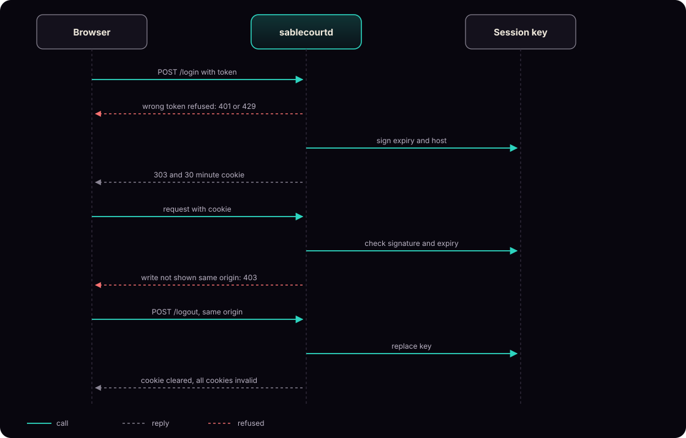
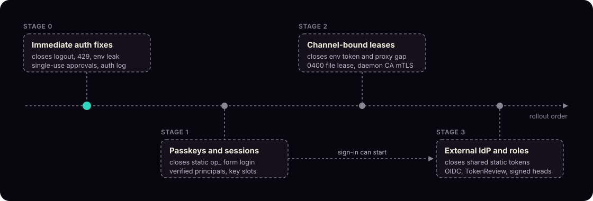

# Identity and access

Who and what may call the daemon, with which credential, and what each credential reaches. Today the callers are you, the integrations, workloads and the per-launch gate proxy. There are no individual identities: the operator credential carries no verified identity, and the actor recorded for a request is a label that depends on the route (see [Who decided](#who-decided)).

Status: partly built. What this page describes is in the code. Passkeys, server-side sessions, roles and the rest of [ADR-0014](../adr/0014-identity-and-authentication.md) (Proposed) are under [Not built yet](#not-built-yet).

## Credentials and the routes they reach

| Caller | Credential | Reaches | Checked in |
| --- | --- | --- | --- |
| You (`sablectl`, browser) | operator token `op_` plus 64 hex characters, or the session cookie it buys | every route not exempted in the rows below, including the web UI and `/metrics` | `cmd/sablecourtd/operator_auth.go` |
| A workload or harness | task lease `sc_task_` plus 64 hex characters | the `/gate/*` routes | `internal/gate/model`, `internal/gate/mcp`, `cmd/sablecourtd/main.go` |
| Shadewright | `shadewright_bearer_token` from the secret store | the two `POST` routes under `/api/v1/integrations/shadewright/` | `internal/integrations/shadewright.go` |
| Nightloom | `observer_bearer_token` from the secret store | `GET` of the observer snapshot, the observer stream and a task's Scry stream (these routes also accept the operator credential) | `cmd/sablecourtd/operator_auth.go` |
| GitHub, A2A peers (parked by ADR-0011) | a webhook HMAC secret; `a2a_bearer_token` | `POST /api/v1/hooks/github`; `POST /a2a`, which submits tasks for any workload and reads any task | `internal/webhook`, `internal/a2a` |
| Anyone | none | the login page, `/healthz`, the agent card, the icons and `/assets/` | `cmd/sablecourtd/operator_auth.go` |

Rules that keep the classes apart:

- The operator check does not run on `/gate/*`; the gates there accept only a bearer whose SHA-256 matches an active lease, so the operator token fails. On operator routes a lease never matches the operator token and is excluded from the observer check, so it gets 401.
- On an operator route, a bearer that is not the operator token gets 401, except the observer token on its three `GET` routes.
- When the Shadewright token is configured, a request that carries it on any other route gets 401. Its two routes refuse a bearer that starts with `op_` or `sc_task_`, so the operator token or a lease cannot stand in for it.
- The observer token is accepted only on `GET` of its three routes, only if the bearer is at most 512 bytes and does not start with `op_` or `sc_task_`. The comparison is constant time on SHA-256 digests.
- The A2A secret is compared as a plain string. If it has the same value as the observer secret, the observer token also reaches `/a2a`.
- A request path that is not in canonical form (for example with `..`, `.` or a doubled slash) gets 401 before any route is exempted.

## The operator token

The daemon creates the token on first start and `sablectl` reads it. Both use the state directory: `$SABLECOURT_STATE_DIR` (it must be an absolute path) or `$HOME/.local/share/sablecourt`.

- The directory must be owned by you with mode `0700` and must not itself be a symlink. Each parent must be owned by you or root and not writable by group or others, unless it is sticky; only root-owned symlinks are followed on the way. If the checks fail, the daemon does not start.
- The file `operator.token` holds `op_` plus 64 hex characters (32 random bytes) and must be a regular file owned by you with mode `0600`. It is written to a pending file, synced and renamed into place. It is stored in plain text, and the running daemon also keeps it in memory.
- The daemon takes an exclusive lock on `daemon.lock` in the same directory, so a second daemon on that directory refuses to start.
- `sablectl` takes the token from `SABLECOURT_OPERATOR_TOKEN` or, for a daemon on a loopback address or the Unix socket, from the file. It adds it only to requests for the configured scheme and host, and refuses to send it over plain HTTP to a host that is not local. `sablectl` has no flag that takes the token.

Operator authentication is always on. The old `--operator-auth-required` flag is deprecated and ignored.

## Sign-in and the session cookie

The "session key" in the diagram is 32 random bytes held in the daemon's memory, made when the daemon starts.

- `POST /login` needs a same-origin request (`Sec-Fetch-Site` absent or `same-origin`, and an `Origin` whose host equals `Host`; on plain HTTP an `Origin` header is required), form encoding, and a body of at most 1024 bytes holding exactly one `token` field.
- Failed tokens are counted per client: 10 a minute for one IPv4 address or one IPv6 `/64`, and 1024 a minute across all clients. Past the limit the answer is 429 with `Retry-After`. A request refused for its origin, encoding, size or form is not counted, and a client at its limit is not counted further. The token is checked before the limiter, so a correct token signs in even while the limit is reached.
- The cookie is `sablecourt_session`, with `Secure`, `HttpOnly`, `SameSite=Strict` and `Path=/`, valid 30 minutes. Its value is the expiry time and an HMAC-SHA256 over the expiry and the lowercased `Host`, keyed with the session key.
- The daemon stores nothing per session. A restart invalidates every cookie. `POST /logout` (same origin, signed in) replaces the session key, which ends every session of every browser at once, and clears the caller's cookie.
- A write authenticated by cookie that does not show it is same origin gets 403. A write that carries an `Origin` or `Sec-Fetch-Site` header showing another origin gets 403 on every route except `/gate/*`, the GitHub webhook and `/a2a`, whatever the credential. Write bodies are limited to 2 MiB, except on the Model Gate and voice transcription routes.
- The daemon serves a request only if its `Host` is `localhost`, `127.0.0.1` or `::1` on the listen port, an `--allow-host` entry, or the container gate host for `/gate/` paths; others get 403. This keeps a page that rebinds its own DNS name to the loopback address from reaching the daemon.
- The optional Unix socket (`--socket`) is set to mode `0600` after it is created and sits behind the same operator authentication.

A cookie does not prove who holds it, and it is not derived from the token. Any process that can read the token file can sign in, which is why harnesses run in containers or under Seatbelt ([threat model](../threat-model.md)). On `localhost` browsers do not isolate cookies by port (RFC 6265 section 8.5, cited in [ADR-0014](../adr/0014-identity-and-authentication.md)), so another web service on `localhost` that you visit in the same browser can receive the cookie.

## Leases

A lease is made for each launch: `sc_task_` plus 64 hex characters from 32 random bytes. Only its SHA-256 is stored, with the task, the workload and an expiry.

- The control plane sets the first expiry to one hour; for a council turn the expiry is cut to the council deadline. While a task is `working` or `input-required`, each fresh reconcile pass extends its lease to one hour past the observation (cut to the council deadline for a council turn), so a running task is not limited to one hour. A resume or a new turn gets a new lease.
- Leases are revoked when the task is cancelled or suspended, when it ends, and when recovery or a failed launch cleans up.
- The Model Gate and the MCP Gate look the hash up on every call and then check the workload's grants, so a valid lease reaches only what its workload is granted.
- Host and generic container runs get the lease in the environment variable `SABLECOURT_TASK_TOKEN`. A council turn receives it on standard input; the bootstrap writes it to a file in the turn's scratch directory under `umask 077` and unsets the variable. The council proxy holds the SHA-256 of the lease and refuses gate requests that carry another; its provider tunnels need no lease.
- A lease is not bound to a channel. Whoever holds the string can use it until it expires or is revoked, from anywhere that can reach a gate route.

## Who decided

The operator credential carries no name, so the recorded actor is a label set by the route, not a verified identity. The approve and deny routes take a `decidedBy` field from the request body (default `operator`) and write it to the audit row as sent; the web UI approve and deny buttons record `operator-ui`, the UI task retry records `operator_ui_retry`, `sablectl task takeover` sends `sablectl`, `detach` records an empty name when none is sent, and a device-signed approval records `device:` plus the device ID. An approval by dialog or by device signature also records its method in the row. The takeover and stdin routes likewise take an operator name from the body.

## Integration tokens

The three integration secrets (and the webhook secret) live in the secret store: the OS keychain, or a plain-text JSON file given with `--secret-file` that must have no group or other permission bits. They have no prefix, expiry or rotation. The daemon reads them from the store on each request, so a replaced secret takes effect on the next request.

## Not built yet

Everything below is decided in [ADR-0014](../adr/0014-identity-and-authentication.md), whose status is Proposed. None of it is in force.

- Server-side hashed sessions with revocation of one session, session-bound CSRF tokens, and the optional local TLS mode with a `__Host-` cookie (stage 1). What exists instead is the stateless cookie above. `POST /logout` rotates the signing key, which differs from the ADR's Stage 0 text: that text says logout clears only the browser cookie.
- Passkey sign-in that consumes `operator.token` on first enrolment, typed principal URNs such as `local:operator`, the `viewer`, `operator` and `approver` roles, and OIDC sign-in with `IdentityProvider` and `RoleBinding` manifests (stages 1 and 3).
- A fresh proof for every approval, a single-use `consumed` state, an expiry check when the action runs, and refusing a self-approval. Today an approved approval can be presented again until the task's lease ends, and an empty `expectedSha256` is accepted (issue 9). Device pairing returns 503 until a confirmed enrolment exists (issue 5).
- Authentication rows in the audit chain. Today no sign-in, failure or logout is recorded ([audit](audit.md)).
- Per-caller integration credentials with key IDs, two overlapping slots and 30 to 90 day lifetimes (stage 1), and workload federation with Kubernetes or GitHub OIDC tokens (stage 3).
- Leases in `0400` files, a 15-minute rolling lifetime and binding to the launch channel, and a daemon certificate authority with mutual TLS (stage 2).
- `sablectl auth recover` and a break-glass token.

The diagram shows the four planned stages. The code has parts of Stage 0: the logout route, no token flag in `sablectl`, the state directory checks and the Seatbelt probe at daemon start and council open. The rest is not.

## In depth

- [ADR-0014](../adr/0014-identity-and-authentication.md), [ADR-0011](../adr/0011-sanctum-scope-trust-and-cli-harnesses.md), [ADR-0005](../adr/0005-dual-path-human-in-the-loop.md)
- [Approvals](approvals.md), [integrations](integrations.md), [threat model](../threat-model.md)
- Code: `cmd/sablecourtd/operator_auth.go`, `cmd/sablecourtd/host.go`, `internal/operatortoken/token.go`, `internal/integrations/shadewright.go`, `internal/a2a/handler.go`, `internal/gate/model/gate.go` (`MintTaskTokenUntil`), `internal/gate/councilproxy/proxy.go`
