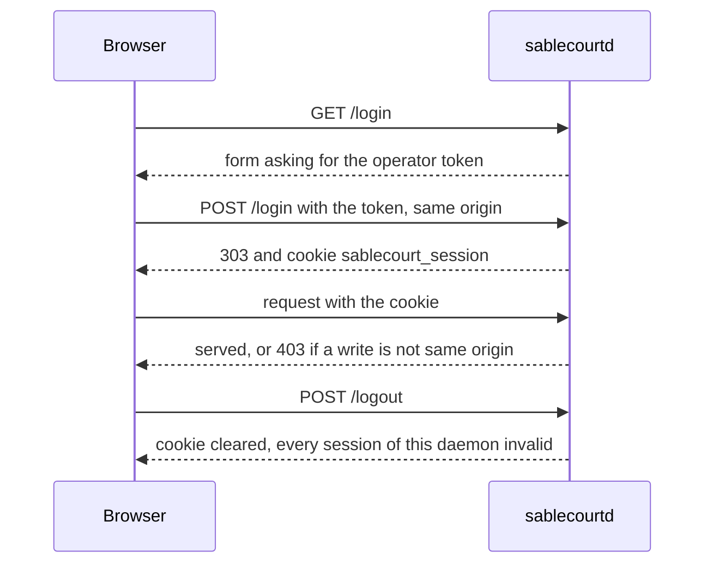

# Identity and access

Who and what may call the daemon, with which credential, and what each credential reaches. Today Sablecourt has four kinds of caller (you, integrations, workloads and the gate proxy), one credential class for each, and no individual identities: everything you do is the single principal `operator`.

Status: partly built. What this page describes is in the code. Passkeys, server-side sessions, roles and the rest of [ADR-0014](../adr/0014-identity-and-authentication.md) (Proposed) are under [Not built yet](#not-built-yet).

## Credentials and the routes they reach

| Caller | Credential | Reaches | Checked in |
| --- | --- | --- | --- |
| You (`sablectl`, browser) | operator token `op_` plus 64 hex characters, or the session cookie it buys | every route not listed in the rows below, including the web UI and `/metrics` | `cmd/sablecourtd/operator_auth.go` |
| A workload or harness | task lease `sc_task_` plus 64 hex characters | `/gate/*` routes only | `internal/gate/model`, `internal/gate/mcp`, `cmd/sablecourtd/main.go` |
| Shadewright | `shadewright_bearer_token` from the secret store | the two `POST` routes under `/api/v1/integrations/shadewright/` | `internal/integrations/shadewright.go` |
| Nightloom | `observer_bearer_token` from the secret store | `GET` of the observer snapshot, the observer stream and a task's Scry stream | `cmd/sablecourtd/operator_auth.go` |
| GitHub, A2A peers (parked by ADR-0011) | a webhook HMAC secret; `a2a_bearer_token` | `POST /api/v1/hooks/github`, `POST /a2a` | `internal/webhook`, `internal/a2a` |
| Anyone | none | the login page, `/healthz`, the agent card, icons and static assets | `cmd/sablecourtd/operator_auth.go` |

Rules that keep the classes apart:

- The operator token is not accepted on `/gate/*`, and a lease is not accepted on operator routes. A bearer that is neither fails with 401.
- The Shadewright token is refused with 401 on every route except its two. On those two routes a token that starts with `op_` or `sc_task_` is refused, so an operator token or a lease cannot stand in for the integration token.
- The observer token is accepted only on `GET` of the three routes above, only if it is at most 512 bytes and does not start with `op_` or `sc_task_`. Comparison is constant time on SHA-256 digests.
- Every request path must already be in canonical form (no `..`, no doubled slashes), or it gets 401 before any exemption applies.

## The operator token

The daemon creates the token on first start and `sablectl` reads it. Both use the state directory, `$SABLECOURT_STATE_DIR` (an absolute path) or `$HOME/.local/share/sablecourt`.

- The directory must be owned by you with mode `0700`, must not be a symlink, and every parent must be owned by you or root and not writable by others (a sticky shared directory is accepted). A directory that fails these checks stops the daemon.
- The file `operator.token` holds `op_` plus 64 hex characters (32 random bytes), mode `0600`, owned by you. It is written to a pending file, synced and renamed, so a half-written token is never read. It is stored in plain text; the daemon keeps only its SHA-256 in memory.
- The daemon takes an exclusive lock on `daemon.lock` in the same directory, so a second daemon on one state directory refuses to start.
- `sablectl` takes the token from `SABLECOURT_OPERATOR_TOKEN` or, for a local daemon, from the file. It sends it only to the origin it was configured for, and refuses to send it over plain HTTP to a host that is not local. There is no `--token` flag, so the token never appears in the process list.

Operator authentication is always on. The old `--operator-auth-required` flag is deprecated and ignored.

## Sign-in and the session cookie

- `POST /login` needs a same-origin request (`Sec-Fetch-Site` and `Origin` agree with `Host`; on plain HTTP an `Origin` header is required), form encoding, and a body of at most 1024 bytes holding one `token` field.
- Failed logins are counted per client: 10 a minute for one IPv4 address or one IPv6 `/64`, and 1024 a minute across all clients. Past the limit the answer is 429 with `Retry-After`. Every wrong token counts, whatever its shape. A correct token is not refused while the limit is hit.
- The cookie is `sablecourt_session`, with `Secure`, `HttpOnly`, `SameSite=Strict` and `Path=/`, valid 30 minutes. Its value is the expiry time and an HMAC-SHA256 over the expiry and the `Host`, keyed with 32 random bytes made when the daemon starts.
- The session is stateless: the daemon stores nothing per session. A restart invalidates every cookie. `POST /logout` (same origin, signed in) replaces the key, which invalidates every cookie of every browser at once, and clears the cookie in the caller.
- A write sent with a cookie must be same origin or it gets 403. A write that carries an `Origin` or `Sec-Fetch-Site` header from another origin is refused on every operator route, bearer or not. Request bodies are limited to 2 MiB on operator routes.
- The daemon serves only requests whose `Host` is `localhost`, `127.0.0.1` or `::1` on its listen port, plus any `--allow-host` entries; others get 403. This is what stops a page on another site from reaching the daemon through a DNS name it controls.
- The optional Unix socket (`--socket`, mode `0600`) sits behind the same operator authentication.

A cookie does not prove who holds it, and it is not tied to the token. Two things follow. Any process that can read the token file can sign in, which is why the harnesses run in containers or a sandbox ([threat model](../threat-model.md)). And on `localhost` browsers do not separate cookies by port, so another web service on `localhost` that you visit in the same browser can receive the cookie.

## Leases

A lease is made when a task is launched: `sc_task_` plus 64 hex characters from 32 random bytes. Only its SHA-256 is stored, with the task, the workload and an expiry.

- The lifetime is one hour, and for a council it is cut to the council deadline. A running task's lease can be renewed.
- Leases are revoked when the task is cancelled, suspended, finishes or fails, and when recovery or a failed launch cleans up.
- A gate looks the hash up on every call and then checks the workload's grants, so a valid lease still reaches only what its workload may.
- Delivery depends on the runtime. Host and generic container runs get the lease in the environment variable `SABLECOURT_TASK_TOKEN`. A council turn receives it on standard input; the bootstrap writes it to a file in the turn's scratch directory (created with mode `0600`) and unsets the variable. The council proxy holds the SHA-256 of the lease and refuses requests that carry another.
- A lease is not bound to a channel. Whoever holds the string can use it until it expires or is revoked, from anywhere that can reach a gate route.

## Who decided

Operator routes record the caller as the literal `operator`. The approve and deny routes take a `decidedBy` field from the request body (default `operator`) and write it to the audit row as sent, so it is a label, not a verified identity. An approval by dialog or by a paired device signature carries its method in the row. Takeover and stdin routes likewise take an operator name from the body.

## Integration tokens

The three integration secrets (and the webhook secret) live in the secret store: the OS keychain, or an optional `0600` JSON file given with `--secret-file`, which is plain text. They have no prefix, expiry or rotation. The daemon reads them on each request, so replacing a secret takes effect at once.

## Not built yet

Everything below is decided in [ADR-0014](../adr/0014-identity-and-authentication.md), whose status is Proposed. None of it is in force.

- Server-side hashed sessions with immediate revocation, session-bound CSRF tokens, and the optional local TLS mode with a `__Host-` cookie (stage 1). What exists instead is the stateless cookie above; `POST /logout` rotating the signing key is stronger than the ADR's Stage 0 text, which says it clears only the caller's cookie.
- Passkey sign-in that consumes `operator.token` on first enrolment, typed principal URNs such as `local:operator`, the `viewer`, `operator` and `approver` roles, and OIDC sign-in with `IdentityProvider` and `RoleBinding` manifests (stages 1 and 3).
- A fresh proof for every approval, a single-use `consumed` state, an expiry check when the action runs, and refusing a self-approval. Today an approved approval can be reused until the task's lease ends, and the dialog path accepts an empty `expectedSha256` (tracking issue 9). Device pairing returns 503 until a confirmed enrolment exists (issue 5).
- Authentication rows in the audit chain. Today no sign-in, failure or logout is recorded ([audit](audit.md)).
- Per-caller integration credentials with key IDs, two overlapping slots and 30 to 90 day lifetimes (stage 1), and workload federation with Kubernetes or GitHub OIDC tokens (stage 3).
- Leases in `0400` files, a 15-minute rolling lifetime and binding to the launch channel, and a daemon certificate authority with mutual TLS (stage 2).
- `sablectl auth recover` and a break-glass token.

The diagram shows the four planned stages. Stage 0 is partly on `main` (the logout route, no `--token` flag, the state directory handle and the sandbox probe); the rest is not.

## In depth

- [ADR-0014](../adr/0014-identity-and-authentication.md), [ADR-0011](../adr/0011-sanctum-scope-trust-and-cli-harnesses.md), [ADR-0005](../adr/0005-dual-path-human-in-the-loop.md)
- [Approvals](approvals.md), [integrations](integrations.md), [threat model](../threat-model.md)
- Code: `cmd/sablecourtd/operator_auth.go`, `internal/operatortoken/token.go`, `internal/integrations/shadewright.go`, `internal/gate/model/gate.go` (`MintTaskTokenUntil`), `internal/gate/councilproxy/proxy.go`
