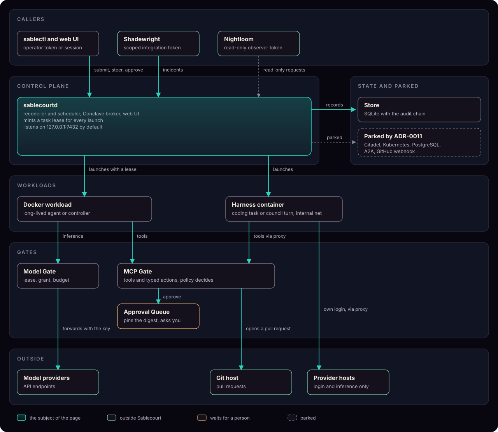

# How it works

The whole path from a request to a recorded result, and where each of the six rules is enforced. Each part has its own page; this one shows how they fit together.

Status: built. Parts that are partly built or parked are marked in the [status table](../index.md#status).

## What happens to a request

1. A caller submits work. The callers are you through `sablectl` or the web UI (operator token or session), Shadewright (scoped integration token) and a `Schedule` or workflow step inside the daemon. Nightloom only reads. The daemon stores a task in state `submitted` with an idempotency key. See [tasks](tasks.md).
2. The reconciler picks up `submitted` tasks, at most four running at once by default. For each it mints a lease, assembles a redacted context packet and starts the workload through the runtime that matches its class: a host coding run, a Docker container, or, for a council turn, a harness container with a per-launch proxy. See [workloads and runtimes](workloads-and-runtimes.md) and [harness containers](harness-containers.md).
3. The workload asks for what it needs through the gates, presenting the lease. The Model Gate checks the lease, grant and budget and forwards inference to the provider with the key it holds ([model gate](model-gate.md)). The MCP Gate serves granted tools and typed actions after policy ([tools and actions](tools-and-actions.md)). An action whose effect is `approve` goes to the Approval Queue, the task waits in `input-required`, and a person confirms the pinned digest ([approvals](approvals.md)).
4. The reconciler observes the workload, moves the task to `completed`, `failed` or `cancelled`, and revokes its lease. A restart of the daemon recovers running tasks instead of dropping them.
5. Every state change, policy decision, approval and model call is appended to the [audit chain](audit.md).

Rooms in which several workloads cooperate are [Conclaves](conclaves.md); a [council](council.md) is the Conclave of the three harnesses. Context and learning are in [context and learning](context-and-learning.md), and who may call what is in [identity and access](identity-and-access.md) and [integrations](integrations.md).

## The six rules and where each is enforced

| Rule | Enforced by |
| --- | --- |
| 1. Model output is never authorization | The policy engine (`internal/policy`) decides each capability; an `approve` effect needs a person to confirm the pinned digest (`internal/approval`). |
| 2. Workloads hold no raw secrets | Provider keys stay in the secret store and the Model Gate; a workload gets a lease and a stripped environment. The subscription logins of ADR-0011 are the one exception. |
| 3. External input is untrusted | `internal/redact` runs at the MCP Gate, in Conclave messages and Relics, in Court Memory writes, in Scry output and in council context. |
| 4. Separate identities, fail closed | Policy defaults to deny, a manifest with another default is rejected, an exhausted budget stops a call, a missing sandbox stops a launch. |
| 5. Evidence over inference | The reconciler decides from observed runtime state and stored heartbeats, and fails a task whose workload or adapter is missing. |
| 6. Idempotent reconciliation | Idempotency keys on tasks, reserved council turns, and recovery of running tasks at startup. |

## Not built yet

- Server-side sessions, passkeys and roles: decided in [ADR-0014](../adr/0014-identity-and-authentication.md), Proposed.
- The learning record of [ADR-0012](../adr/0012-learning-evidence-and-expiry.md): stored, not yet accepted or injected.
- The proxy-to-daemon hop of the harness containers is described in an amendment to [ADR-0011](../adr/0011-sanctum-scope-trust-and-cli-harnesses.md) that is still Proposed.

## In depth

- [Concepts](../concepts.md) and the [glossary](../glossary.md)
- [Design: architecture](../design/architecture.md) and the [threat model](../threat-model.md)
- [ADR-0001](../adr/0001-local-first-control-plane-with-k8s-adapters.md), [ADR-0004](../adr/0004-in-house-capability-gates-three-doors.md), [ADR-0006](../adr/0006-hub-and-spoke-a2a-task-envelope.md)
- Code: `cmd/sablecourtd/main.go` (`newHandler` and the route wiring), `internal/controlplane/reconciler.go`
