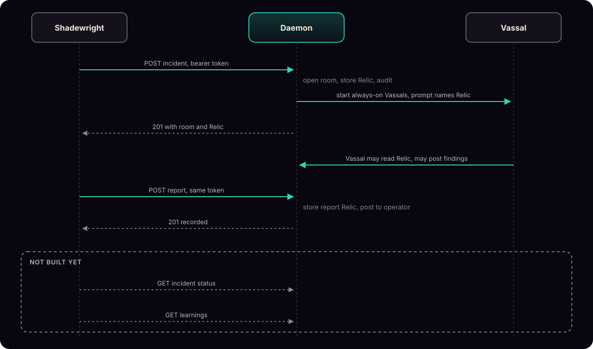

# Integrations

Sablecourt talks to two sibling products over narrow, optional channels. Shadewright can hand over an incident and report a verification result. Nightloom can read a status snapshot and recognise sessions Sablecourt started. Nothing else crosses: Sablecourt does not scan the host for other agent sessions, and Nightloom never launches or controls a workload ([ADR-0007](../adr/0007-strict-boundary-with-nightloom.md)).

Status: partly built. Incident intake, verification reports, the observer routes and the session marker are built. A status the caller can read, a learnings read for analysts and an incident council template are decided but not built.

## Shadewright: incident and verification

[](../diagrams/incident-sequence.svg "Open full size")

Both routes are self-authenticated: the operator check skips them and each handler checks the token itself.

| Route | Sent by | Effect |
| --- | --- | --- |
| `POST /api/v1/integrations/shadewright/incidents` | the analyzer, when an incident needs a source change | opens a Conclave for the incident |
| `POST /api/v1/integrations/shadewright/verifications` | the verifier, after a merge and rollout | posts the result into that Conclave |

The credential is the secret `shadewright_bearer_token` (store it with `sablectl secret set shadewright_bearer_token`), sent as one `Authorization: Bearer` header. The comparison is constant time. A token that starts with `op_` or `sc_task_` is refused, and the Shadewright token is refused with 401 on every other route, even when operator authentication is off. The routes exist only when the daemon runs the Conclave broker. The body is one JSON object of at most 2 MiB.

### Incident intake

The request carries `incidentId` (letters, digits, `_` and `-`, up to 128 characters, starting with a letter or digit), `summary` (required), and optionally `conclaveTemplate`, `cluster`, `namespace`, `workload`, `evidence` (an object) and `logs`:

```json
{
  "incidentId": "inc-2026-0001",
  "conclaveTemplate": "incident-room",
  "cluster": "lab",
  "namespace": "shop",
  "workload": "checkout",
  "summary": "checkout crashes on start after the last release",
  "evidence": {"restarts": 14},
  "logs": "panic: nil map assignment"
}
```

The daemon then:

1. Derives the room ID from the incident ID, `ccl-shadewright-` plus a SHA-256 hex digest, so the same incident always maps to the same room. The title is "Shadewright Incident" plus that ID. An ID already used by a room that is not an incident room gets 409.
2. Picks the template: `conclaveTemplate` from the request, or the daemon flag `--incident-conclave-template`. It must name a loaded `Conclave`; otherwise 400.
3. Creates the room in state `active` and writes the audit row `conclave.open`.
4. Stores the redacted evidence as the Relic `incident-<room id>.json`, authored as `integration:shadewright`.
5. Starts the `always-on` Vassals of the template with a fixed prompt that names the Relic. Caller text is never put in that prompt.
6. Posts a `report` message from `integration:shadewright` to `all` with the summary, wakes the Vassals it mentions, and writes the audit row `shadewright.incident_escalated`.

The reply is 201 with the room and the Relic for a new incident, and 200 for a repeat with the same evidence. A repeat with different evidence, or for a room that is no longer active, gets 409. A restart halfway through leaves enough in the audit chain for the same request to finish the work. A Vassal sees the Relic in its [context packet](context-and-learning.md) as untrusted data, cut at 2048 bytes.

A template that loads with the current loader (checked with `sablectl validate`; the loader also checks Conclave references):

```yaml
apiVersion: sablecourt.io/v1alpha1
kind: Budget
metadata:
  name: incident-budget
spec:
  perTask:
    maxCostUSD: 2.50
  daily:
    maxCostUSD: 15.00
---
apiVersion: sablecourt.io/v1alpha1
kind: Workload
metadata:
  name: incident-analyst
  zone: runtime
spec:
  class: coding-agent
  runtime:
    type: worktree-cli
  coding:
    harness: claude
    repoPath: .
    sandbox: seatbelt
  grants:
    modelGate:
      allowed: true
      providers: [anthropic]
      budgetRef: incident-budget
---
apiVersion: sablecourt.io/v1alpha1
kind: Conclave
metadata:
  name: incident-room
spec:
  description: Room opened for each incident Shadewright hands over.
  budgetRef: incident-budget
  wards:
    maxRuns: 3
  vassals:
    - role: analyst
      workload: incident-analyst
      activation: always-on
      canMessage: [operator]
```

### Verification report

The request carries `conclaveId` and `status` (required), and optionally `incidentId`, `prNumber`, `summary` and `report` (an object). `status` is free text of at most 64 printable characters. The values Shadewright uses (`RolledOut`, `Cleared`, `Failed`) are its convention; the daemon does not check them. The room must be an incident room whose intake finished, or the answer is 404; a given `incidentId` must match the room, or 400; a room in `input-required` or closed answers 409.

The daemon stores the request fields (`conclaveId`, `incidentId`, `prNumber`, `status`, `summary`, `report`) as the Relic `verification-<digest>.json` (the digest is of the request, so a repeat reuses it), posts a `report` message from `integration:shadewright` to `operator`, and writes `shadewright.verification_posted` with the status as its outcome. The reply is 201 with `status: recorded`.

## Nightloom: observer and session marker

Three read-only routes accept the operator credential or the secret `observer_bearer_token`, on GET only. A token that starts with `op_` or `sc_task_` is never taken as an observer token.

| Route | Returns |
| --- | --- |
| `GET /api/v1/observer/snapshot` | `source`, `observedAt`, the active tasks (ID, workload, state, update time; states `submitted`, `working`, `input-required` and `suspended`), all Conclaves, the number of pending approvals and the budget totals |
| `GET /api/v1/observer/stream` | server-sent `observer` events every 3 seconds, each holding three counts `tasks:conclaves:approvals` |
| `GET /api/v1/tasks/{id}/scry` | live redacted output of one task |

Sablecourt marks what it starts. A host coding task runs with `SABLECOURT_MANAGED=1`, `SABLECOURT_TASK_ID` and `SABLECOURT_WORKLOAD` in its environment, and the worktree holds `.sablecourt-session.json` with `managed_by`, `task_id`, `workload`, `zone`, `started_at` and, for Conclave tasks, `conclave_id` and `role`. Git excludes the file and cleanup removes it. Docker, council and Kubernetes containers get `SABLECOURT_MANAGED=1`. How Nightloom uses the marker is described in Nightloom's own documentation.

## Not built yet

- A status route for the caller, `GET /api/v1/integrations/shadewright/incidents/{incidentId}`: state, round, a short redacted result and links to any pull request the council opened, with no message bodies.
- A learnings read for the integration token, by cluster, namespace, workload kind and symptom, returning accepted, unexpired learnings under a size cap, and verification posts that name the learnings used and record an outcome on each. ADR-0012 decides this and depends on the learning record described in [context and learning](context-and-learning.md).
- An incident council template shipped as an example: a read-only analysis round by two participants, a cross-review round and a digest with the proposed cause. Today intake opens whatever template you name.
- Shadewright proposing learnings.

## In depth

- [ADR-0007](../adr/0007-strict-boundary-with-nightloom.md), [ADR-0009](../adr/0009-sanctum-citadel-audit-chain-and-crypto-approvals.md), [ADR-0012](../adr/0012-learning-evidence-and-expiry.md)
- [Identity and access](identity-and-access.md) for the credential classes, [Conclaves](conclaves.md) for rooms
- Code: `internal/integrations/shadewright.go`, `cmd/sablecourtd/operator_auth.go`, `cmd/sablecourtd/main.go`, `internal/runtime/coding/worktree.go`, `internal/runtime/coding/coding.go`
