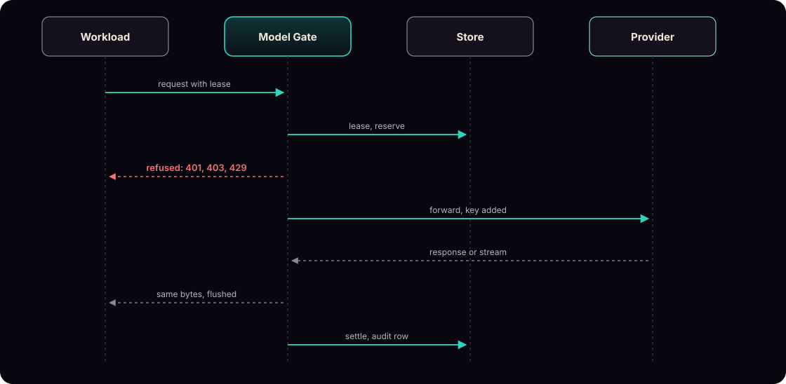

# Model Gate

The Model Gate is an HTTP proxy under `/gate/model/` through which a workload calls a model without holding a provider key. It checks the task lease, the grant and the budget, reserves the cost before the call, forwards the request with the key it holds, and settles the real usage afterwards.

Status: built. Inference that a subscription harness runs outside the gate is not counted here ([ADR-0011](../adr/0011-sanctum-scope-trust-and-cli-harnesses.md)).

## Routes

| Path under `/gate/model/` | Provider |
| --- | --- |
| `openai/v1/chat/completions`, `openai/v1/responses` | OpenAI |
| `local/v1/chat/completions`, `local/v1/responses` | A local server (default `127.0.0.1:11434`, no key needed) |
| `anthropic/v1/messages` | Anthropic |
| `gemini/v1beta/models/<model>:generateContent` and `:streamGenerateContent` | Gemini |

Any other path returns 404. Keys come from the secret store under `openai_api_key`, `anthropic_api_key`, `gemini_api_key` and `local_model_api_key`. With `--model-gateway-url` (or `SABLECOURT_MODEL_GATEWAY_URL`) every provider route goes to one external gateway and no key is required. The caller's own `Authorization`, `x-api-key` and `x-goog-api-key` headers are dropped and the provider's are injected. Redirects are refused.

## Order of checks

Each refusal returns an error; the audit rows are listed below.

1. A bearer token with the `sc_task_` prefix must be present, in `Authorization`, `x-api-key` or `x-goog-api-key`, and match an active lease (not revoked, not expired): 401.
2. The workload must be declared (403), must not be a deterministic controller and must hold `modelGate.allowed` (403, `no_model_gate_grant`).
3. If `providers` is listed it must include the route's provider (403, `provider_not_allowed`). An empty list allows all four.
4. The `budgetRef` must resolve to a `Budget` (403, `missing_budget`).
5. The body (up to 16 MiB) is read and a cost is reserved. An exceeded budget is 429 with `budget exceeded: <reason>`; a missing or malformed child ceiling is 403 `invalid_child_budget_ceiling`; any other budget-check error is 500.
6. The provider key must be available (502 otherwise).

## Reserve, forward, settle

Before the call the gate estimates the request: input tokens are one quarter of the bytes in the prompt fields (`messages`, `input`, `contents`, `system`, `tools` and similar), and output tokens are the requested maximum (`max_tokens`, `max_completion_tokens`, `max_output_tokens`, or the Gemini equivalent) times the number of choices. With no maximum, output is reserved as one token. Cost uses built-in prices per provider, not per model; the highest of the primary and its fallbacks is reserved.

One transaction checks the reservation against the workload's `Budget` and records it:

- per task: `perTask.maxInputTokens`, `maxOutputTokens` and `maxCostUSD`, counting settled usage plus live reservations of that task;
- per day: `daily.maxCostUSD`, counting the workload's settled usage since 00:00 UTC plus all its live reservations;
- a value of zero means no limit for that dimension. A request is refused when usage is already at the limit or when usage plus the reservation would pass it.

A reservation lasts 15 minutes. After a 2xx response the gate settles: it removes the reservation and writes the actual usage to the ledger, priced with the model named in the request. If the response reports no usage, for instance a stream without a usage event, the reserved estimate is charged, so a call is never free. Usage is read from the first 8 MiB of the response. A non-2xx response, or a failed upstream call, releases the reservation and charges nothing. If settlement itself fails after three tries the reservation stays until it expires, so the budget errs high for those 15 minutes. No ledger entry is written for that call, so once the reservation expires its usage no longer counts against any budget.

Streams are copied to the caller as they arrive with a flush per chunk, so streaming is not delayed by accounting.

## Fallback

A request routed to `openai` or `local` may be retried once on the other of the two, if the workload's grant lists it and it is configured, when the first call fails at transport level or answers 429, 502, 503 or 504. The response then carries the header `X-Sablecourt-Fallback-Provider` and an audit row `model.fallback`. Anthropic and Gemini requests are not retried elsewhere because their wire formats differ.

## Child budgets

Reservation and settlement are two transactions, one before the upstream request and one after the response; each is atomic, and a failed settlement keeps the reservation until it expires (PR 86). The ceiling check for delegated tasks came with PR 66.

A task with a parent, such as a workflow step after the first, must carry a ceiling (stored with the task) with `maxInputTokens`, `maxOutputTokens` and `maxCostUSD` (at least one, no unknown members, at most 4 KiB). The gate applies it on top of the workload's budget, counting only that task's own usage; a ceiling of zero refuses everything. A missing or malformed ceiling returns 403 `invalid_child_budget_ceiling`, and an exhausted one 429 with `child_input_tokens`, `child_output_tokens` or `child_cost_usd`. A ceiling cannot raise the workload's own limits. Workflow steps after the first have a parent; see [Known gaps](#known-gaps) for what that means today.

## What goes into the audit chain

The gate appends a row for a missing or invalid token, an unknown workload, a missing grant, a provider or budget refusal, a missing key, a failed upstream call, a fallback, a settlement failure and each successful call (model, tokens, cost in micro-USD). It appends nothing for an unknown route, an unreadable body, an internal budget error or a non-2xx answer from the provider, for instance an upstream 400, which is passed to the caller.

## Known gaps

What the code does today, where it falls short of the design.

- Workflow steps after the first have a parent task but are created without a budget ceiling, so a Model Gate call from such a step is refused with `invalid_child_budget_ceiling`. This follows from the code and its tests; it has not been run end to end.

## Not built yet

- Subscription harness inference is not metered; ceilings on rounds and wall time bound it instead.
- Per-model prices and configurable pricing; the daemon uses the built-in table.

## In depth

- [Tools and actions](tools-and-actions.md), [tasks](tasks.md), [audit](audit.md)
- [ADR-0004](../adr/0004-in-house-capability-gates-three-doors.md), [ADR-0011](../adr/0011-sanctum-scope-trust-and-cli-harnesses.md)
- Code: `internal/gate/model/gate.go`, `internal/gate/model/usage.go`, `internal/gate/model/child_budget.go`, `internal/store/budget.go`
