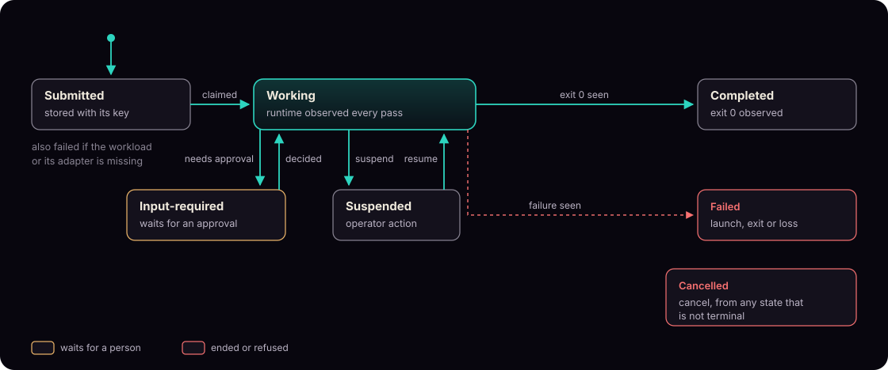
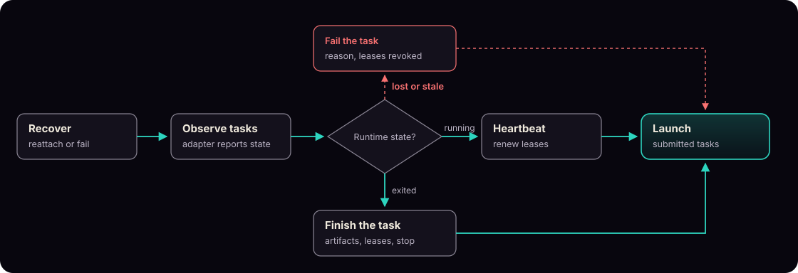

# Tasks

A task is one run of a workload. The daemon stores it, a loop called the reconciler launches and watches it, and every change of state is written as an event, so a restart can pick up where the last process stopped. This page explains how tasks start, which states they move through, and what keeps them from running twice.

Status: partly built. Suspend and resume do not keep a workload alive (see [Known gaps](#known-gaps)).

## How a task is created

Each of these ends in one call that stores a task in state `submitted`:

- `sablectl task submit <workload>` and `POST /api/v1/tasks` (operator credential).
- The web UI task form and workflow form.
- A `Schedule` manifest. The cron expression is read in UTC, and minutes in which the daemon was not running are not made up.
- A [Conclave](../glossary.md#conclave) turn, which the broker submits with a reserved key.
- The next step of a `Workflow`, or a retry of a failed task.

The GitHub webhook and A2A routes also submit tasks; both are parked by [ADR-0011](../adr/0011-sanctum-scope-trust-and-cli-harnesses.md).

A task carries an idempotency key. If none is given the task ID is used. Submitting the same key for the same workload returns the task that already exists; the same key for another workload is refused. Keys that start with `wf:` belong to workflows and keys that start with `conclave-` need a reservation, so an operator call cannot use them. A scheduled workload gets the key `sched:<name>:<UTC minute>`, so a double fire in one minute makes one task. A workflow run takes its root task ID from a hash of its key, so a schedule slot keeps one root across restarts.

## States and what moves a task

| State | Meaning | Left by |
| --- | --- | --- |
| `submitted` | Stored, nothing started. No lease, no heartbeat and no budget ceiling yet. | The reconciler claims it (`dispatch_claimed`) or fails it (`workload_missing`, `adapter_missing`); an operator cancels it. |
| `working` | Launched; the runtime is observed on every pass. | Exit observed, a failure reason, cancel, suspend, or the MCP Gate asking for an approval. |
| `input-required` | An action or tool call waits for an approval. | The reconciler returns it to `working` when every approval of the task is decided and none is pending (`approval_decided`). |
| `suspended` | An operator suspended it. | Resume or cancel. |
| `completed`, `failed`, `cancelled` | Terminal. | Nothing. A retry creates a new task. |

The store does not check a general table of allowed transitions for ordinary tasks; in SQLite, the trigger `council_attempt_terminal` forbids moving a council attempt task out of `completed`, `failed` or `cancelled`. Each change is a compare-and-swap on the current state (`UPDATE ... WHERE state = from`), so two callers cannot both move the same task, and each change adds a row to `task_events` with a reason. `sablectl task inspect` shows those events. Failure reasons include `launch_failed`, `lost_on_restart`, `observe_error`, `runtime_unknown` and `author_checkout_unavailable`. A coding task refused because no container runtime is configured and host mode is off fails with `launch_failed` and the fact `"reason":"coding_runtime_unavailable"`.

## What one pass of the reconciler does

The daemon runs a pass every 2 seconds. ADR-0002 calls the loop observe, update, derive and act; in the code it is the flow below.

- Observe: the adapter reports `running`, `suspended`, `completed` or `failed`. A running answer with a fresh timestamp is recorded as a heartbeat and extends the task's leases to one hour past the observation.
- Stale: a working task with no heartbeat for more than 2 minutes, whose runtime has not exited, fails with `lost_on_restart`. Three observation errors in a row fail it with the error reason.
- Launch: at most 4 tasks run at once by default (`--max-concurrent`, 0 means no limit) and at most 4 launches are in flight. A launch mints a lease valid for one hour, builds the input and calls the adapter with a 30 second start timeout.
- Terminal: when the exit is observed the reconciler stores artifacts, sets `completed` or `failed`, revokes leases and stops what is left of the runtime. Completed tasks record only `{"exit_code":0}`. On failure, `runtime_exit_observed` carries `exit_code`, adds the redacted diagnostic `reason` when non-empty (cut to 1024 bytes on a UTF-8 boundary), and sets `log_close: true` when a runtime output log failed to close or write; those fields are copied onto `runtime_failed`. Tasks with `log_close: true` or exit code `-2` end `failed` without auto-remediation so side effects are not rerun. A completed workflow step submits the next step here. A workflow [command step](command-steps.md) that fails or is refused halts its run instead.

## Restart recovery

Each running task has a handle (process ID and OS start time, or container identity) stored as a memory entry in a reserved namespace that tools cannot read or write. After a restart the first pass loads each handle and checks it:

- A process handle is reattached if the recorded ID and start time match a live process, or if that process has exited and left an exit record with the same ID and start time, in which case the next pass records its completion. An unverified ID is never signalled.
- A container handle is always cleaned up (container, proxy and network of the old launch), then the task fails with `lost_on_restart`, because the old daemon's listeners are gone.
- A missing or invalid handle fails the task with `lost_on_restart`.
- A claim record keeps two daemons from recovering the same task.

`submitted` tasks need no recovery; the next pass launches them. Because `submitted` to `working` is a compare-and-swap, no pass can launch a task twice, and the worktree and branch names are derived from the task ID (`sablecourt/<task id>`), so a repeat cannot create a second checkout.

When the daemon exits, it closes the store once. Any store-close error is redacted, cut to 1024 bytes on a UTF-8 boundary, and logged at error level. If the daemon was otherwise exiting cleanly, the close error becomes the exit error and the process exits non-zero; if an earlier daemon error already occurred, that earlier error stays the return value and both errors are logged.

## Child tasks and sub-budgets

A task may have a parent: workflow steps after the first and retries of those steps do. A parent-bound task that calls the Model Gate must carry a budget ceiling (`maxInputTokens`, `maxOutputTokens`, `maxCostUSD`); the gate refuses its calls at or past the ceiling (PR 66, PR 86) and refuses a missing or malformed one (see [Model Gate](model-gate.md#child-budgets)). A delegated child (`delegate:<workload>` after a policy check) has no caller yet; see [Known gaps](#known-gaps).

## Known gaps

What the code does today, where it falls short of the design.

- Suspend and resume. `task suspend` asks the adapter for a checkpoint, then always stops the workload; the coding and Docker adapters keep nothing resumable, and `task resume` fails for coding tasks. Tracking issue #14 lists the faults; use cancel and retry instead.
- Model calls from workflow steps: steps after the first have a parent but are created without a budget ceiling, so the Model Gate refuses their calls with `invalid_child_budget_ceiling`; see [Model Gate](model-gate.md#known-gaps).
- Delegation: `ProposeChildTask` exists in the reconciler but nothing calls it, so no agent can create a child task today.

## In depth

- [Workloads and runtimes](workloads-and-runtimes.md), [model gate](model-gate.md), [approvals](approvals.md)
- [ADR-0002](../adr/0002-heterogeneous-mvp-workload-adapters.md), [ADR-0006](../adr/0006-hub-and-spoke-a2a-task-envelope.md)
- Code: `internal/controlplane/reconciler.go`, `internal/controlplane/recovery.go`, `internal/controlplane/scheduler.go`, `internal/store/reconcile.go`
