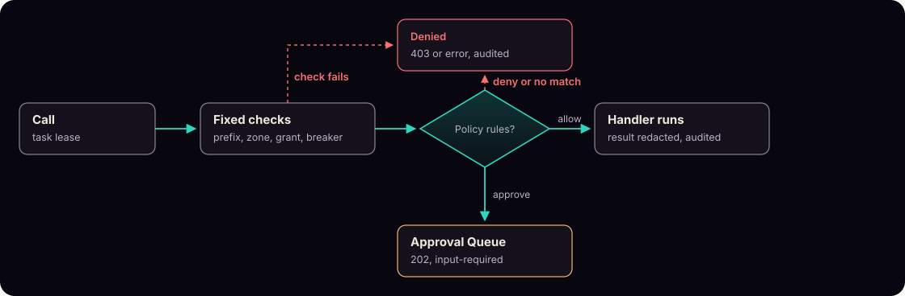

# Tools and actions

The MCP Gate (also called the Data and Action Gate) serves the tools a workload is granted and runs a small closed set of typed actions, after the policy engine has said yes. A workload reads Court Memory on demand through its tools and asks for a change outside its own checkout through its actions; the daemon also puts a context packet into the task input.

Status: built. Several faults are known and tracked in issue #9 (see [Known gaps](#known-gaps)).

## Two routes

| Route | What it serves | Credential |
| --- | --- | --- |
| `/gate/mcp` | MCP over Streamable HTTP, stateless. `tools/list` returns only the tools named in the workload's `grants.mcpTools` that the gate has registered. | Task lease as a bearer token |
| `/gate/actions/<name>` | `POST` of one typed action with `{"payload": ..., "approvalId": ...}`. The action must be in the catalog; an unknown name is 404 and audited. | Task lease |

The lease must be active, and its workload must be declared in the loaded manifests. The action body is limited to 2 MiB, unknown fields are refused. The action path is `/gate/actions/<name>`.

Built-in tools: `sablecourt.list_workloads`, four memory tools (`memory.put`, `memory.get`, `memory.search` and `memory.delete`) and four Conclave tools (`conclave.post`, `conclave.read`, `conclave.relic_put` and `conclave.relic_get`). `memory.put` redacts the value it stores. `memory.put` and `memory.delete` refuse the namespaces `learning:*`, `proposed:learning:*` and `system:*`; `memory.get` and `memory.search` refuse `learning:*` and `system:*` (a search without a namespace leaves their entries out). `memory.search` is a substring match (SQL `LIKE`) on keys and values and returns 50 entries by default. Built-in actions: `git.create_branch` (local branch, name must start with `sablecourt/`), `git.open_pr` (opens a GitHub pull request with the gate's token; head must start with `sablecourt/`, and owner and repository must be the GitHub repository pinned at start, see below) and `sandbox.propose_promotion` (checks that the workload is in the sandbox zone and returns the next step; it changes nothing).

Each action payload is decoded once, strictly, into the action's typed input: a duplicate key, a key that differs from a field only in case, an unknown field, a `null` value, text that is not UTF-8, a `\u` escape of an unpaired surrogate (which the decoder would turn into U+FFFD) or any data after the object is refused with 400 before an approval exists (a `git.open_pr` target other than the pinned repository is refused with 403 at the same point). The approval digest, the dialog and the executor all use that one decoded value. Branch and base names are checked as Git ref names and used as given, nothing trimmed, and `git.create_branch` needs an explicit `base`. The gate accepts a narrower set than Git: at most 200 bytes, each `/`-separated part starts with an ASCII letter or digit and holds only letters, digits, `.`, `_` and `-`, no part ends in `.` or `.lock`, and no `..` or `HEAD`. A base such as `release/_candidate`, which Git accepts, is refused with 400. A body over 2 MiB is refused: with 400 when it comes through the daemon, whose body limit applies first, and with 413 from the action handler alone.

## Which repository `git.open_pr` may target

When the daemon starts it reads the `origin` remote of its repo root once and pins that GitHub `owner/repo`. `git.open_pr` refuses any other target with 403 when the payload is checked, before an approval is requested or spent, refuses every call when the origin read when the action runs (after an approval is spent) differs from the pin, and refuses every call when nothing could be pinned (no origin, or an origin that is not on github.com; GitHub's SSH over port 443, user `git` at host `ssh.github.com` port 443, is accepted). While a repository is pinned, each audit row the gate writes for an action call names it as `allowed_repo`, except the row for an unknown action name and the `pending` row the approval queue writes. A reload (`POST /api/v1/reload`, a manifest saved in the web UI, or a manifests git sync) never changes the pin: it reads the origin again only to compare it. A changed or unreadable origin logs a warning on each reload and writes one `denied` audit row with reason `repo_origin_changed` or `repo_origin_unreadable` each time the observed origin changes. A row that cannot be written stays owed, and later reloads write it in order, even after the origin has changed again; at most 16 owed rows are kept and the oldest is dropped past that. These rows are in category `data_action_gate` and name no task. To point `git.open_pr` at another repository, change the origin and restart the daemon.

## How a call is decided

The capability string is `mcp:<tool>`, `action:<name>` or `delegate:<workload>`. The engine (`internal/policy`) applies these steps in order and the first match wins:

A rule names a workload and a capability, each exact, `*`, or a prefix ending in `*`. All matching rules are read: one `deny` wins, then `approve`, then `allow`; no match means `default_deny`. A `Policy` whose `defaultEffect` is not `deny` is rejected at load. A missing engine, an empty name or an unknown effect also deny. The reason string (`explicit_policy_deny`, `capability_not_granted_on_workload`, `sandbox_zone_forbids_mutation`, `circuit_breaker_open`, `default_deny` and others) goes into the audit row and the error the workload sees.

- allow: the handler runs. The result is redacted before it is returned, and the audit row records the number of redaction hits. Arguments are not redacted on the way in.
- approve: for an action without `approvalId`, an approval is created with a 15 minute lifetime, the task moves to `input-required`, and the gate answers 202 with the approval ID and payload digest. The workload repeats the call with the approved ID; the gate runs it only if the approval is `approved` and matches the same task, the same capability and the SHA-256 of the same payload (see [approvals](approvals.md)).
- deny: 403 for an action, an error result for a tool, plus an audit row.

## Circuit breaker

Each failed run of an action records a failure for its capability, a target refused when the action runs included. When the policy effect is `allow`, a payload or target refused at the check counts too. Three failures in a row open the breaker for 2 minutes, and a success resets it. An open breaker makes the engine deny `action:` calls with `circuit_breaker_open`. In the current wiring the gate records failures on a breaker object that the policy engine does not check, so the breaker never opens (see [Known gaps](#known-gaps)).

## Redaction

`internal/redact` has two layers, and the gate applies both to every tool and action result and to error messages. Court Memory writes redact their value, and the coding adapter redacts task input. Neither layer runs on tool arguments: the gate hands them to the handler unchanged, so redaction of an argument is up to the handler. The memory tools redact the values they store or put in an audit row, and the Conclave tools redact message and Relic bodies. Neither layer runs on Model Gate request bodies, so repository content a harness reads can reach the model provider.

Exact match is the layer that can be tested as a guarantee ([ADR-0015](../adr/0015-redaction-is-defence-in-depth.md) and its 2026-11-27 amendment, Proposed). It replaces each secret the daemon holds in memory (the operator token, task leases it issued, provider keys, webhook secrets and the other secrets it loads) when the value appears in its literal bytes or in a fixed list of spellings: quoted, JSON-escaped, and base64 or hex for binary values. It decodes nothing else. The launch input and stored task messages are declared JSON records: each is decoded once, and one that shows a held value is refused whole, with none of its payload. Stored task input is checked again when it is read through A2A `tasks/get`, the task API and the dashboard, so a value registered after the task was stored does not come back out.

A credential shorter than 8 bytes is refused where it is loaded, with an error that names the setting and not the value; at start the daemon does not run with one.

Pattern rules are the second layer: regular expressions for some common key shapes, bearer headers and secret-looking `key: value` pairs, run in linear time. They are best effort, and the test rows in `internal/redact` show what they replace.

Exact match does not cover percent encoding, mixed-case hex, nested encodings, Unicode normalisation, number renderings, or a value split across fields or records. It does not run on audit fields, error and log text, the Agent Card, council reads or Takeover input. These limits are tracked in [issue 189](https://github.com/shadewright-labs/sablecourt/issues/189).

### Known redaction gaps

The tests in `internal/redact` hold, for the pattern rules, a corpus of synthetic secrets and ordinary text. Each row is either asserted (hidden, or kept unchanged) or listed in the gap table of `known_gaps_test.go`, which pins today's result: the secret stays visible, or, in the over-redaction class, ordinary text is hidden. When a rule starts covering a gap row, `TestKnownGaps` fails and tells you to move the row to the corpus. The table below is generated from the gap table, and `TestKnownGapsDoc` fails when the two differ.

<!-- redact-gaps:start -->

| Class | Rows | Examples |
| --- | --- | --- |
| token key names | 3 | `auth_token: <value>`, `https://x.invalid/?token=<value>&next=/home` |
| URL userinfo | 17 | `postgres://app:<password>@example.com:5432/x`, `redis://:<password>@cache.internal:6379/0`, `postgres://app:p@<rest of password>@example.com/x` |
| Basic auth | 7 | `Authorization: Basic <base64>`, `Proxy-Authorization: Basic <base64>`, `map[Authorization:[Basic <base64>]]` |
| truncated PEM | 9 | `a BEGIN RSA PRIVATE KEY header and body with no END line`, `a BEGIN PRIVATE KEY block closed by an END line of another label`, `BEGIN PRIVATE KEY header with the body glued to it, no END line` |
| JWT | 11 | `session=<header>.<payload>.<signature>`, `tok=<header>.<payload>`, `enc=<five dot-separated segments>` |
| cookies | 11 | `Cookie: session=<value>`, `Set-Cookie: sid=<value>; Path=/; HttpOnly`, `curl -H 'Cookie: a=b' https://x.invalid` |
| nested YAML | 34 | `secret:\n  value: <value>`, `database:\n  password:\n    value: <value>`, `{"text":"secret:\n  value: <value>\n"}` |
| Slack keys | 1 | `slack=xoxb-<digits>-<digits>-<letters>` |
| Stripe keys | 1 | `stripe=sk_live_<24 characters>` |
| other: key names | 16 | `SECRET_KEY: <value>`, `pwd=<value>`, `credentials: <value>` |
| other: Authorization forms | 10 | `{"Authorization":["Bearer <value>"]}`, `Authorization: Token <value>`, `Authorization: Digest username="u", response="<value>"` |
| other: value shapes | 21 | `{"password": 12345678901}`, `{'password': '<value>'}`, `password=ab,<rest of value>` |
| other: command-line flags | 4 | `mycli --password <value> --host db.internal`, `curl -u admin:<value> https://api.invalid/v1`, `curl --proxy-user u:<value> https://example.test/` |
| other: split tokens | 17 | `a GitHub token with an invalid UTF-8 byte inside`, `a GitHub token with a zero-width space inside`, `AKIA<16 characters>_ID` |
| other: opaque strings | 1 | `deploy <40 hex characters>` |
| over-redaction | 6 | `interface Cfg { token: string; apiKey: string }`, `secret:\n  secretName: db-creds\n  defaultMode: 0400`, `password: changed` |

<!-- redact-gaps:end -->

## Audit rows

Once the lease and the request envelope are accepted, the gate appends a row, category `data_action_gate`, for a policy denial, a handler error or refusal, an allowed call, an unknown action and an approval mismatch. Requests that fail the lease check or the envelope check (401, 403, 400, 413, 503) write no gate row, and neither does a failure to queue an approval. The memory tools add rows in category `memory`, including refusals of reserved namespaces. Creating an approval writes a row in category `approval`. Gate rows are best effort: the gate ignores an error from the append, so a failed write loses the row and the call carries on. The exception is the `consumed` row of an approved action, which must be written before the action runs. A tool call that returns `approval_required` writes nothing in the gate itself.

## Known gaps

What the code does today, where it falls short of the design.

- Tool calls whose effect is `approve` cannot complete: each call creates a new pending approval and there is no way to present an approved one. Only actions can be approved and re-run.
- The circuit breaker never opens, because the gate and the policy engine hold separate breaker objects.
- There is no action that commits or pushes, so the branch, commit and pull request path of [ADR-0004](../adr/0004-in-house-capability-gates-three-doors.md) stops at the branch and the pull request call.
- The sandbox-zone rule covers `action:` and `delegate:` only; a mutating MCP tool such as `memory.put` is open to a sandbox workload when policy allows it.

## Upstream MCP servers

Upstream MCP servers (`grants.mcpServers`) are built, but ADR-0011 puts them outside the current scope. At start-up and on reload the daemon registers, for each server with a name and a URL, each non-blank tool of `allowedTools` as `<name>.<tool>`. Registration is daemon-wide: a workload sees a tool only when its own `mcpTools` grant holds the full name, and the policy engine decides each call. The bridge adds the server's secret on the way out and reads at most 4 MiB of a response.

## In depth

- [Approvals](approvals.md), [model gate](model-gate.md), concepts (page planned)
- [ADR-0004](../adr/0004-in-house-capability-gates-three-doors.md), [ADR-0005](../adr/0005-dual-path-human-in-the-loop.md)
- Code: `internal/gate/mcp/gate.go`, `internal/gate/mcp/actions.go`, `internal/gate/mcp/memory.go`, `internal/policy/policy.go`, `internal/redact/redact.go`
