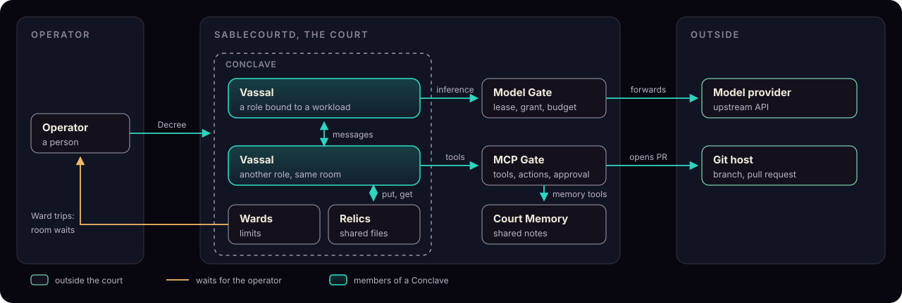

# The court

Sablecourt names some of its parts after a court. This page explains the convention, lists the court terms the product uses and the places where each one appears, says why each name fits the thing it names, and says why each manifest kind and option has the name it has. Plain definitions are in the [glossary](glossary.md), and types and defaults are in the [manifest reference](reference/manifests.md).

Status: built, apart from the items under [Not built yet](#not-built-yet). The location lists below were taken by searching the web UI templates and scripts, the HTTP routes, the `sablectl` and `sablecourtd` commands, the audit actions and the manifest loader in the source tree. A term can also appear in places that search did not reach, such as free text in an error message.

## The convention

The brand notes give the three Shadewright Labs products a role each: Nightloom is the Watchman, Sablecourt is the Court and Shadewright is the Craftsman. The notes describe Nightloom as a read-only observer and Shadewright as the product that works through reviewed GitOps pull requests. Sablecourt is the one that runs declared workloads under rules.

In the court picture:

- The operator is the person the court answers to.
- The daemon (`sablecourtd`) is the court itself. It reads the manifests, launches work and keeps the record.
- A Conclave is a room the court convenes. Its members, the Vassals, are workloads that each hold a role in it. A Council is a Conclave with a fixed panel that answers one question.
- Wards limit the room, a Decree is the operator speaking into it, and Relics are the files its members hand to one another.
- The gates are the doors a workload's requests go through. The audit chain is the court's record.

The brand notes describe Sablecourt as a runtime and tribunal that governs declared workloads, and the court vocabulary names who may speak, who may act, who must ask and what the record says. How the gates, policy and audit chain behave is covered in [how it works](how-it-works/index.md).

The brand notes also say what the mark shows: a shield with three hooded councilors, which the brand book gives as a sign of quorum, Conclaves and policy oversight. They call the set of terms in their lexicon the dark-elven domain lexicon and give each term its technical meaning. They do not record where any of the words came from, and this page does not invent a source for them.

### What the metaphor buys

- A short name for each role. "Vassal" says a member that serves a room and answers to it, which "agent" does not.
- Terms that other tools do not use in the same sense. A "session" or an "approval" means something different from one tool to the next, and a Ward is a Ward only here.
- Specific verbs. A Ward trips, a Decree is issued, a Relic is put.

### Where it stops

- The terms in the table below are the court terms the code uses. Other names are plain: `Workload`, `Policy`, `Budget`, `Workflow`, `Schedule`, task, lease, harness, gate, audit chain, approval.
- A Ward is a counter with a limit, not a judge. A `Policy` must set `defaultEffect: deny`, and the loader rejects any other value.
- There is no court term for a task or a lease, because the plain word is the clearer one.
- Some terms are in the code only as labels in the web UI (Houses, Tribunal, Cockpit). The tables below say where each appears, and a search of the CLI, the HTTP routes and the manifest loader found none of them there.
- The decided-but-not-built terms are kept out of the table. They are under [Not built yet](#not-built-yet).

The diagram shows who is who and who talks to whom. The operator speaks to a Conclave with a Decree. Inside the daemon, the Vassals of a Conclave message each other, only along the pairs their `canMessage` lists allow, and they put and get Relics. A Vassal reaches the Model Gate for inference and the MCP Gate for tools and actions. The Model Gate forwards to the provider. The MCP Gate serves the `memory.*` tools that read and write Court Memory and runs allowed actions such as `git.open_pr`. A tripped Ward pauses the Conclave (state `input-required`). The Wards, the Relics and the room itself are shown as parts of the Conclave because they belong to one room. For how requests move through the gates, see [how it works](how-it-works/index.md).

## Court terms

"Where the name comes from" gives the source in the brand notes or an ADR where there is one, and otherwise says that no note records one. "Where it appears" lists the places found in the source tree, and says what kind of element each one is. The next section, [Why the names fit](#why-the-names-fit), gives the reasons for each name.

| Term | In plain words | Where the name comes from | Where it appears |
| --- | --- | --- | --- |
| The Court | The role the brand notes give Sablecourt among the three products. | The brand notes' ecosystem topology labels Sablecourt "The Court", next to Nightloom "The Watchman" and Shadewright "The Craftsman on Kubernetes". | Web UI: the `title` attribute of the logo link on the home page, "Sablecourt · The Court". It is not on the other pages. |
| Conclave | A room where several workloads work on one topic under limits. | The brand notes list it in the lexicon as a multi-agent room under shared governance. ADR-0008 titles the design "Multi-agent Conclaves". | Manifest kind `Conclave`. HTTP routes `/api/v1/conclaves`, `/api/v1/conclaves/{id}` and its `stream`, `decree`, `voice-decree`, `close` and `relics` sub-routes, and the member routes `/gate/conclave/{id}/messages` and `/gate/conclave/{id}/relics` (these are registered only when the conclave broker runs). CLI group `sablectl conclave` with `list`, `open`, `decree`, `inspect`, `watch`, `relic put`, `relic get` and `close`. MCP gate tools `conclave.post`, `conclave.read`, `conclave.relic_put`, `conclave.relic_get`. Tools of `sablectl mcp-server`: `sablecourt_open_conclave`, `sablecourt_inspect_conclave`, `sablecourt_conclave_decree`. Audit actions `conclave.open`, `conclave.post`, `conclave.ward`, `conclave.relic_put`, `conclave.close` and `conclave.run_window_reset`. Web UI: nav item "Conclaves" on every page, pages `/conclaves` and `/conclaves/{id}`, the form headed "Convene a Conclave" with its "Conclave template" select, the heading "Active and recent Conclaves", the "Close Conclave" form on the room page, and the heading "Define Conclave (multi-agent room)" on the Studio page. |
| Council | A Conclave of `claude`, `codex` and `agy` that answers one question in bounded rounds. | ADR-0013 ("Bounded council rounds in Conclaves"). No note records why the word was chosen. | CLI `sablectl council`, which prompts "Council question: " on standard error when no question is given, and `sablectl harness build` ("Build local council harness images"). Route `POST /api/v1/councils`. Tools `sablecourt_council_convene`, `sablecourt_council_read` and `sablecourt_council_say` of `sablectl mcp-server`. The workload names `claude`, `codex` and `agy` are reserved: the manifest loader rejects them as names of declared workloads. The daemon refuses to open one with the error "council opening requires Sanctum" when councils are switched off, which `sablecourtd` does in Citadel mode. No web UI page or label uses the word. |
| Vassal | A member of a Conclave: a role bound to a workload. | The brand notes list it in the lexicon as an individual agent in a Conclave. | Manifest field `spec.vassals` of a Conclave. Web UI: the heading "Vassals" on the room page, the "Vassal 1" to "Vassal 3" labels, "+ Add vassal" and "Remove" buttons and `vassal_role`, `vassal_workload` and `vassal_activation` fields of the Studio Conclave form, and the "(N vassals)" suffix in the template select of the Convene form. |
| Ward | A limit on a Conclave that pauses it when reached. | The brand notes list it in the lexicon as the automated safety breaker of a Conclave. ADR-0008 calls them deterministic Wards. | Manifest field `spec.wards` (`maxRuns`, `maxMessages`, `maxPingPong`); the Conclave's `budgetRef` is also checked as a Ward. Conclave state `input-required` with a ward reason. Audit action `conclave.ward` with outcome `paused`, the alert event `conclave.ward_paused`, and the metric `sablecourt_conclave_ward_trips_recent`. Web UI: the line "Wards: maxMessages=..., maxPingPong=..." and a "ward:" reason line on the room page, a `ward=` suffix in the Conclave list, the placeholder "Direct the Conclave or resume after a Ward pause..." in the Decree field, the "Ward: maxMessages" and "Ward: maxPingPong" fields of the Studio Conclave form, and the description text of the alerts card on the Providers page. |
| Decree | A message from the operator to a Conclave. It steers the room and can resume a paused one. | The brand notes list it in the lexicon as live operator intervention in a running Conclave, by text or push-to-talk voice. | CLI `sablectl conclave decree`, and the `--decree` flag of `sablectl conclave open`. Routes `POST /api/v1/conclaves/{id}/decree` and `POST /api/v1/conclaves/{id}/voice-decree`; `POST /ui/conclaves/{id}/decree`. Tool `sablecourt_conclave_decree`, and the `decree` field of `sablecourt_open_conclave`, of `sablectl mcp-server`. Message kind `decree`. Web UI: the "Opening Decree (optional, sent to @all)" field of the Convene form, the "Issue operator Decree to" select, the "Decree" field and the "Issue Decree" button on the room page, and the "Voice Decree (local STT)" button next to it. |
| Relic | A named, redacted file that members of a Conclave hand to one another. | The brand notes list it in the lexicon as a named, secret-redacted artifact published by a Vassal for the other members. | CLI `sablectl conclave relic put` and `get`. Routes `POST /api/v1/conclaves/{id}/relics` and `GET /api/v1/conclaves/{id}/relics/{name}`, the member routes `/gate/conclave/{id}/relics`, and `POST /ui/conclaves/{id}/relics`. MCP gate tools `conclave.relic_put` and `conclave.relic_get`. Audit action `conclave.relic_put`. Web UI: the heading "Relics (N)" and the "Upload Relic" form on the room page. The context packet of a task has a section named "Conclave Relics". A council writes its closing digest as a Relic named `digest`. How a Relic reaches another member is described in [how a Conclave works](how-it-works/conclaves.md) and [how a context packet is built](how-it-works/context-and-learning.md). |
| Scry | A live, read-only, redacted view of a running task's output. | The brand notes list it in the lexicon as live read-only streaming of a running agent's output. | CLI `sablectl task scry`. Route `GET /api/v1/tasks/{id}/scry`, registered only when the attach hub runs. Audit action `task.scry`. Web UI: on the task page, the heading "Live console (Scry / Takeover)" and the status text "Connecting to Scry stream..." and "Scry live (read-only)". |
| Takeover | Exclusive input to a running task's `stdin`, with an audit record. | The brand notes list it in the lexicon as exclusive operator attachment to a running task, with automatic audit logging. | CLI `sablectl task takeover`. Routes `POST /api/v1/tasks/{id}/takeover`, `.../stdin` and `.../detach`, registered only when the attach hub runs. Audit actions `task.takeover` and `task.detach`. Web UI: the "Takeover" button on the task page. ADR-0011 parks feature work on live takeover; the code stays in the tree. |
| Sanctum | The default mode of `sablecourtd`. | The brand notes list it in the lexicon as the personal or workstation mode. | `sablecourtd --mode=sanctum` (the default; `local` is accepted as an alias, and the `SABLECOURT_MODE` environment variable can change it). The `--mode=sanctum` argument in the launchd job and the systemd unit that `sablectl service install` writes. The error "council opening requires Sanctum". The help text of the `--mode` flag. |
| Citadel | The Kubernetes mode of `sablecourtd`. ADR-0011 parks feature work on it. | The brand notes list it in the lexicon as the enterprise Kubernetes mode. | `sablecourtd --mode=citadel` (`enterprise` is accepted as an alias). The log line "citadel mode active: host coding-agent disabled, fail-closed operator auth enforced". Councils are switched off in this mode. The help text of the `--mode` flag. |
| Court Memory | The key-value store the court keeps across tasks and Conclaves. Entries are redacted. | No note explains the name. The brand notes' ecosystem topology mentions "Court Memory" but the lexicon does not list it. | Web UI: the page `/memory` with the title and heading "Court Memory", the nav item "Memory", the "Store Memory Entry" form, the routes `POST /ui/memory/set` and `POST /ui/memory/delete`, and the command palette entry "Court Memory (FTS5)". CLI `sablectl memory` with `list`, `set` and `delete`. Routes `GET` and `POST /api/v1/memory` and `DELETE /api/v1/memory/{namespace}/{key}`. MCP gate tools `memory.get`, `memory.put`, `memory.search` and `memory.delete`. Store table `court_memory`. |
| Houses | The web UI's name for the declared workloads. | UI label only. No note explains it. | Web UI home page only: the card "Declared Houses" in the row of count cards, and the panel "Houses (Workloads)" in the left column. |
| Tribunal | The web UI's name for the audit view and the approval panel. | The brand notes call the mark the Tribunal Shield and describe Sablecourt as a policy tribunal. No note explains the UI labels. | Web UI: the heading and title "Audit Tribunal" on the `/audit` page, the command palette entry "Audit Tribunal & SHA-256 Chain", the count card "Tribunal Approvals" and the panel "Tribunal · Approvals" on the home page. |
| Cockpit | The web UI's home page. | UI label only. No note explains it. | Web UI: the nav item "Cockpit" (it links to `/`) and the command palette entry "Cockpit Dashboard". The home page layout also uses the CSS class `sc-cockpit`. |
| Studio | The web UI page where you define an agent, a workflow or a Conclave in the browser. | UI label only. No note explains it. | Web UI: the nav item "Studio", the page `/studio` with the heading "Agent & workflow studio", the palette entry "Workload & Conclave Studio", and the form routes `POST /ui/studio/agent`, `POST /ui/studio/workflow` and `POST /ui/studio/conclave`. |
| Convene | The verb for opening a Conclave or a Council. | No note explains it. | CLI: the short text of `sablectl conclave`, `sablectl conclave open` and `sablectl council`, and the output "convened conclave" and "convened council". The descriptions of the `sablecourt_open_conclave` and `sablecourt_council_convene` tools. Web UI: the heading "Convene a Conclave", the button "Convene Conclave" and the notice "Conclave convened". |

Two points on the table.

1. The names in manifests, routes and commands are the same words as the table: `Conclave`, `vassals`, `wards`, `decree`, `relic`, `scry`, `takeover`. The UI labels (Houses, Tribunal, Cockpit, Studio) appear in the web UI, and the label for a workload elsewhere is "workload".
2. A UI string says something the code does not do. The command palette lists "Court Memory (FTS5)", but memory search uses SQL `LIKE`, not full-text search. This page follows the code.

## Why the names fit

The brand notes record no source for any of these words. What follows is our reasoning for why each name suits what the component does: what the word means in a court or in ordinary English, and which property of the component it points at. It is design rationale, not the history of how the names were chosen. Each entry ends with a rating: good, partial or weak.

| Term | What the word means | The property it points at | Fit |
| --- | --- | --- | --- |
| Sablecourt | A court is a body that hears a matter, applies rules and records what it decided. "Sable" is the heraldic word for black. | The brand book describes Sablecourt as a tribunal that governs declared workloads, and the product applies rules to every request that reaches a gate and records the outcome in the audit chain. The brand uses a heraldic shield on a near-black field (Night, `#08060E`), which matches "sable". The notes do not link the word to the colour. That link is our reading. | Good for "court". The "sable" reading is ours. |
| The Court | The body that decides under rules and does not act on its own initiative. | `sablecourtd` reads declared manifests to know what may run, and a `Policy` must have `defaultEffect: deny`, so a request that no rule allows is refused by default. | Good |
| Conclave | A private meeting held behind closed doors. | A Conclave is a bounded room. Members exchange messages through the daemon, and `canMessage` lists decide which roles may address which. The room has its own limits (Wards) and closes. | Good |
| Council | A body that deliberates and advises, and does not rule. | A Council is three harnesses (`claude`, `codex`, `agy`) answering one question in rounds, two by default. When it closes, the daemon writes one digest Relic from the recorded answers and keeps disagreements. No chair is launched to decide. The default checkout is read-only, so the Council advises on code and does not change it. | Good |
| Vassal | Someone who serves a higher authority and answers to it. | A Vassal is a role bound to a workload. The room launches it (`always-on` or `on-mention`), limits who it may message, and can pause it by tripping a Ward. | Good. The feudal sense of owing service fits less well than the sense of answering to the room. |
| Ward | To keep ward is to guard, and a ward is also a person under a guardian. | A Ward is a limit (`maxMessages`, `maxPingPong`, `maxRuns`, the budget). When one trips, the Conclave stops and stays paused until the operator speaks. In the guardian sense the room is the ward and the limit is the guardian. | Good. Both senses point at a guard that stops the room and does not judge it. |
| Decree | An authoritative order from the person in charge. | A Decree is stored with kind `decree`, goes into the context of later turns as a "Recent Conclave Decrees" section, and can resume a paused room. Only the operator issues one. | Good |
| Relic | An object that is kept and passed on. | A Relic is a named file stored by the daemon in one room, with its SHA-256 recorded in the audit record when it is put. Members read it later, and so does the operator. | Partial. Relics are old objects, and these files are made during the run. The "kept and passed on" part fits. |
| Scry | To see something far away by looking into a glass, without touching it. | Scry is a read-only stream of a running task's redacted output. It offers no way to write. | Good |
| Takeover | Taking control of something that someone else is running. | Takeover gives one operator exclusive write access to a task's `stdin`. A second operator is refused while it is held, and the audit chain records `task.takeover` and `task.detach`. | Good |
| Sanctum | A private, protected place. | The default mode, for one person's machine. The daemon listens on `127.0.0.1:7432` unless told otherwise. | Good |
| Citadel | The fortified stronghold of a city. | The Kubernetes mode, started with host coding agents disabled and operator authentication that fails closed. The pair also reads as a personal room against a fortified shared place. | Good |
| Court Memory | A court keeps records of what it has been told. | A key-value store with a namespace, a key, a value and an author. Entries are redacted. Workloads reach it through `memory.*` tools. The audit chain is closer to a court record than this store is. | Partial |
| Houses | A household or a noble family under a lord. | The home page shows each declared workload as a card with its name and class. No CLI command, route or manifest uses the word, and "workload" is the working name. | Weak |
| Tribunal | A court of justice, where a decision is given. | The "Tribunal · Approvals" panel lists requests that wait for a person to approve or deny, and the audit page lists what was decided. The approvals panel is a decision point. The audit view is closer to a record. | Partial |
| Cockpit | The place where a pilot sits among the instruments. | The home page shows counts, a workload list and a task list on one screen. It is not a court word. | Weak as a court term. It describes the page. |
| Studio | A room where something is made. | The Studio page writes agent, workflow and Conclave manifests as YAML files in the sandbox zone. It is not a court word. | Weak as a court term. It describes the page. |
| Convene | To call a group together for a purpose. | `sablectl conclave open`, `sablectl council` and the web form each create a room and launch its first members. | Good |

## Manifest kinds and their options

A manifest is a YAML document with `apiVersion: sablecourt.io/v1alpha1`, a `kind` and a `metadata.name`. The loader in `internal/config` accepts six kinds. This section says why each kind and each field has its name. Types, defaults and limits are in the [manifest reference](reference/manifests.md).

### Common to every kind

| Field | Why it is named so |
| --- | --- |
| `apiVersion` | The version of the manifest language, written in the Kubernetes style. `v1alpha1` says it is early and may change. The loader rejects any other value. |
| `kind` | Which of the six declarations this document is. |
| `metadata` | What the object is, as opposed to `spec`, which says what you want. It holds `name` and `zone`. |
| `metadata.name` | The name other manifests use to refer to this one. The loader requires it and rejects a duplicate name within the same kind. |
| `metadata.zone` | The zone the object sits in, `runtime` or `sandbox`. A zone is a trust area. A `Workload` must set it. A `Workflow` may set it, and the loader checks the value when it is set. A `sandbox` workload may not hold actions or delegation grants, and may not message a `runtime` Vassal. |
| `spec` | What you want, as opposed to `metadata`, which says what the object is. |

### Workload

A workload is something the court may launch. The word is plain on purpose: it covers a coding agent, a long-lived agent and a program with no model.

| Field | Why it is named so |
| --- | --- |
| `spec.class` | What kind of workload it is: `coding-agent`, `long-lived-agent` or `deterministic-controller`. The loader refuses a Model Gate grant for the last class, which runs fixed code. |
| `spec.runtime` | How the court launches the workload. The block is required. |
| `spec.runtime.type` | The launch method: `docker` or `worktree-cli`. |
| `spec.runtime.image` | The container image, required for `docker`. |
| `spec.runtime.readOnlyRootfs` | Whether the container's root filesystem is read-only. |
| `spec.coding` | The block only a `coding-agent` has, and one it must have. |
| `spec.coding.harness` | The coding CLI that is launched: `claude`, `codex` or `agy`. The word is used for the wrapper that runs a command-line agent. |
| `spec.coding.repoPath` | The repository the agent works in. |
| `spec.coding.sandbox` | The host sandbox for the run, for example `seatbelt`. |
| `spec.agentCard` | A short description of the workload for other agents, in the style of an A2A Agent Card (ADR-0006). Holds `description` and `skills`. |
| `spec.roleCard` | The card that says what role the workload plays. The context packet puts it first. |
| `spec.grants` | What the workload may ask for. A grant is permission given. |
| `spec.grants.modelGate` | The grant for the Model Gate, the door for inference. `allowed` switches it on, `providers` limits which providers, and `budgetRef` names the `Budget` that caps the spend. The loader requires `budgetRef` when `allowed` is true. |
| `spec.grants.mcpTools` | The tools it may call through the MCP Gate, such as `memory.get`. |
| `spec.grants.mcpServers` | Remote MCP servers the gate may proxy for it. Each has a `name`, a `url`, a `secretName` (the name of a stored secret, never the secret), an `authHeader` and `authPrefix` (how the credential is sent) and `allowedTools`. |
| `spec.grants.actions` | The typed actions it may ask for, such as `git.open_pr`. |
| `spec.grants.delegateTo` | The workloads it may hand a task to. |

### Policy

A policy is a set of rules about what a workload may do. It does not say who is right, only what is allowed.

| Field | Why it is named so |
| --- | --- |
| `spec.defaultEffect` | What happens when no rule matches. The loader requires `deny`. |
| `spec.rules` | The list of exceptions to that default. |
| `spec.rules[].workload` | The workload the rule is about. |
| `spec.rules[].capability` | What is being asked for, such as an action or a tool. |
| `spec.rules[].effect` | The outcome: `allow`, `approve` (wait for a person) or `deny`. |

### Budget

A budget is a spending limit. It is named as in accounting, not as a court term.

| Field | Why it is named so |
| --- | --- |
| `spec.perTask` | Limits for a single task. |
| `spec.perTask.maxInputTokens`, `maxOutputTokens` | The most tokens a task may send to and take from a model. |
| `spec.perTask.maxCostUSD` | The most a task may cost, in US dollars. |
| `spec.daily` | A limit counted per workload per day. |
| `spec.daily.maxCostUSD` | The most a workload may cost in a day. |

### Workflow

A workflow is a fixed order of steps, each run by a workload.

| Field | Why it is named so |
| --- | --- |
| `spec.description` | What the workflow is for. |
| `spec.steps` | The ordered steps. At least one is required. |
| `spec.steps[].name` | The name of the step. |
| `spec.steps[].workload` | Which workload runs it. It must exist. |
| `spec.steps[].role` | The part the step plays. The type notes name `author`, `verifier` and `fast`, and the reconciler treats `verifier` specially. |
| `spec.steps[].tier` | The class of model to use: `fast`, `coding` or `critic`. The loader rejects an unknown tier. A tier is a rung, from cheap to careful. |
| `spec.steps[].maxRetries` | How many times a failed step may be tried again. |
| `spec.steps[].provider`, `model` | An explicit model route. A `deterministic-controller` step may not set them. |
| `spec.steps[].prompt` | The text sent to the workload. |

### Schedule

A schedule starts work on a clock.

| Field | Why it is named so |
| --- | --- |
| `spec.cron` | The time pattern, in cron syntax. The loader rejects an invalid expression. |
| `spec.targetKind` | What the schedule starts: a `workload` or a `workflow`. |
| `spec.targetName` | The name of that workload or workflow. It must exist. |
| `spec.input` | The input given to the task it creates. |
| `spec.enabled` | Whether the schedule runs. |

The old [reference](reference.md) lists `spec.workload` for a schedule. The loader reads `targetKind` and `targetName`, and this page follows the code.

### Conclave

A **Conclave** is the room. It is the one kind that uses court words for its fields.

| Field | Why it is named so |
| --- | --- |
| `spec.description` | What the room is for. |
| `spec.budgetRef` | The `Budget` that caps the spend of the whole room, as a reference by name. The loader requires it to exist. ADR-0008 counts this limit among the Wards. |
| `spec.wards` | The limits on the room. |
| `spec.wards.maxRuns` | The most launches in the room. The loader accepts 0 to 6. |
| `spec.wards.maxMessages` | The most messages the room may carry. |
| `spec.wards.maxPingPong` | The most turns that pass between members without operator input (ADR-0008). Named after the table-tennis game of messages back and forth. |
| `spec.vassals` | The members. At least one is required. |
| `spec.vassals[].role` | The name a member answers to in the room, such as `reviewer`. Roles must be unique in the room, and may not be `operator`, `all` or `system`, or start with `@`. |
| `spec.vassals[].workload` | The workload that holds the role. It must exist. |
| `spec.vassals[].activation` | When the member is launched: `always-on` or `on-mention`. The loader rejects other values. |
| `spec.vassals[].canMessage` | The roles this member may speak to. `operator` and `all` are valid targets. The broker checks each message against these lists. |

## Plain words

If you know another tool, these are the nearest court terms. They are close, not equal.

| In other tools | In Sablecourt | Note |
| --- | --- | --- |
| Agent | Workload, or Vassal when it holds a role in a Conclave | A coding agent is a `Workload` of class `coding-agent`, run by a harness. |
| Session, run | Task | One run of a workload. Plain word, not a court term. |
| Room, chat, team | Conclave | A Council is a Conclave with a fixed panel. |
| Participant, seat | Vassal | The role and the workload together. |
| Artifact, attachment | Relic, inside a Conclave | A task also has artifacts. They are not Relics. |
| Approval, confirmation | Approval | Plain word. The web UI lists pending approvals in the panel "Tribunal · Approvals". |
| Memory, notes | Court Memory | Key-value store, entries redacted. |
| Guardrail, circuit breaker | Ward | A counter with a limit. |
| Human in the loop, intervention | Decree | A message to a Conclave. The answer to an approval is a separate action (`approve` or `deny`) and is not a Decree. |
| Live logs, tail | Scry | Read-only and redacted. |
| Attach, take the controls | Takeover | Exclusive input. |
| Local mode, cluster mode | Sanctum, Citadel | The two values of `--mode`. |

## Not built yet

These names appear in the brand notes or the ADRs and have no counterpart in the code on `main`.

- Three Doors: ADR-0004 names the three capability gates. A search of the source found no identifier or label with this name. The docs use "Model Gate", "MCP Gate" and "Approval Queue".
- Tribunal Shield, councilors, quorum: brand words for the mark. No code or manifest uses them. The UI word "Tribunal" is a different, shorter label.
- Barrier: ADR-0013 describes the rule that round two starts only when all recorded answers are in. The code has no name for it.
- Learning acceptance in the court's terms: ADR-0012 defines learnings with their own record. They have no court name.
- Device pairing and push alerts for a tripped Ward: the brand notes expect a companion device. The pairing routes answer `503`.
