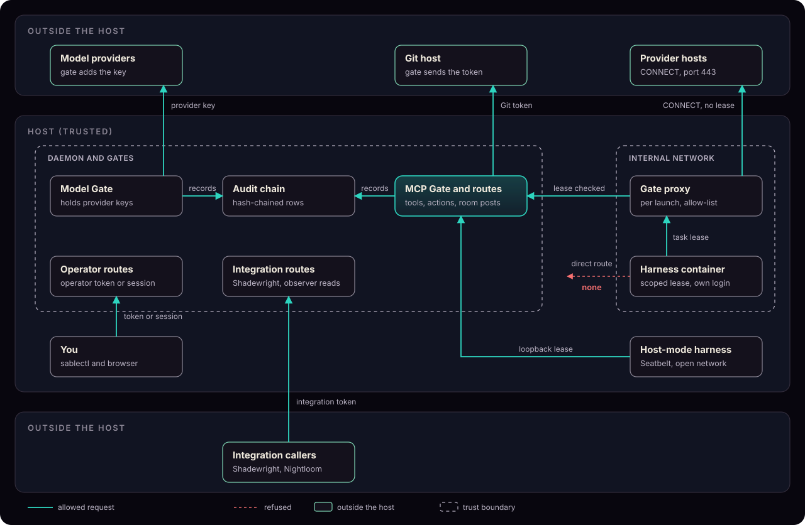

# Threat model

What Sablecourt protects, where its trust boundaries are, who it defends against, and for each threat two separate lists: the controls that exist in the code (with the package that implements each one) and the gaps (with the issue that tracks each one). Anything decided but not built is in its own section at the end, and no control below depends on it.

Status: partly built. Local operation (Sanctum) is built. Of the identity work in [ADR-0014](adr/0014-identity-and-authentication.md), which is Proposed, the code has only parts of Stage 0 (the logout route, the state directory checks, the sandbox probe). The audit chain has known holes.

## What is protected

- The provider logins of the three harnesses. In container mode each is in a Docker volume of its own.
- Provider API keys, the Git token and the other entries of the secret store that the gates use.
- The operator token and the session cookie.
- Approvals: the payload digest an approval is pinned to, and the decision.
- The audit chain.
- The repository checkouts the harnesses read, and the writer checkout a council writes to.
- Budgets, and the council run ceiling, deadline and wall-time limit.

## Trust boundaries

ADR-0011 treats you, the daemon and the operating system as trusted, and everything else as untrusted.

- Host: a process that runs as your user can read your files, the operator token included, unless something confines it. Harnesses run in a container or under Seatbelt for that reason.
- Daemon and gates: `sablecourtd` holds the Model Gate (it adds the provider key to each upstream request), the MCP Gate and the other lease-checked `/gate/*` routes (typed actions that use the Git token, Conclave rooms), the operator routes, the integration routes and the audit chain. The gates do not put a provider key or the Git token in a workload's environment or in a request a workload sends. A workload can still receive a credential that an upstream echoes back: the Model Gate passes upstream response headers and bodies through unchanged.
- Model providers: by default `openai`, `anthropic` and `gemini` are remote, and `local` is `127.0.0.1:11434` on the host itself.
- Internal network: one Docker `--internal` bridge network per container launch, with isolated gateway mode (launch fails if Docker does not apply it). Sablecourt attaches the harness container and its gate proxy to it. The proxy is also attached to the default bridge network for its outbound tunnels; the harness container is not.
- Gate proxy: one container per launch. For gate routes it requires the launch's lease and forwards only a fixed list of `/gate/` routes, over a per-launch Unix socket or a pinned TLS 1.3 connection, to a gate in the daemon that checks the lease and the route list again. For provider traffic it accepts HTTPS `CONNECT` to the listed provider host names of that harness on port 443, with no lease.
- Host-mode harness: a harness run on the host under a macOS Seatbelt profile with an allow-listed environment. The profile allows outbound network connections to any address. The harness gets its lease in the environment and the gate address on loopback. ADR-0011 calls host mode the weaker fallback.
- Integration callers: Shadewright posts with its own token to its two routes; Nightloom reads three `GET` routes with the observer token.

Container mode is covered in [harness containers](how-it-works/harness-containers.md) and [council](how-it-works/council.md); the credentials are in [identity and access](how-it-works/identity-and-access.md).

## Threats, controls and gaps

### Untrusted text steers a model into an unwanted action (invariants 1 and 3)

Controls that exist:

- A policy whose `defaultEffect` is not `deny` is rejected at load (`internal/config`), and the policy engine returns deny when no rule matches (`internal/policy`).
- An action name that is not registered is refused with 404 and a `denied` audit row (`internal/gate/mcp`).
- An action whose policy effect is `approve` runs only with the ID of an approval that is `approved` for the same task, capability and payload digest (`internal/gate/mcp`, `internal/approval`).
- MCP tool output, action results, Conclave messages and Relics, Court Memory writes and council prompts pass through pattern-based redaction (`internal/redact`, `internal/gate/mcp`, `internal/conclave`). Redaction covers the memory value and the Relic body only; the memory namespace and key, the learning proposal namespace, key and target namespace, and the Relic name and content type are stored unredacted, and the Relic name is also written to the audit row.

Gaps:

- Redaction matches a fixed list of patterns; other secrets pass, and the fields named above are not redacted at all. The Model Gate redacts neither requests nor responses. Tracked in issue 8.
- An approved approval can be presented again, and its expiry is not checked when the action runs. Tracked in issues 9 and 101.
- An MCP tool whose effect is `approve` cannot complete, and `git.open_pr` does not validate `owner`, `repo` or `base`. Tracked in issue 9.
- Learnings are reported to reach prompts sent to remote providers, which ADR-0012 forbids. Tracked in issue 99.

### A sandbox-zone workload mutates or delegates

Controls that exist:

- The loader rejects a sandbox-zone workload that holds `action:` or delegation grants, and a Conclave template in which a sandbox workload may message a runtime workload (`internal/config`).
- The policy engine denies `action:` and `delegate:` capabilities to sandbox-zone workloads (`internal/policy`).

Gaps:

- A sandbox-zone workload may hold mutating `mcp:` tools; the zone rule covers `action:` and `delegate:` only. Tracked in issue 9.

### A compromised harness reads host files or another harness's login

Controls that exist:

- A council container runs as user `10001` with a read-only root file system, all capabilities dropped, `no-new-privileges`, a `noexec` scratch tmpfs sized to the memory limit, CPU, memory and process limits, and a wall-time limit that kills the process (`internal/runtime/docker`).
- The container mounts only its own harness's login volume, and the launch fails if two harnesses share one (`internal/runtime/docker`).
- The checkout is mounted read-only, except for the council writer, and a checkout that is the file system root, contains your home directory, or contains the Docker socket is refused (`internal/runtime/docker`).
- Host mode runs the harness under a Seatbelt profile that denies by default, with an allow-listed environment (`internal/runtime/coding`).
- At daemon start, and again when a council is opened, a probe checks that a Seatbelt profile denies reading and writing a private file; if the start probe fails, the host coding adapter is not registered (`internal/runtime/coding`, `cmd/sablecourtd`).

Gaps:

- An individual host launch does not run that probe. It only checks that `sandbox-exec` applies the task's profile to `/usr/bin/true`. Tracked in issue 104.
- Nothing refuses host-mode `codex`. The adapter accepts it and starts it under Seatbelt, although ADR-0011 says host-mode `codex` stays refused until a test shows its own sandbox denies reads of `operator.token` and other logins. Tracked in issue 104.
- The Seatbelt profile allows outbound network to any address, loopback included, and exposes the shared Git object store and refs and wide system read paths (reported, not reproduced). Tracked in issue 63.

### A harness sends data to arbitrary hosts or reaches the daemon directly

Controls that exist:

- The council container's only network is the internal one, and launch fails unless Docker reports it as an internal bridge with isolated gateway mode (`internal/gate/councilproxy`, `internal/runtime/docker`).
- The proxy accepts `CONNECT` only to the harness's listed provider host names on port 443, refuses the tunnel if any resolved address is not public, allows at most 16 tunnels at once, and closes each after 15 minutes (`internal/gate/councilproxy`).
- Every other proxy request must be on the fixed gate route list and carry the launch's lease, or it is refused (`internal/gate/councilproxy`).

Gaps:

- `CONNECT` needs no lease, and the proxy does not inspect what goes through a tunnel, so data can leave to any listed provider host. Tracked in issue 104.
- Host-mode harnesses have unrestricted outbound network. Tracked in issue 63.

### A workload uses another task's lease, or one after the task ended

Controls that exist:

- A lease is `sc_task_` plus 32 random bytes in hex; only its SHA-256 is stored (`internal/gate/model`).
- The control plane issues leases with a lifetime of one hour, cut to the council deadline for a council turn, and renews the lease of a running task to one hour past the latest observation on each reconcile pass (still cut to the council deadline for a council turn), and revokes a task's leases on cancel, suspend, the end of the task, recovery and a failed launch (`internal/controlplane`).
- The Model Gate and the MCP Gate look the lease up on every call and then check the workload's grants (`internal/gate/model`, `internal/gate/mcp`).
- The council proxy and its per-launch gate accept on gate routes only the lease the launch was started with (`internal/gate/councilproxy`).

Gaps:

- A lease is not bound to a channel. Host and generic container runs receive it in an environment variable, and a copied lease works from anywhere that reaches a gate route until it expires or is revoked. Tracked in issue 104.

### A web page or another host reaches the daemon (cross-site writes, DNS rebinding)

Controls that exist (all in `cmd/sablecourtd`):

- Requests are served only when the `Host` header is `localhost`, `127.0.0.1` or `::1` on the listen port, an `--allow-host` entry, or (for `/gate/` paths) the container gate host.
- A write that carries an `Origin` or `Sec-Fetch-Site` header showing another origin is refused with 403, except on `/gate/*`, the GitHub webhook and `/a2a`. A write authenticated by cookie must show it is same origin.
- The cookie is `SameSite=Strict`, `Secure` and `HttpOnly`. Responses carry `X-Frame-Options: DENY`, `nosniff`, `Referrer-Policy: no-referrer` and a content security policy that still allows inline scripts.
- Write bodies on operator routes are limited to 2 MiB, except the Model Gate and voice transcription, which have their own limits.

Gaps:

- On `localhost`, browsers do not isolate cookies by port (RFC 6265 section 8.5, cited in ADR-0014), so another local web service you visit can receive the session cookie. Tracked in issue 104.

### Guessing the operator token

Controls that exist:

- The token holds 32 random bytes (`internal/operatortoken`).
- `POST /login` refuses a client after 10 failed tokens in a minute (per IPv4 address or IPv6 `/64`) and all clients after 1024 failures in a minute (`cmd/sablecourtd`).
- Tokens are compared as SHA-256 digests with a constant-time comparison (`cmd/sablecourtd`).

Gaps:

- The limiter counts only failures that pass the origin, encoding and size checks, and a bearer token on API routes is not rate limited at all. Tracked in issue 104.

### Another local user reads the token

Controls that exist (all in `internal/operatortoken`):

- The state directory must be owned by you with mode `0700`, must not itself be a symlink, and each parent must be owned by you or root and not writable by group or others unless sticky.
- The token file must be a regular file owned by you with mode `0600`.
- A second daemon on the same state directory fails to take the lock and stops.

Gaps: none known for other users. A process running as your user can read the file (see accepted exceptions).

### A local process approves its own request (invariant 1)

Controls that exist:

- Approving through the operator route needs a click on a native macOS dialog that shows the workload, the capability, the task, the first 16 characters of the digest and the first 220 bytes of the payload; off macOS, on Deny, on error and after 60 seconds the approval is not made (`internal/approval`).
- The other path is a P-256 signature over the approval ID and digest from a paired device (`internal/approval`), and `pair/start` and `pair/complete` return 503, so no new device can be paired (`cmd/sablecourtd`).
- An expected digest that differs from the stored one is refused (`internal/approval`).

Gaps:

- An empty expected digest is accepted, and the dialog shows only the start of the payload. Tracked in issue 9.
- `decidedBy` comes from the request body and is written to the audit row as sent. Tracked in issue 104.
- Device enrolment with independent confirmation does not exist. Tracked in issue 5.

### A leaked integration token is used elsewhere

Controls that exist:

- When the Shadewright token is configured, a request that carries it on any other route is refused with 401, and its two routes refuse a bearer that starts with `op_` or `sc_task_` (`internal/integrations`).
- The observer token is accepted only on `GET` of the observer snapshot, the observer stream and a task's Scry stream (`cmd/sablecourtd`).

Gaps:

- The A2A secret is compared as a plain string with no prefix check. If the observer secret is reused as the A2A secret, the observer token also submits tasks and reads any task through `/a2a`. Tracked in issues 13 and 104.
- Integration tokens never expire or rotate; they are plain secrets in the keychain or in an optional `0600` JSON file. Tracked in issue 104.

### A workload runs up cost

Controls that exist (all in `internal/gate/model`):

- Before each upstream call the gate reserves an estimate against the per-task and daily budgets, and an exhausted budget answers 429.
- After a 2xx answer the reservation is settled with the reported usage, or with the reserved estimate when the answer reports none; otherwise it is released.

Gaps:

- Compressed or very large answers can lose the usage report, and cost uses a flat rate per provider. Tracked in issue 8.
- Subscription inference by the three council harnesses does not pass the Model Gate and is not counted (see accepted exceptions).

### A stolen cookie

Controls that exist (all in `cmd/sablecourtd`):

- A cookie is valid for 30 minutes and only for the `Host` it was issued to.
- It stops working when the daemon restarts, and when anyone signed in posts to `/logout`, which replaces the signing key and so ends every session.

Gaps:

- There is no per-session revocation; ending one session ends all of them. Tracked in issue 104.
- Sign-ins, failures and logouts write no audit row. Tracked in issue 104.

### Someone edits the audit log

Controls that exist:

- Each row stores the hash of the row before it, and `audit verify` recomputes the chain; it detects a changed field in a hashed row (unless every later hash was recomputed, and except a `|` moved between adjacent hashed fields) and a hashed row deleted from or inserted into the middle (`internal/domain`, `internal/store`).

Gaps (all tracked in issue 10):

- Verification skips rows with an empty hash (an unhashed row inserted into the middle passes), accepts any surviving prefix of the chain, does not hash the row ID, and joins the hashed fields with an unescaped `|`, so moving a `|` between adjacent fields passes. The next append after a row with an empty hash starts again from `genesis`.
- The hash has no key and no copy of the newest hash is kept elsewhere, so whoever can write the database can rewrite the chain.
- Almost every writer ignores a failed append.

## Accepted exceptions

- ADR-0011 accepts one exception to invariant 2: the three Sanctum harnesses (`claude`, `codex`, `agy`) may use their own provider subscription login for inference, kept in the harness's own login volume. In container mode the harness environment holds no API key, Git credential, database password or operator token. That inference goes through the proxy's provider tunnels, not the Model Gate, so the gate does not count its tokens or cost; the council run ceiling, deadline and wall-time limit bound it.
- The lease crosses plain HTTP between the harness and its proxy inside the per-launch network. The ADR-0011 amendment that records this is Proposed; the code works this way.
- A process that runs as your user is inside the trust boundary and can read the token file.

## Not built yet

[ADR-0014](adr/0014-identity-and-authentication.md) is Proposed. Its passkeys, server-side sessions, roles, per-launch channel-bound leases, mutual TLS, OIDC sign-in, signed audit heads and recovery commands would close several gaps above if built. None of them is a protection today.

## In depth

- [Overview](overview.md), [identity and access](how-it-works/identity-and-access.md), [audit](how-it-works/audit.md), [approvals](how-it-works/approvals.md), [harness containers](how-it-works/harness-containers.md)
- [ADR-0003](adr/0003-hybrid-workload-isolation.md), [ADR-0004](adr/0004-in-house-capability-gates-three-doors.md), [ADR-0005](adr/0005-dual-path-human-in-the-loop.md), [ADR-0009](adr/0009-sanctum-citadel-audit-chain-and-crypto-approvals.md), [ADR-0011](adr/0011-sanctum-scope-trust-and-cli-harnesses.md)
- Hard invariants: `AGENTS.md`. Reporting a vulnerability: `SECURITY.md`.
